# 📚 Thư viện Bộ Nhựa Honda 2026

Thư viện tra cứu **1.129 bộ nhựa (dàn áo)** của **16 dòng xe**, gồm **29.223 dòng chi tiết**, **8.991 mã** và **1.086 ảnh đời xe**. Xem trực tiếp trên GitHub, không cần cài đặt hay mở web riêng.

<sub>Dữ liệu cập nhật: 11/11/2026</sub>

## Cách tra cứu

| Muốn tìm | Cách làm |
|---|---|
| **Theo dòng xe** | Bấm tên dòng xe ở bảng bên dưới → bấm vào ảnh đời/màu xe → ra danh sách mã chi tiết. |
| **Theo tên xe hoặc mã bộ** | Ở trang chủ kho, nhấn phím **`t`** rồi gõ, ví dụ `BO0025` hoặc `wave 110s do 313`. Tên file không dấu nên gõ không dấu. |
| **Theo mã chi tiết** | Vào [Tra theo mã](tra-ma/README.md), chọn nhóm theo số đầu của mã rồi **Ctrl+F** gõ mã. Hoặc gõ mã vào ô **Search** trên đầu GitHub (cần đăng nhập). |
| **Lọc cả bảng** | Mở file trong [data/theo-dong-xe](data/theo-dong-xe) — GitHub hiện thành bảng có ô **Search this file**. |
| **Lấy dữ liệu về máy** | Tải [data/bo_nhua.csv](data/bo_nhua.csv) (mở bằng Excel) hoặc [data/bo_nhua.json](data/bo_nhua.json). Bấm nút **Download raw file** ở góc phải. |

## Dòng xe

| | Dòng xe | Số đời/màu xe | Bảng dữ liệu |
|---|---|---:|---|
| 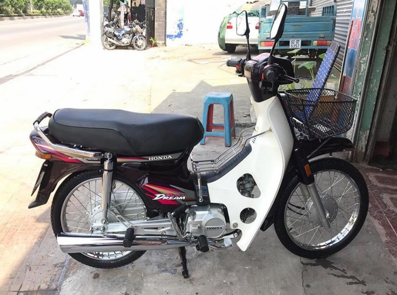 | **[Dream](dong-xe/dream.md)** | 13 | [CSV](data/theo-dong-xe/dream.csv) |
| 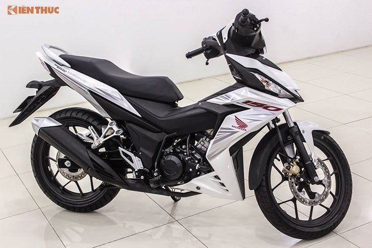 | **[Winner](dong-xe/winner.md)** | 55 | [CSV](data/theo-dong-xe/winner.csv) |
| 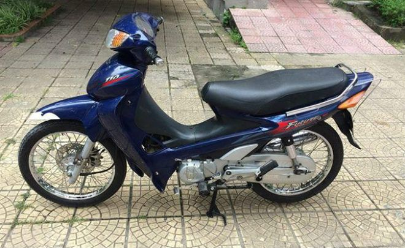 | **[Future](dong-xe/future.md)** | 153 | [CSV](data/theo-dong-xe/future.csv) |
| 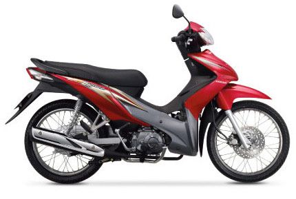 | **[Wave](dong-xe/wave.md)** | 160 | [CSV](data/theo-dong-xe/wave.csv) |
| 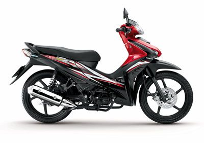 | **[Wave RSX](dong-xe/wave-rsx.md)** | 121 | [CSV](data/theo-dong-xe/wave-rsx.csv) |
| 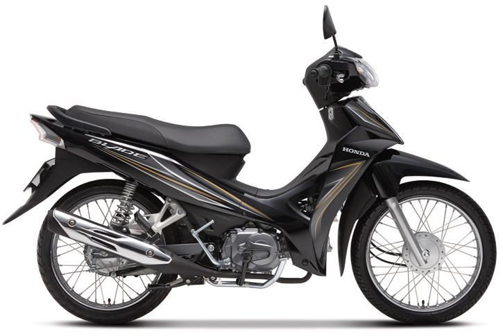 | **[Blade](dong-xe/blade.md)** | 65 | [CSV](data/theo-dong-xe/blade.csv) |
| 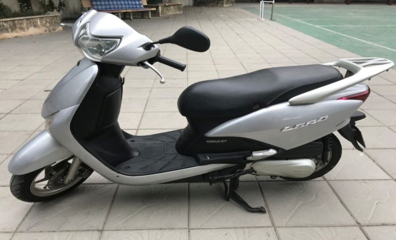 | **[Lead](dong-xe/lead.md)** | 89 | [CSV](data/theo-dong-xe/lead.csv) |
| 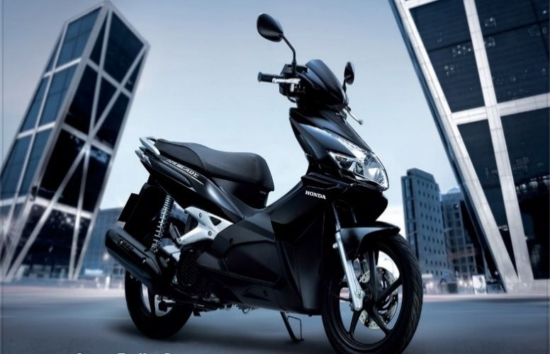 | **[Air Blade](dong-xe/air-blade.md)** | 125 | [CSV](data/theo-dong-xe/air-blade.csv) |
| 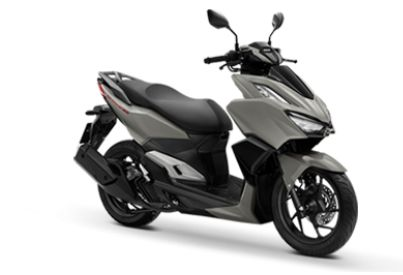 | **[Vario](dong-xe/vario.md)** | 7 | [CSV](data/theo-dong-xe/vario.csv) |
| 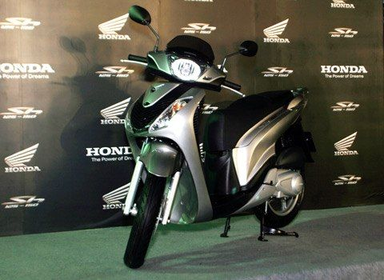 | **[SH](dong-xe/sh.md)** | 114 | [CSV](data/theo-dong-xe/sh.csv) |
| 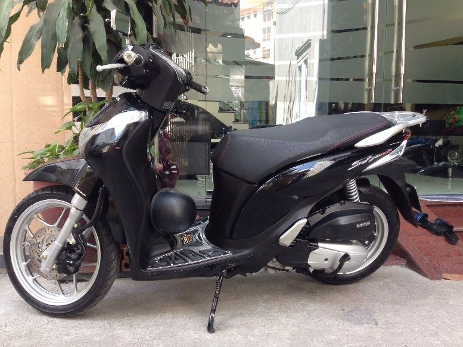 | **[SH Mode](dong-xe/sh-mode.md)** | 82 | [CSV](data/theo-dong-xe/sh-mode.csv) |
| 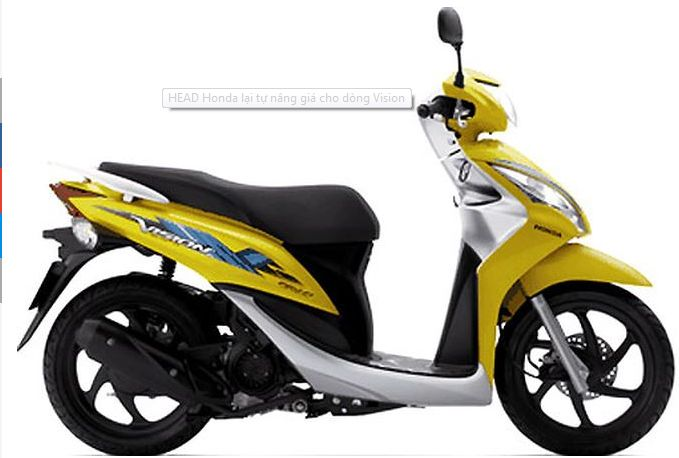 | **[Vision](dong-xe/vision.md)** | 96 | [CSV](data/theo-dong-xe/vision.csv) |
| 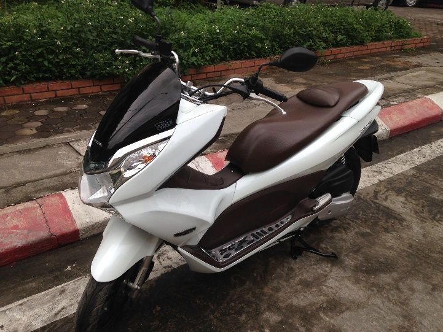 | **[PCX](dong-xe/pcx.md)** | 27 | [CSV](data/theo-dong-xe/pcx.csv) |
| 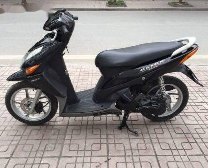 | **[Click](dong-xe/click.md)** | 18 | [CSV](data/theo-dong-xe/click.csv) |
| 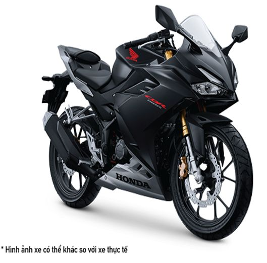 | **[CBR](dong-xe/cbr.md)** | 6 | [CSV](data/theo-dong-xe/cbr.csv) |
| 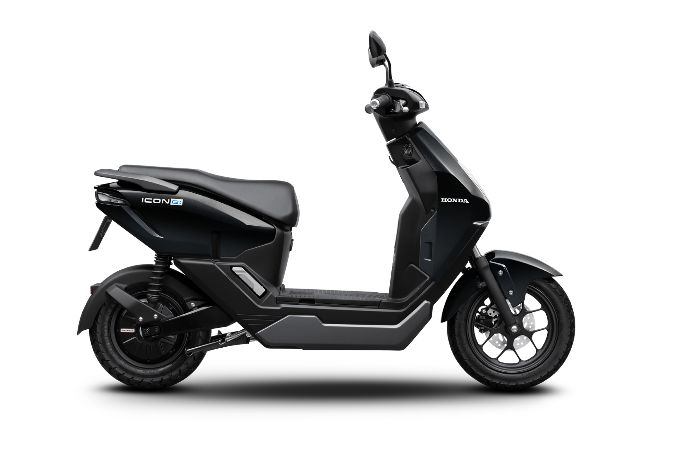 | **[Icon E](dong-xe/icon-e.md)** | 6 | [CSV](data/theo-dong-xe/icon-e.csv) |

## Cấu trúc thư mục

```
README.md               ← trang này
dong-xe/<dong-xe>.md    ← lưới ảnh đời/màu xe của từng dòng
bo/<dong-xe>/BOxxxx-….md ← 1 trang cho mỗi bộ nhựa: ảnh + danh sách chi tiết
tra-ma/<nhom>.md        ← mã chi tiết → có trong bộ nào
anh/BOxxxx.jpg          ← ảnh đời xe theo mã bộ
data/                   ← dữ liệu thô CSV / JSON
```

## Quy ước

- **Mã bộ** dạng `BO0025`. Mã có đuôi `.1` (ví dụ `BO0768.1`) là bộ liên quan của bộ gốc, xem mục *Bộ liên quan* trong trang bộ.
- **Mã thay thế** gộp từ cột *Mã thay thế* và mã ghi ở cột *Ghi chú* trong file gốc.
- **Mã thiếu bổ sung** không tính sẵn trong bộ, người tra tự thêm khi cần.
- Thư viện **không chứa giá và tồn kho**.

## Cập nhật dữ liệu

Dữ liệu sinh tự động từ file Excel *Bộ nhựa 2026 tách từng bộ* bằng công cụ trong thư mục [`tools`](tools). Khi file Excel thay đổi, chạy lại công cụ rồi tải đè các thư mục lên kho.
