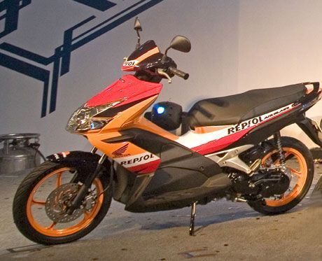

[🏠 Trang chủ](../../README.md) › [Air Blade](../../dong-xe/air-blade.md) › **BO0631**

# BO0631 · AirBlade 110 2008 KVG Repsol cam- PB383

| | |
|---|---|
| **Mã bộ** | `BO0631` |
| **Tên bộ** | Bộ nhựa (Dàn áo) AirBlade 110 2008 KVG Repsol cam- PB383 |
| **Đời xe** | Ari Blade Năm 2008 màu Xanh đen- PB383 |
| **Model** | A2 |
| **Dòng xe** | Air Blade |
| **Số chi tiết** | 32 |

## Chi tiết trong bộ

| STT | Mã chi tiết | Tên chi tiết | Dùng chung | Mã thay thế | Ghi chú |
|---:|---|---|:---:|---|---|
| 1 | [`53205KVGV00ZA`](../../tra-ma/5320.md#53205kvgv00za) | Nắp trước tay lái \*PB383M\* |  |  |  |
| 2 | [`53206KVG950`](../../tra-ma/5320.md#53206kvg950) | Nắp sau tay lái | ✔ |  |  |
| 3 | [`53250KVGV00ZB`](../../tra-ma/5325.md#53250kvgv00zb) | Bộ trang trí nắp trước tay lái |  |  |  |
| 4 | [`61110KVGV00ZA`](../../tra-ma/611.md#61110kvgv00za) | Bộ chắn bùn trước \*PB383M\* |  |  |  |
| 5 | [`64300KVG950ZB`](../../tra-ma/6430.md#64300kvg950zb) | Bộ mặt nạ trước \*R263\* |  |  |  |
| 6 | [`64311KVG950`](../../tra-ma/6431.md#64311kvg950) | Tấm bắt sàn phải | ✔ |  |  |
| 7 | [`64316KVG900`](../../tra-ma/6431.md#64316kvg900) | Nắp mở bugi | ✔ |  |  |
| 8 | [`64320KVGV00ZA`](../../tra-ma/6432.md#64320kvgv00za) | Bộ ốp ốngtrên trước \*YR271\* |  |  |  |
| 9 | [`64321KVG950`](../../tra-ma/6432.md#64321kvg950) | Tấm bắt sàn trái | ✔ |  |  |
| 10 | [`64405KVG900`](../../tra-ma/6440.md#64405kvg900) | Nắp chắn đường nhiên liệu | ✔ |  |  |
| 11 | [`64410KVG900`](../../tra-ma/6441.md#64410kvg900) | Tấm ốp yếm phải | ✔ |  |  |
| 12 | [`64420KVG900`](../../tra-ma/6442.md#64420kvg900) | Tấm ốp yếm trái | ✔ |  |  |
| 13 | [`64460KVG900`](../../tra-ma/6446.md#64460kvg900) | Hộp chứa đồ phải | ✔ |  |  |
| 14 | [`64470KVG900`](../../tra-ma/6447.md#64470kvg900) | Hộp chứa đồ trái | ✔ |  |  |
| 15 | [`64480KVG900`](../../tra-ma/6448.md#64480kvg900) | Nẹp ốp yếm phải (đen) | ✔ |  |  |
| 16 | [`64490KVG900`](../../tra-ma/6449.md#64490kvg900) | Nẹp ốp yếm trái (đen) | ✔ |  |  |
| 17 | [`64500KVGV00ZA`](../../tra-ma/645.md#64500kvgv00za) | Bộ ốp yếm phải trước \*YR271\* |  |  |  |
| 18 | [`64520KVG950ZA`](../../tra-ma/645.md#64520kvg950za) | Chắn bùn trước bên trong \*NH1\* | ✔ |  |  |
| 19 | [`64530KVG950ZA`](../../tra-ma/645.md#64530kvg950za) | Tấm ốp sàn dưới \*NH1\* | ✔ |  |  |
| 20 | [`64540KVGV00ZA`](../../tra-ma/645.md#64540kvgv00za) | Bộ ốp đèn pha trước phải \*YR27 |  |  |  |
| 21 | [`64550KVGV00ZA`](../../tra-ma/645.md#64550kvgv00za) | Bộ ốp đèn pha trước trái \*YR27 |  |  |  |
| 22 | [`64600KVGV00ZA`](../../tra-ma/6460.md#64600kvgv00za) | Bộ ốp yếm trái trước \*YR271\* |  |  |  |
| 23 | [`64700KVGV00ZA`](../../tra-ma/647.md#64700kvgv00za) | Bộ tấm ốp trung tâm \*NHA96P\* |  |  |  |
| 24 | [`80105KVG950`](../../tra-ma/8010.md#80105kvg950) | Chắn bùn sau | ✔ |  |  |
| 25 | [`80106KVG900`](../../tra-ma/8010.md#80106kvg900) | Chắn bùn sau bên trong | ✔ |  |  |
| 26 | [`81131KVG950`](../../tra-ma/8113.md#81131kvg950) | Tấm ốp bên trong trước | ✔ |  |  |
| 27 | [`83510KVG900ZA`](../../tra-ma/8351.md#83510kvg900za) | Bộ tấm ốp đuôi đèn sau s/s | ✔ |  |  |
| 28 | [`83520KVGV00ZA`](../../tra-ma/8352.md#83520kvgv00za) | Bộ ốp đuôi sau \*PB383M\* |  |  |  |
| 29 | [`83550KVGV00ZA`](../../tra-ma/8355.md#83550kvgv00za) | Bộ ốp sườn bên phải \*PB383M\* |  |  |  |
| 30 | [`83650KVGV00ZA`](../../tra-ma/8365.md#83650kvgv00za) | Bộ ốp sườn bên trái \*PB383M\* |  |  |  |
| 31 | [`83700KVG900`](../../tra-ma/837.md#83700kvg900) | Trang trí sườn phải | ✔ |  |  |
| 32 | [`83800KVG900`](../../tra-ma/838.md#83800kvg900) | Trang trí sườn trái | ✔ |  |  |

Cập nhật 11/11/2026
