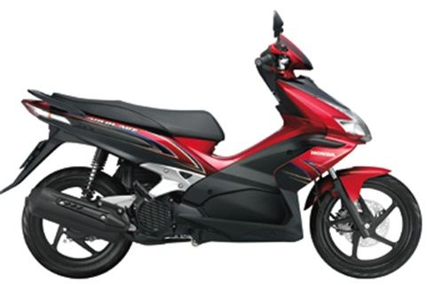

[🏠 Trang chủ](../../README.md) › [Air Blade](../../dong-xe/air-blade.md) › **BO0633**

# BO0633 · AirBlade 110 2008 KVG Đỏ R313C

| | |
|---|---|
| **Mã bộ** | `BO0633` |
| **Tên bộ** | Bộ nhựa (Dàn áo) AirBlade 110 2008 KVG Đỏ R313C |
| **Đời xe** | Ari Blade Năm 2008 màu Đỏ - R313 |
| **Model** | A3 |
| **Dòng xe** | Air Blade |
| **Số chi tiết** | 32 |

## Chi tiết trong bộ

| STT | Mã chi tiết | Tên chi tiết | Dùng chung | Mã thay thế | Ghi chú |
|---:|---|---|:---:|---|---|
| 1 | [`53205KVGV00ZC`](../../tra-ma/5320.md#53205kvgv00zc) | Nắp trước tay lái \*R313C\* | ✔ |  |  |
| 2 | [`53206KVG950`](../../tra-ma/5320.md#53206kvg950) | Nắp sau tay lái | ✔ |  |  |
| 3 | [`53207KVG900ZN`](../../tra-ma/5320.md#53207kvg900zn) | Trang trí nắp trước \*NHA69P\* |  |  |  |
| 4 | [`61100KVG900ZT`](../../tra-ma/611.md#61100kvg900zt) | Chắn bùn trước \*R313C\* |  | [`61110KVG960ZC`](../../tra-ma/611.md#61110kvg960zc) |  |
| 5 | [`64300KVG950ZC`](../../tra-ma/6430.md#64300kvg950zc) | Bộ mặt nạ trước \*NHA69P\* | ✔ |  |  |
| 6 | [`64311KVG950`](../../tra-ma/6431.md#64311kvg950) | Tấm bắt sàn phải | ✔ |  |  |
| 7 | [`64316KVG900`](../../tra-ma/6431.md#64316kvg900) | Nắp mở bugi | ✔ |  |  |
| 8 | [`64321KVG950`](../../tra-ma/6432.md#64321kvg950) | Tấm bắt sàn trái | ✔ |  |  |
| 9 | [`64330KVG900ZQ`](../../tra-ma/6433.md#64330kvg900zq) | Tấm ốp trên trước \*R313C\* |  |  |  |
| 10 | [`64340KVG900ZQ`](../../tra-ma/6434.md#64340kvg900zq) | Tấm ốp trung tâm \*R313C\* |  |  |  |
| 11 | [`64405KVG900`](../../tra-ma/6440.md#64405kvg900) | Nắp chắn đường nhiên liệu | ✔ |  |  |
| 12 | [`64410KVG900`](../../tra-ma/6441.md#64410kvg900) | Tấm ốp yếm phải | ✔ |  |  |
| 13 | [`64420KVG900`](../../tra-ma/6442.md#64420kvg900) | Tấm ốp yếm trái | ✔ |  |  |
| 14 | [`64460KVG900`](../../tra-ma/6446.md#64460kvg900) | Hộp chứa đồ phải | ✔ |  |  |
| 15 | [`64470KVG900`](../../tra-ma/6447.md#64470kvg900) | Hộp chứa đồ trái | ✔ |  |  |
| 16 | [`64480KVG900`](../../tra-ma/6448.md#64480kvg900) | Nẹp ốp yếm phải (đen) | ✔ |  |  |
| 17 | [`64490KVG900`](../../tra-ma/6449.md#64490kvg900) | Nẹp ốp yếm trái (đen) | ✔ |  |  |
| 18 | [`64500KVGV10ZB`](../../tra-ma/645.md#64500kvgv10zb) | Bộ ốp yếm phải trước \*R313C\* |  |  |  |
| 19 | [`64510KVG950ZC`](../../tra-ma/645.md#64510kvg950zc) | ốp đèn pha trước phải \*R313C\* |  |  |  |
| 20 | [`64511KVG950ZC`](../../tra-ma/645.md#64511kvg950zc) | ốp đèn pha trước trái \*R313C\* |  |  |  |
| 21 | [`64520KVG950ZA`](../../tra-ma/645.md#64520kvg950za) | Chắn bùn trước bên trong \*NH1\* | ✔ |  |  |
| 22 | [`64530KVG950ZA`](../../tra-ma/645.md#64530kvg950za) | Tấm ốp sàn dưới \*NH1\* | ✔ |  |  |
| 23 | [`64600KVGV10ZB`](../../tra-ma/6460.md#64600kvgv10zb) | Bộ ốp yếm trái trước \*R313C\* |  |  |  |
| 24 | [`80105KVG950`](../../tra-ma/8010.md#80105kvg950) | Chắn bùn sau | ✔ |  |  |
| 25 | [`80106KVG900`](../../tra-ma/8010.md#80106kvg900) | Chắn bùn sau bên trong | ✔ |  |  |
| 26 | [`81131KVG950`](../../tra-ma/8113.md#81131kvg950) | Tấm ốp bên trong trước | ✔ |  |  |
| 27 | [`83510KVG900ZA`](../../tra-ma/8351.md#83510kvg900za) | Bộ tấm ốp đuôi đèn sau s/s | ✔ |  |  |
| 28 | [`83550KVGV10ZE`](../../tra-ma/8355.md#83550kvgv10ze) | Bộ ốp sườn phải \*R313C\* |  |  |  |
| 29 | [`83650KVGV10ZB`](../../tra-ma/8365.md#83650kvgv10zb) | Bộ ốp sườn trái \*R313C\* |  |  |  |
| 30 | [`83700KVG900`](../../tra-ma/837.md#83700kvg900) | Trang trí sườn phải | ✔ |  |  |
| 31 | [`83750KVG950ZT`](../../tra-ma/837.md#83750kvg950zt) | ốp đuôi sau \*R313C\* |  |  |  |
| 32 | [`83800KVG900`](../../tra-ma/838.md#83800kvg900) | Trang trí sườn trái | ✔ |  |  |

Cập nhật 11/11/2026
