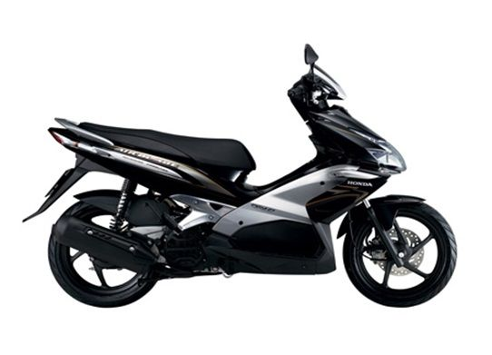

[🏠 Trang chủ](../../README.md) › [Air Blade](../../dong-xe/air-blade.md) › **BO0635**

# BO0635 · AirBlade 110 2009 KVG đen NHA69P

| | |
|---|---|
| **Mã bộ** | `BO0635` |
| **Tên bộ** | Bộ nhựa (Dàn áo) AirBlade 110 2009 KVG đen NHA69P |
| **Đời xe** | Ari Blade Năm 2009 màu đen - NHA69P |
| **Model** | A4 A6 |
| **Dòng xe** | Air Blade |
| **Số chi tiết** | 36 |

## Chi tiết trong bộ

| STT | Mã chi tiết | Tên chi tiết | Dùng chung | Mã thay thế | Ghi chú |
|---:|---|---|:---:|---|---|
| 1 | [`53206KVG950`](../../tra-ma/5320.md#53206kvg950) | Nắp sau tay lái | ✔ |  |  |
| 2 | [`53207KVG900ZL`](../../tra-ma/5320.md#53207kvg900zl) | Trang trí nắp trước tay lái \*N | ✔ |  |  |
| 3 | [`53210KVGV20ZB`](../../tra-ma/5321.md#53210kvgv20zb) | Bộ nắp trước tay lái \*NHA69P\* |  |  |  |
| 4 | [`61100KVG900ZN`](../../tra-ma/611.md#61100kvg900zn) | Chắn bùn trước \*NHA69P\* |  | [`61110KVG960ZA`](../../tra-ma/611.md#61110kvg960za) |  |
| 5 | [`64300KVG950ZC`](../../tra-ma/6430.md#64300kvg950zc) | Bộ mặt nạ trước \*NHA69P\* |  |  |  |
| 6 | [`64311KVG950`](../../tra-ma/6431.md#64311kvg950) | Tấm bắt sàn phải | ✔ |  |  |
| 7 | [`64316KVG900`](../../tra-ma/6431.md#64316kvg900) | Nắp mở bugi | ✔ |  |  |
| 8 | [`64321KVG950`](../../tra-ma/6432.md#64321kvg950) | Tấm bắt sàn trái | ✔ |  |  |
| 9 | [`64330KVGA30ZL`](../../tra-ma/6433.md#64330kvga30zl) | ốp ống yếm trên trước \*NHA69P\* |  |  |  |
| 10 | [`64340KVGV20ZD`](../../tra-ma/6434.md#64340kvgv20zd) | Tấm ốp trung tâm \*NHA69P\* |  |  |  |
| 11 | [`64350KVGA30`](../../tra-ma/6435.md#64350kvga30) | Khay tràn xăng | ✔ |  |  |
| 12 | [`64405KVGA30ZL`](../../tra-ma/6440.md#64405kvga30zl) | Nắp mở bình xăng \*NHA69P\* |  |  |  |
| 13 | [`64415KVGV20ZA`](../../tra-ma/6441.md#64415kvgv20za) | Bộ ốp yếm bên phải \*NH411M\* | ✔ | [`64410KVGV20ZA`](../../tra-ma/6441.md#64410kvgv20za) |  |
| 14 | [`64425KVGV20ZA`](../../tra-ma/6442.md#64425kvgv20za) | Bộ ốp yếm bên trái \*NH411M\* | ✔ | [`64420KVGV20ZA`](../../tra-ma/6442.md#64420kvgv20za) |  |
| 15 | [`64460KVGA30`](../../tra-ma/6446.md#64460kvga30) | Hộp đồ bên phải | ✔ |  |  |
| 16 | [`64461KVGA30`](../../tra-ma/6446.md#64461kvga30) | Nắp hộp đồ bên phải | ✔ |  |  |
| 17 | [`64470KVGA30`](../../tra-ma/6447.md#64470kvga30) | Hộp đồ bên trái | ✔ |  |  |
| 18 | [`64471KVGA30`](../../tra-ma/6447.md#64471kvga30) | Nắp hộp đồ bên trái | ✔ |  |  |
| 19 | [`64480KVGV20ZA`](../../tra-ma/6448.md#64480kvgv20za) | Nẹp ốp yếm bên phải \*NH411M\* | ✔ |  |  |
| 20 | [`64490KVGV20ZA`](../../tra-ma/6449.md#64490kvgv20za) | Nẹp ốp yếm bên trái \*NH411M\* | ✔ |  |  |
| 21 | [`64500KVGV20ZA`](../../tra-ma/645.md#64500kvgv20za) | Bộ ốp yếm phải trước \*NHA69P\* |  |  |  |
| 22 | [`64520KVG950ZA`](../../tra-ma/645.md#64520kvg950za) | Chắn bùn trước bên trong \*NH1\* | ✔ |  |  |
| 23 | [`64530KVG950ZA`](../../tra-ma/645.md#64530kvg950za) | Tấm ốp sàn dưới | ✔ |  |  |
| 24 | [`64540KVGV20ZA`](../../tra-ma/645.md#64540kvgv20za) | Bộ ốp đèn pha trước phải \*NHA6 | ✔ |  |  |
| 25 | [`64550KVGV20ZA`](../../tra-ma/645.md#64550kvgv20za) | Bộ ốp đèn pha trước trái \*NHA6 |  |  |  |
| 26 | [`64600KVGV20ZA`](../../tra-ma/6460.md#64600kvgv20za) | Bộ ốp yếm trái trước \*NHA69P\* |  |  |  |
| 27 | [`80101KVGV20`](../../tra-ma/8010.md#80101kvgv20) | Chắn bùn sau bên dưới | ✔ |  |  |
| 28 | [`80105KVG950`](../../tra-ma/8010.md#80105kvg950) | Chắn bùn sau | ✔ |  |  |
| 29 | [`80106KVGV20`](../../tra-ma/8010.md#80106kvgv20) | Chắn bùn sau bên trong | ✔ |  |  |
| 30 | [`81131KVG950`](../../tra-ma/8113.md#81131kvg950) | Tấm ốp bên trong trước | ✔ |  |  |
| 31 | [`83510KVG900ZA`](../../tra-ma/8351.md#83510kvg900za) | Bộ tấm ốp đuôi đèn sau s/s | ✔ |  |  |
| 32 | [`83550KVGV20ZA`](../../tra-ma/8355.md#83550kvgv20za) | Bộ ốp sườn bên phải \*NHA69P\* |  |  |  |
| 33 | [`83650KVGV20ZA`](../../tra-ma/8365.md#83650kvgv20za) | Bộ ốp sườn bên trái \*NHA69P\* |  |  |  |
| 34 | [`83700KVGV20ZA`](../../tra-ma/837.md#83700kvgv20za) | Trang trí sườn phải \*NH411M\* | ✔ | [`83710KVGV20ZA`](../../tra-ma/837.md#83710kvgv20za) |  |
| 35 | [`83750KVG950ZN`](../../tra-ma/837.md#83750kvg950zn) | ốp đuôi sau \*NHA69P\* |  | [`83750KVG900ZN`](../../tra-ma/837.md#83750kvg900zn) |  |
| 36 | [`83800KVGV20ZA`](../../tra-ma/838.md#83800kvgv20za) | Trang trí sườn trái \*NH411M\* | ✔ | [`83810KVGV20ZA`](../../tra-ma/838.md#83810kvgv20za) |  |

Cập nhật 11/11/2026
