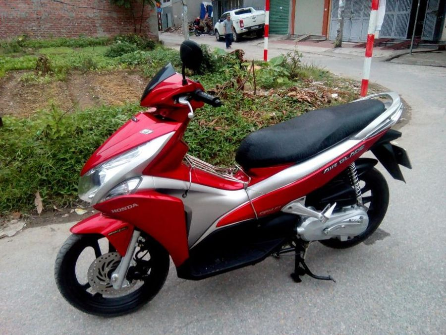

[🏠 Trang chủ](../../README.md) › [Air Blade](../../dong-xe/air-blade.md) › **BO0643**

# BO0643 · AirBlade 110 2011 béo KVG Đỏ bạc R340

| | |
|---|---|
| **Mã bộ** | `BO0643` |
| **Tên bộ** | Bộ nhựa (Dàn áo) AirBlade 110 2011 béo KVG Đỏ bạc R340 |
| **Đời xe** | Ari Blade Năm 2011 màu Đỏ - R-340 |
| **Model** | A9 |
| **Dòng xe** | Air Blade |
| **Số chi tiết** | 32 |

## Chi tiết trong bộ

| STT | Mã chi tiết | Tên chi tiết | Dùng chung | Mã thay thế | Ghi chú |
|---:|---|---|:---:|---|---|
| 1 | [`53203KVGV40`](../../tra-ma/5320.md#53203kvgv40) | Tấm chắn đồng hồ | ✔ |  |  |
| 2 | [`53204KVGV40ZB`](../../tra-ma/5320.md#53204kvgv40zb) | Nắp ốp đồng hồ \*NHB24M\* | ✔ |  |  |
| 3 | [`53205KVGV40ZC`](../../tra-ma/5320.md#53205kvgv40zc) | Nắp trước tay lái \*R340C\* |  |  |  |
| 4 | [`53206KVGV40ZC`](../../tra-ma/5320.md#53206kvgv40zc) | Nắp sau tay lái \*R340C\* |  |  |  |
| 4 | [`61100KVGV40ZC`](../../tra-ma/611.md#61100kvgv40zc) | Chắn bùn trước \*R340C\* |  | [`61110KVGV40ZC`](../../tra-ma/611.md#61110kvgv40zc) |  |
| 6 | [`64300KVGV40ZA`](../../tra-ma/6430.md#64300kvgv40za) | Bộ mặt nạ trước \*R340C\* |  |  |  |
| 7 | [`64311KVGV40`](../../tra-ma/6431.md#64311kvgv40) | Tấm bắt sàn phải | ✔ |  |  |
| 8 | [`64316KVGV40`](../../tra-ma/6431.md#64316kvgv40) | Nắp mở bugi | ✔ |  |  |
| 9 | [`64321KVGV40`](../../tra-ma/6432.md#64321kvgv40) | Tấm bắt sàn trái | ✔ |  |  |
| 10 | [`64330KVGV40ZC`](../../tra-ma/6433.md#64330kvgv40zc) | Tấm ốp yếm trên \*R340C\* |  |  |  |
| 11 | [`64331KVGV40`](../../tra-ma/6433.md#64331kvgv40) | Nắp hộp | ✔ |  |  |
| 12 | [`64340KVGV40ZC`](../../tra-ma/6434.md#64340kvgv40zc) | Tấm ốp trung tâm \*R340C\* |  |  |  |
| 13 | [`64351KVGV40`](../../tra-ma/6435.md#64351kvgv40) | Hộp đồ trước | ✔ |  |  |
| 14 | [`64405KVGV40ZC`](../../tra-ma/6440.md#64405kvgv40zc) | Nắp hộp đồ trước \*R340C\* |  |  |  |
| 15 | [`64410KVGV40ZB`](../../tra-ma/6441.md#64410kvgv40zb) | Tấm ốp yếm phải \*NHB24M\*(bạc xẫm) | ✔ |  |  |
| 16 | [`64420KVGV40ZB`](../../tra-ma/6442.md#64420kvgv40zb) | Tấm ốp yếm trái \*NHB24M\* | ✔ |  |  |
| 17 | [`64460KVGV40`](../../tra-ma/6446.md#64460kvgv40) | ốp trước phải bên trong | ✔ |  |  |
| 18 | [`64470KVGV40`](../../tra-ma/6447.md#64470kvgv40) | ốp trước trái bên trong | ✔ |  |  |
| 19 | [`64500KVGV40ZA`](../../tra-ma/645.md#64500kvgv40za) | Bộ ốp trước phải \*R340C\* |  |  |  |
| 20 | [`64501KVGV40ZC`](../../tra-ma/645.md#64501kvgv40zc) | ốp đèn pha phải trước \*NHB24M\* | ✔ |  |  |
| 21 | [`64502KVGV40ZC`](../../tra-ma/645.md#64502kvgv40zc) | ốp đèn pha trái trước \*NHB24M\* | ✔ |  |  |
| 22 | [`64520KVGV40`](../../tra-ma/645.md#64520kvgv40) | Chắn bùn trước bên trong | ✔ |  |  |
| 23 | [`64530KVGV40`](../../tra-ma/645.md#64530kvgv40) | Tấm ốp sàn dưới |  |  |  |
| 24 | [`64600KVGV40ZA`](../../tra-ma/6460.md#64600kvgv40za) | Bộ ốp trước trái \*R340C\* |  |  |  |
| 25 | [`80100KVGV40`](../../tra-ma/8010.md#80100kvgv40) | Chắn bùn sau |  |  |  |
| 26 | [`80101KVGV40`](../../tra-ma/8010.md#80101kvgv40) | Chắn bùn sau bên dưới | ✔ |  |  |
| 27 | [`83510KVGV40`](../../tra-ma/8351.md#83510kvgv40) | Bộ nắp ốp đèn soi biển số | ✔ |  |  |
| 28 | [`83550KVGV40ZA`](../../tra-ma/8355.md#83550kvgv40za) | Bộ ốp sườn phải \*R340C\* |  |  |  |
| 29 | [`83650KVGV40ZA`](../../tra-ma/8365.md#83650kvgv40za) | Bộ ốp sườn trái \*R340C\* |  |  |  |
| 30 | [`83700KVGV40ZB`](../../tra-ma/837.md#83700kvgv40zb) | ốp sườn phải trên \*NHB24M\* | ✔ |  |  |
| 31 | [`83751KVGV40ZB`](../../tra-ma/837.md#83751kvgv40zb) | ốp đuôi sau \*NHB24M\* | ✔ |  |  |
| 32 | [`83800KVGV40ZB`](../../tra-ma/838.md#83800kvgv40zb) | ốp sườn trái trên \*NHB24M\* | ✔ |  |  |

Cập nhật 11/11/2026
