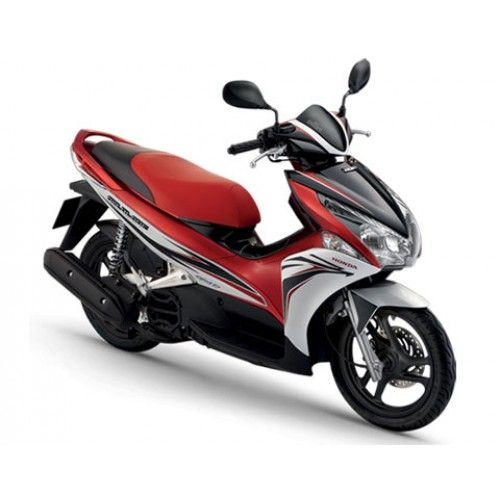

[🏠 Trang chủ](../../README.md) › [Air Blade](../../dong-xe/air-blade.md) › **BO0649**

# BO0649 · AirBlade 110 2011 béo KVG Trắng đỏ NHB35

| | |
|---|---|
| **Mã bộ** | `BO0649` |
| **Tên bộ** | Bộ nhựa (Dàn áo) AirBlade 110 2011 béo KVG Trắng đỏ NHB35 |
| **Đời xe** | Ari Blade Năm 2011 màu Trắng đỏ - NH-B35 |
| **Model** | L1 L4 |
| **Dòng xe** | Air Blade |
| **Số chi tiết** | 32 |

## Chi tiết trong bộ

| STT | Mã chi tiết | Tên chi tiết | Dùng chung | Mã thay thế | Ghi chú |
|---:|---|---|:---:|---|---|
| 1 | [`53203KVGV40`](../../tra-ma/5320.md#53203kvgv40) | Tấm chắn đồng hồ | ✔ |  |  |
| 2 | [`53204KVGV40ZA`](../../tra-ma/5320.md#53204kvgv40za) | Nắp ốp đồng hồ \*R340C\* |  |  |  |
| 3 | [`53206KVGV40ZE`](../../tra-ma/5320.md#53206kvgv40ze) | Nắp sau tay lái \*NHB25M\* |  |  |  |
| 4 | [`53210KVGV50ZA`](../../tra-ma/5321.md#53210kvgv50za) | Bộ nắp trước tay lái \*NHB35P\* |  | [`53210KVGV50ZB`](../../tra-ma/5321.md#53210kvgv50zb) [`53210KVGV80ZB`](../../tra-ma/5321.md#53210kvgv80zb) |  |
| 5 | [`61100KVGV40ZD`](../../tra-ma/611.md#61100kvgv40zd) | Chắn bùn trước \*NHB35P\* |  | [`61110KVGV50ZA`](../../tra-ma/611.md#61110kvgv50za) |  |
| 6 | [`64300KVGV50ZA`](../../tra-ma/6430.md#64300kvgv50za) | Bộ mặt nạ trước \*NHB35P\* |  | [`64300KVGV50ZB`](../../tra-ma/6430.md#64300kvgv50zb) [`64300KVGV80ZB`](../../tra-ma/6430.md#64300kvgv80zb) |  |
| 7 | [`64311KVGV40`](../../tra-ma/6431.md#64311kvgv40) | Tấm bắt sàn phải | ✔ |  |  |
| 8 | [`64316KVGV40`](../../tra-ma/6431.md#64316kvgv40) | Nắp mở bugi | ✔ |  |  |
| 9 | [`64321KVGV40`](../../tra-ma/6432.md#64321kvgv40) | Tấm bắt sàn trái | ✔ |  |  |
| 10 | [`64330KVGV40ZE`](../../tra-ma/6433.md#64330kvgv40ze) | Tấm ốp yếm trên \*NHB25M\* |  |  |  |
| 11 | [`64331KVGV40`](../../tra-ma/6433.md#64331kvgv40) | Nắp hộp | ✔ |  |  |
| 12 | [`64340KVGV40ZE`](../../tra-ma/6434.md#64340kvgv40ze) | Tấm ốp trung tâm \*NHB25M\* |  |  |  |
| 13 | [`64351KVGV40`](../../tra-ma/6435.md#64351kvgv40) | Hộp đồ trước | ✔ |  |  |
| 14 | [`64405KVGV40ZE`](../../tra-ma/6440.md#64405kvgv40ze) | Nắp hộp đồ trước \*NHB25M\* |  |  |  |
| 15 | [`64410KVGV40ZA`](../../tra-ma/6441.md#64410kvgv40za) | Tấm ốp yếm phải \*R340C\* |  |  |  |
| 16 | [`64420KVGV40ZA`](../../tra-ma/6442.md#64420kvgv40za) | Tấm ốp yếm trái \*R340C\* |  |  |  |
| 17 | [`64460KVGV40`](../../tra-ma/6446.md#64460kvgv40) | ốp trước phải bên trong | ✔ |  |  |
| 18 | [`64470KVGV40`](../../tra-ma/6447.md#64470kvgv40) | ốp trước trái bên trong | ✔ |  |  |
| 19 | [`64500KVGV50ZA`](../../tra-ma/645.md#64500kvgv50za) | Bộ ốp trước phải \*NHB35P\* |  | [`64500KVGV80ZB`](../../tra-ma/645.md#64500kvgv80zb) |  |
| 20 | [`64501KVGV40ZB`](../../tra-ma/645.md#64501kvgv40zb) | ốp đèn pha phải trước \*R340C\* |  |  |  |
| 21 | [`64502KVGV40ZB`](../../tra-ma/645.md#64502kvgv40zb) | ốp đèn pha trái trước \*R340C\* |  |  |  |
| 22 | [`64520KVGV40`](../../tra-ma/645.md#64520kvgv40) | Chắn bùn trước bên trong | ✔ |  |  |
| 23 | [`64530KVGV40`](../../tra-ma/645.md#64530kvgv40) | Tấm ốp sàn dưới | ✔ |  |  |
| 24 | [`64600KVGV50ZA`](../../tra-ma/6460.md#64600kvgv50za) | Bộ ốp trước trái \*NHB35P\* |  | [`64600KVGV80ZB`](../../tra-ma/6460.md#64600kvgv80zb) |  |
| 25 | [`80100KVGV40`](../../tra-ma/8010.md#80100kvgv40) | Chắn bùn sau | ✔ |  |  |
| 26 | [`80101KVGV40`](../../tra-ma/8010.md#80101kvgv40) | Chắn bùn sau bên dưới | ✔ |  |  |
| 27 | [`83510KVGV40`](../../tra-ma/8351.md#83510kvgv40) | Bộ nắp ốp đèn soi biển số | ✔ |  |  |
| 28 | [`83550KVGV50ZC`](../../tra-ma/8355.md#83550kvgv50zc) | Bộ ốp sườn phải \*NHB35P\* |  | [`83550KVGV80ZB`](../../tra-ma/8355.md#83550kvgv80zb) |  |
| 29 | [`83650KVGV50ZC`](../../tra-ma/8365.md#83650kvgv50zc) | Bộ ốp sườn trái \*NHB35P\* |  | [`83650KVGV80ZB`](../../tra-ma/8365.md#83650kvgv80zb) |  |
| 30 | [`83700KVGV40ZA`](../../tra-ma/837.md#83700kvgv40za) | ốp sườn phải trên \*R340C\* |  |  |  |
| 31 | [`83751KVGV40ZA`](../../tra-ma/837.md#83751kvgv40za) | ốp đuôi sau \*R340C\* |  |  |  |
| 32 | [`83800KVGV40ZA`](../../tra-ma/838.md#83800kvgv40za) | ốp sườn trái trên \*R340C\* |  |  |  |

Cập nhật 11/11/2026
