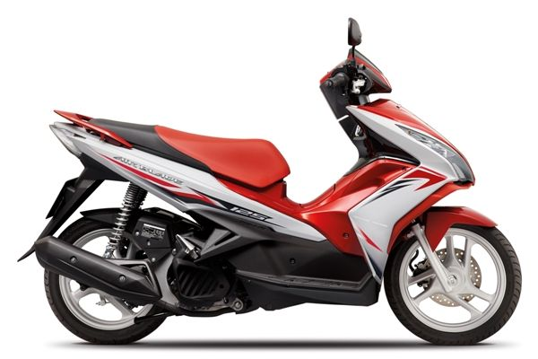

[🏠 Trang chủ](../../README.md) › [Air Blade](../../dong-xe/air-blade.md) › **BO0657**

# BO0657 · AirBlade 125 2012 K27 đỏ trắng đen R340X

| | |
|---|---|
| **Mã bộ** | `BO0657` |
| **Tên bộ** | Bộ nhựa (Dàn áo) AirBlade 125 2012 K27 đỏ trắng đen R340X |
| **Đời xe** | Ari Blade 125  Năm 2012 Màu đỏ trắng đen - R340X |
| **Model** | L7 L8 |
| **Dòng xe** | Air Blade |
| **Số chi tiết** | 28 |

## Chi tiết trong bộ

| STT | Mã chi tiết | Tên chi tiết | Dùng chung | Mã thay thế | Ghi chú |
|---:|---|---|:---:|---|---|
| 1 | [`33720K27V01`](../../tra-ma/337.md#33720k27v01) | Ốp đèn sau | ✔ |  |  |
| 2 | [`53115K27V00ZE`](../../tra-ma/531.md#53115k27v00ze) | Bộ nắp ốp đồng hồ \*R340C\* |  | [`53115K27V50ZD`](../../tra-ma/531.md#53115k27v50zd) |  |
| 3 | [`53207K27V00ZE`](../../tra-ma/5320.md#53207k27v00ze) | Trang trí nắp tay lái FR R340C |  |  |  |
| 4 | [`53210K27V00ZA`](../../tra-ma/5321.md#53210k27v00za) | Bộ nắp trước tay lái | ✔ |  |  |
| 5 | [`53230K27V00ZA`](../../tra-ma/5323.md#53230k27v00za) | Bộ nắp sau tay lái | ✔ | [`53230K27V50ZC`](../../tra-ma/5323.md#53230k27v50zc) |  |
| 6 | [`61100K27V00ZD`](../../tra-ma/611.md#61100k27v00zd) | Chắn bùn trước \*R340C\* |  | [`61110K27V50ZF`](../../tra-ma/611.md#61110k27v50zf) [`61110K27V00ZC`](../../tra-ma/611.md#61110k27v00zc) |  |
| 7 | [`64300K27V00ZE`](../../tra-ma/6430.md#64300k27v00ze) | Bộ mặt nạ trước \*R340C\* |  |  |  |
| 8 | [`64311K27V00ZA`](../../tra-ma/6431.md#64311k27v00za) | Tấm bắt sàn phải \*NH1\* | ✔ |  |  |
| 9 | [`64320K27V10ZA`](../../tra-ma/6432.md#64320k27v10za) | Bộ ốp ống yếm trên | ✔ | [`64330K27V00ZA`](../../tra-ma/6433.md#64330k27v00za) |  |
| 10 | [`64321K27V00ZA`](../../tra-ma/6432.md#64321k27v00za) | Tấm bắt sàn trái \*NH1\* | ✔ |  |  |
| 11 | [`64331K27V10ZA`](../../tra-ma/6433.md#64331k27v10za) | Ốp đèn chính \*NHB25M\* |  |  |  |
| 12 | [`64340K27V00ZE`](../../tra-ma/6434.md#64340k27v00ze) | Ốp nhựa trung tâm \*R340C\* |  |  |  |
| 13 | [`64410K27V00ZE`](../../tra-ma/6441.md#64410k27v00ze) | Tấm ốp yếm phải \*R340C\* |  |  |  |
| 14 | [`64420K27V00ZE`](../../tra-ma/6442.md#64420k27v00ze) | Tấm ốp yếm trái \*R340C\* |  |  |  |
| 15 | [`64421K27V00ZD`](../../tra-ma/6442.md#64421k27v00zd) | Ốp sàn dưới phải \*NHB25M\* |  |  |  |
| 16 | [`64431K27V00ZD`](../../tra-ma/6443.md#64431k27v00zd) | Ốp sàn dưới trái \*NHB25M\* |  |  |  |
| 17 | [`64500K27V10ZD`](../../tra-ma/645.md#64500k27v10zd) | Bộ ốp trước bên phải \*R340X\* |  |  |  |
| 18 | [`64510K27V00ZC`](../../tra-ma/645.md#64510k27v00zc) | Bộ ốp trước dưới phải \*R346R\* |  |  |  |
| 19 | [`64520K27V00ZC`](../../tra-ma/645.md#64520k27v00zc) | Bộ ốp trước dưới trái \*R346R\* |  |  |  |
| 20 | [`64530K27V00`](../../tra-ma/645.md#64530k27v00) | Tấm ốp sàn dưới | ✔ |  |  |
| 21 | [`64600K27V10ZD`](../../tra-ma/6460.md#64600k27v10zd) | Bộ ốp trước bên trái \*R340X\* |  |  |  |
| 22 | [`64750K27V00ZE`](../../tra-ma/647.md#64750k27v00ze) | Bộ nắp bình xăng \*R340C\* |  |  |  |
| 23 | [`80101K27V00`](../../tra-ma/8010.md#80101k27v00) | Chắn bùn sau bên dưới | ✔ |  |  |
| 24 | [`80102K27V00`](../../tra-ma/8010.md#80102k27v00) | Ốp bình chứa dung dịch làm mát | ✔ |  |  |
| 25 | [`80110K27V00ZA`](../../tra-ma/8011.md#80110k27v00za) | Bộ chắn bùn sau | ✔ |  |  |
| 26 | [`83550K27V10ZC`](../../tra-ma/8355.md#83550k27v10zc) | Bộ ốp sườn phải \*R340X\* |  |  |  |
| 27 | [`83650K27V10ZC`](../../tra-ma/8365.md#83650k27v10zc) | Bộ ốp sườn trái \*R340X\* |  |  |  |
| 28 | [`83751K27V00ZC`](../../tra-ma/837.md#83751k27v00zc) | Bộ nắp trên đèn hậu \*NHB35P\* |  |  |  |

Cập nhật 11/11/2026
