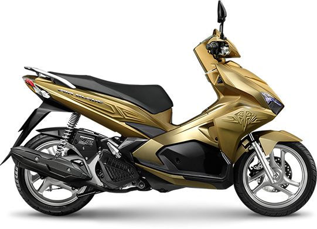

[🏠 Trang chủ](../../README.md) › [Air Blade](../../dong-xe/air-blade.md) › **BO0679**

# BO0679 · AirBlade 125 2016 K66 Vàng đen 3D YR224M

| | |
|---|---|
| **Mã bộ** | `BO0679` |
| **Tên bộ** | Bộ nhựa (Dàn áo) AirBlade 125 2016 K66 Vàng đen 3D YR224M |
| **Đời xe** | Ari Blade 125  Năm 2015-2016 Màu Vàng đen magnet - YR224 |
| **Model** | M6,M7 |
| **Dòng xe** | Air Blade |
| **Số chi tiết** | 28 |

## Chi tiết trong bộ

| STT | Mã chi tiết | Tên chi tiết | Dùng chung | Mã thay thế | Ghi chú |
|---:|---|---|:---:|---|---|
| 1 | [`53115K66V00ZK`](../../tra-ma/531.md#53115k66v00zk) | Bộ nắp ốp sau tay lái \*Y221M\* |  |  |  |
| 2 | [`53204K66V00ZA`](../../tra-ma/5320.md#53204k66v00za) | Nắp ốp đồng hồ \*Y224M\* |  |  |  |
| 3 | [`53205K66V00ZE`](../../tra-ma/5320.md#53205k66v00ze) | Nắp trước tay lái \*Y221M\* |  |  |  |
| 4 | [`53225K66V00ZL`](../../tra-ma/5322.md#53225k66v00zl) | Trang trí nắp tay lái trước \*Y224M\* |  |  |  |
| 5 | [`61110K66V00ZA`](../../tra-ma/611.md#61110k66v00za) | Bộ chắn bùn trước \*Y224M\* |  |  |  |
| 6 | [`64300K66V00ZK`](../../tra-ma/6430.md#64300k66v00zk) | Bộ ốp trước \*Y224M\* |  |  |  |
| 7 | [`64303K66V20ZA`](../../tra-ma/6430.md#64303k66v20za) | Nắp trên ốp trước \*Y219M\* |  |  |  |
| 8 | [`64304K66V00`](../../tra-ma/6430.md#64304k66v00) | Trang trí đèn pha phải | ✔ |  |  |
| 9 | [`64305K66V00`](../../tra-ma/6430.md#64305k66v00) | Trang trí đèn pha trái | ✔ |  |  |
| 10 | [`64311K66V00`](../../tra-ma/6431.md#64311k66v00) | Tấm bắt sàn phải | ✔ |  |  |
| 11 | [`64320K66V10ZH`](../../tra-ma/6432.md#64320k66v10zh) | Ốp ống yếm chính \*Y221M\* |  |  |  |
| 12 | [`64321K66V00`](../../tra-ma/6432.md#64321k66v00) | Tấm bắt sàn trái | ✔ |  |  |
| 13 | [`64340K66V00ZK`](../../tra-ma/6434.md#64340k66v00zk) | Ốp nhựa trung tâm \*Y221M\* |  |  |  |
| 14 | [`64410K66V00ZA`](../../tra-ma/6441.md#64410k66v00za) | Tấm ốp yếm phải \*Y224M\* |  |  |  |
| 15 | [`64420K66V00ZA`](../../tra-ma/6442.md#64420k66v00za) | Tấm ốp yếm trái \*Y224M\* |  |  |  |
| 16 | [`64421K66V00ZA`](../../tra-ma/6442.md#64421k66v00za) | Ốp sàn dưới phải \*Y224M\* |  |  |  |
| 17 | [`64431K66V00ZA`](../../tra-ma/6443.md#64431k66v00za) | Ốp sàn dưới trái \*Y224M\* |  |  |  |
| 18 | [`64501K66V20ZA`](../../tra-ma/645.md#64501k66v20za) | Ốp trước bên phải \*Y219M\* |  |  |  |
| 19 | [`64502K66V20ZA`](../../tra-ma/645.md#64502k66v20za) | Ốp trước bên trái \*Y219M\* |  |  |  |
| 20 | [`64530K66V00`](../../tra-ma/645.md#64530k66v00) | Tấm ốp sàn dưới | ✔ |  |  |
| 21 | [`64750K66V00ZM`](../../tra-ma/647.md#64750k66v00zm) | Bộ nắp bình xăng \*Y221M\* |  |  |  |
| 22 | [`80101K66V00`](../../tra-ma/8010.md#80101k66v00) | Chắn bùn sau bên trong | ✔ |  |  |
| 23 | [`80110K66V00ZA`](../../tra-ma/8011.md#80110k66v00za) | Bộ chắn bùn sau \*TYPE1\* | ✔ |  |  |
| 24 | [`81252K66V00`](../../tra-ma/812.md#81252k66v00) | Nắp hộp đồ | ✔ |  |  |
| 25 | [`83550K66V20ZD`](../../tra-ma/8355.md#83550k66v20zd) | Bộ ốp sườn phải \*Y219M\* |  |  |  |
| 26 | [`83650K66V20ZD`](../../tra-ma/8365.md#83650k66v20zd) | Bộ ốp sườn trái \*Y219M\* |  |  |  |
| 27 | [`83751K66V00ZH`](../../tra-ma/837.md#83751k66v00zh) | Bộ nắp trên đèn hậu \*Y221M\* |  |  |  |
| 28 | [`83760K66V00ZA`](../../tra-ma/837.md#83760k66v00za) | Bộ nắp đèn hậu \*Y224M\* |  |  |  |

Cập nhật 11/11/2026
