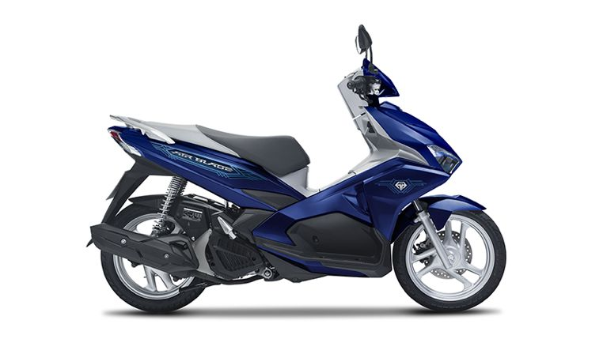

[🏠 Trang chủ](../../README.md) › [Air Blade](../../dong-xe/air-blade.md) › **BO0684**

# BO0684 · AirBlade 125 2017 K66 Xanh bạc P390M

| | |
|---|---|
| **Mã bộ** | `BO0684` |
| **Tên bộ** | Bộ nhựa (Dàn áo) AirBlade 125 2017 K66 Xanh bạc P390M |
| **Đời xe** | Ari Blade 125  Năm 2017 Màu Xanh bạc -P-390 |
| **Model** | M8 |
| **Dòng xe** | Air Blade |
| **Số chi tiết** | 29 |

## Chi tiết trong bộ

| STT | Mã chi tiết | Tên chi tiết | Dùng chung | Mã thay thế | Ghi chú |
|---:|---|---|:---:|---|---|
| 1 | [`53115K66VG0ZD`](../../tra-ma/531.md#53115k66vg0zd) | Bộ nắp ốp sau tay lái \*NHB24M\* |  |  |  |
| 2 | [`53204K66V00ZB`](../../tra-ma/5320.md#53204k66v00zb) | Nắp ốp đồng hồ \*NHB25M\* |  |  |  |
| 3 | [`53205K66V00ZD`](../../tra-ma/5320.md#53205k66v00zd) | Nắp trước tay lái \*NHB25M\* |  |  |  |
| 4 | [`53225K66V00ZN`](../../tra-ma/5322.md#53225k66v00zn) | Trang trí nắp tay lái trước \*PB390M\* |  |  |  |
| 5 | [`61110K66V00ZM`](../../tra-ma/611.md#61110k66v00zm) | Bộ chắn bùn trước \*PB390M\* |  |  |  |
| 6 | [`64300K66V00ZN`](../../tra-ma/6430.md#64300k66v00zn) | Bộ ốp trước \*PB390M\* |  |  |  |
| 7 | [`64304K66V00`](../../tra-ma/6430.md#64304k66v00) | Trang trí đèn pha phải | ✔ |  |  |
| 8 | [`64305K66V00`](../../tra-ma/6430.md#64305k66v00) | Trang trí đèn pha trái | ✔ |  |  |
| 9 | [`64305K66VF0ZB`](../../tra-ma/6430.md#64305k66vf0zb) | Ốp trang trí mặt trước \*PB390M\* |  | [`64305K66V10ZC`](../../tra-ma/6430.md#64305k66v10zc) |  |
| 10 | [`64311K66V00`](../../tra-ma/6431.md#64311k66v00) | Tấm bắt sàn phải | ✔ |  |  |
| 11 | [`64321K66V00`](../../tra-ma/6432.md#64321k66v00) | Tấm bắt sàn trái | ✔ |  |  |
| 12 | [`64330K66VG0ZB`](../../tra-ma/6433.md#64330k66vg0zb) | Bộ ốp ống yếm trên \*NHB24M\* |  |  |  |
| 13 | [`64335K66VG0ZD`](../../tra-ma/6433.md#64335k66vg0zd) | Ốp khóa khẩn cấp \*NHB24M\* |  |  |  |
| 14 | [`64340K66V00ZN`](../../tra-ma/6434.md#64340k66v00zn) | Ốp trung tâm \*NHB24M\* |  |  |  |
| 15 | [`64410K66V00ZF`](../../tra-ma/6441.md#64410k66v00zf) | Tấm ốp yếm phải \*PB390M\* |  |  |  |
| 16 | [`64420K66V00ZF`](../../tra-ma/6442.md#64420k66v00zf) | Tấm ốp yếm trái \*PB390M\* |  |  |  |
| 17 | [`64421K66V00ZG`](../../tra-ma/6442.md#64421k66v00zg) | Ốp sàn dưới phải  \*PB390M\* |  |  |  |
| 18 | [`64431K66V00ZG`](../../tra-ma/6443.md#64431k66v00zg) | Ốp sàn dưới trái \*PB390M\* |  |  |  |
| 19 | [`64500K66VF0ZF`](../../tra-ma/645.md#64500k66vf0zf) | Bộ ốp trước bên phải \*PB390M\* |  |  |  |
| 20 | [`64530K66V00`](../../tra-ma/645.md#64530k66v00) | Tấm ốp sàn dưới | ✔ |  |  |
| 21 | [`64600K66VF0ZF`](../../tra-ma/6460.md#64600k66vf0zf) | Bộ ốp trước bên trái \*PB390M\* |  |  |  |
| 22 | [`64750K66V00ZN`](../../tra-ma/647.md#64750k66v00zn) | Nắp mở bình xăng \*NHB24M\* |  |  |  |
| 23 | [`80101K66V00`](../../tra-ma/8010.md#80101k66v00) | Chắn bùn sau bên trong | ✔ |  |  |
| 24 | [`80110K66V00ZA`](../../tra-ma/8011.md#80110k66v00za) | Bộ chắn bùn sau \*TYPE1\* | ✔ |  |  |
| 25 | [`81252K66V00`](../../tra-ma/812.md#81252k66v00) | Nắp hộp đồ | ✔ |  |  |
| 26 | [`83550K66VF0ZF`](../../tra-ma/8355.md#83550k66vf0zf) | Bộ ốp sườn phải \*PB390M\* |  |  |  |
| 27 | [`83650K66VF0ZF`](../../tra-ma/8365.md#83650k66vf0zf) | Bộ ốp sườn trái \*PB390M\* |  |  |  |
| 28 | [`83751K66V00ZC`](../../tra-ma/837.md#83751k66v00zc) | Bộ nắp trên đèn hậu \*PB390M\* |  |  |  |
| 29 | [`83760K66V00ZE`](../../tra-ma/837.md#83760k66v00ze) | Bộ nắp đèn hậu \*NHB25M\* |  |  |  |

Cập nhật 11/11/2026
