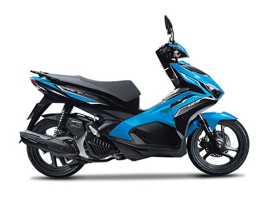

[🏠 Trang chủ](../../README.md) › [Air Blade](../../dong-xe/air-blade.md) › **BO0699**

# BO0699 · AirBlade 125 2018 K66 Xanh B189C

| | |
|---|---|
| **Mã bộ** | `BO0699` |
| **Tên bộ** | Bộ nhựa (Dàn áo) AirBlade 125 2018 K66 Xanh B189C |
| **Đời xe** | Ari Blade 125  Năm 2018 Màu Xanh - B189 |
| **Model** | M9 |
| **Dòng xe** | Air Blade |
| **Số chi tiết** | 29 |

## Chi tiết trong bộ

| STT | Mã chi tiết | Tên chi tiết | Dùng chung | Mã thay thế | Ghi chú |
|---:|---|---|:---:|---|---|
| 1 | [`53115K66VG0ZC`](../../tra-ma/531.md#53115k66vg0zc) | Bộ nắp ốp đồng hồ \*NHB25M\* |  |  |  |
| 2 | [`53204K66V00ZB`](../../tra-ma/5320.md#53204k66v00zb) | Nắp ốp đồng hồ \*NHB25M\* |  |  |  |
| 3 | [`53205K66V00ZD`](../../tra-ma/5320.md#53205k66v00zd) | Nắp trước tay lái \*NHB25M\* |  |  |  |
| 4 | [`53225K66V00ZX`](../../tra-ma/5322.md#53225k66v00zx) | Trang trí nắp tay lái trước \*B189C\* |  |  |  |
| 5 | [`61110K66V00ZU`](../../tra-ma/611.md#61110k66v00zu) | Bộ chắn bùn trước \*B189C\* |  |  |  |
| 6 | [`64300K66VN0ZA`](../../tra-ma/6430.md#64300k66vn0za) | Bộ ốp trước trên \*B189C\* |  |  |  |
| 7 | [`64303K66V00ZD`](../../tra-ma/6430.md#64303k66v00zd) | Nắp trên ốp trước \*NHB25M\* |  | [`64305K66V10ZA`](../../tra-ma/6430.md#64305k66v10za) |  |
| 8 | [`64304K66V00`](../../tra-ma/6430.md#64304k66v00) | Trang trí đèn pha phải | ✔ |  |  |
| 9 | [`64305K66V00`](../../tra-ma/6430.md#64305k66v00) | Trang trí đèn pha trái | ✔ |  |  |
| 10 | [`64311K66V00`](../../tra-ma/6431.md#64311k66v00) | Tấm bắt sàn phải | ✔ |  |  |
| 11 | [`64321K66V00`](../../tra-ma/6432.md#64321k66v00) | Tấm bắt sàn trái | ✔ |  |  |
| 12 | [`64330K66V00ZH`](../../tra-ma/6433.md#64330k66v00zh) | Ốp ống yếm trên \*NHB25M\* |  | [`64320K66V90ZA`](../../tra-ma/6432.md#64320k66v90za) |  |
| 13 | [`64335K66VG0ZC`](../../tra-ma/6433.md#64335k66vg0zc) | Ốp khóa khẩn cấp \*NHB25M\* |  |  |  |
| 14 | [`64340K66V00ZH`](../../tra-ma/6434.md#64340k66v00zh) | Ốp nhựa trung tâm \*NHB25M\* |  |  |  |
| 15 | [`64410K66V00ZK`](../../tra-ma/6441.md#64410k66v00zk) | Tấm ốp yếm phải \*B189C\* |  |  |  |
| 16 | [`64420K66V00ZK`](../../tra-ma/6442.md#64420k66v00zk) | Tấm ốp yếm trái \*B189C\* |  |  |  |
| 17 | [`64421K66V00ZB`](../../tra-ma/6442.md#64421k66v00zb) | Ốp sàn dưới phải \*NHB25M\* |  |  |  |
| 18 | [`64431K66V00ZB`](../../tra-ma/6443.md#64431k66v00zb) | Ốp sàn dưới trái \*NHB25M\* |  |  |  |
| 19 | [`64500K66VN0ZA`](../../tra-ma/645.md#64500k66vn0za) | Bộ ốp trước bên phải \*B189C\* |  |  |  |
| 20 | [`64530K66V00`](../../tra-ma/645.md#64530k66v00) | Tấm ốp sàn dưới | ✔ |  |  |
| 21 | [`64600K66VN0ZA`](../../tra-ma/6460.md#64600k66vn0za) | Bộ ốp trước bên trái \*B189C\* |  |  |  |
| 22 | [`64750K66V00ZH`](../../tra-ma/647.md#64750k66v00zh) | Bộ nắp bình xăng \*NHB25M\* |  |  |  |
| 23 | [`80101K66V00`](../../tra-ma/8010.md#80101k66v00) | Chắn bùn sau bên trong | ✔ |  |  |
| 24 | [`80110K66V00ZA`](../../tra-ma/8011.md#80110k66v00za) | Bộ chắn bùn sau \*TYPE1\* | ✔ |  |  |
| 25 | [`81252K66V00`](../../tra-ma/812.md#81252k66v00) | Nắp hộp đồ | ✔ |  |  |
| 26 | [`83550K66VN0ZA`](../../tra-ma/8355.md#83550k66vn0za) | Bộ ốp sườn phải \*B189C\* |  |  |  |
| 27 | [`83650K66VN0ZA`](../../tra-ma/8365.md#83650k66vn0za) | Bộ ốp sườn trái \*B189C\* |  |  |  |
| 28 | [`83751K66V00ZP`](../../tra-ma/837.md#83751k66v00zp) | Bộ nắp trên đèn hậu \*B189C\* |  |  |  |
| 29 | [`83760K66V00ZE`](../../tra-ma/837.md#83760k66v00ze) | Bộ nắp đèn hậu \*NHB25M\* |  |  |  |

Cập nhật 11/11/2026
