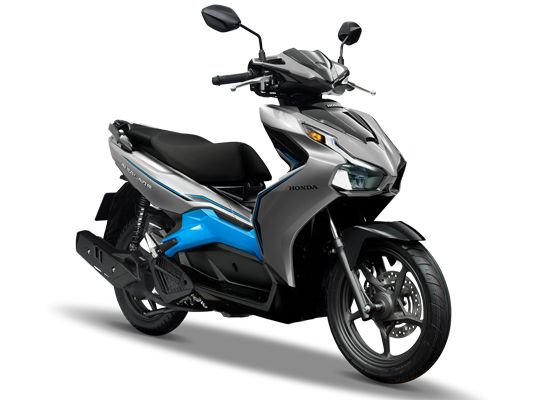

[🏠 Trang chủ](../../README.md) › [Air Blade](../../dong-xe/air-blade.md) › **BO0707**

# BO0707 · AirBlade 125 2020 K1F Bạc Xanh Đen NH262M

| | |
|---|---|
| **Mã bộ** | `BO0707` |
| **Tên bộ** | Bộ nhựa (Dàn áo) AirBlade 125 2020 K1F Bạc Xanh Đen NH262M |
| **Đời xe** | Ari Blade 125  Năm 2020 Màu Bạc Xanh Đen - NH-62 |
| **Model** | M10 |
| **Dòng xe** | Air Blade |
| **Số chi tiết** | 31 |

## Chi tiết trong bộ

| STT | Mã chi tiết | Tên chi tiết | Dùng chung | Mã thay thế | Ghi chú |
|---:|---|---|:---:|---|---|
| 1 | [`53115K1FV00ZC`](../../tra-ma/531.md#53115k1fv00zc) | Bộ nắp ốp đồng hồ \*NHB25M\* |  |  |  |
| 2 | [`53204K1GV00`](../../tra-ma/5320.md#53204k1gv00) | Nắp mặt đồng hồ tốc độ |  |  |  |
| 3 | [`53205K1FV00ZD`](../../tra-ma/5320.md#53205k1fv00zd) | Nắp trước tay lái \*NHB25M\* |  |  |  |
| 4 | [`53207K1FV00ZJ`](../../tra-ma/5320.md#53207k1fv00zj) | Trang trí nắp tay lái \*NH262M\* |  |  |  |
| 5 | [`61110K1GV00ZA`](../../tra-ma/611.md#61110k1gv00za) | Bộ chắn bùn trước \*TYPE1\* |  | [`61110K1GV00ZC`](../../tra-ma/611.md#61110k1gv00zc) |  |
| 6 | [`64302K1FV00ZD`](../../tra-ma/6430.md#64302k1fv00zd) | Mặt nạ trước \*NH262M\* |  |  |  |
| 7 | [`64304K1FV00ZA`](../../tra-ma/6430.md#64304k1fv00za) | Ốp trang trí mặt trước \*NH1\* |  |  |  |
| 8 | [`64310K1FV00ZD`](../../tra-ma/6431.md#64310k1fv00zd) | Mặt nạ trước \*NHB25M\* |  |  |  |
| 9 | [`64311K1FV00ZA`](../../tra-ma/6431.md#64311k1fv00za) | Tấm bắt sàn phải \*NH1\* |  |  |  |
| 10 | [`64321K1FV00ZA`](../../tra-ma/6432.md#64321k1fv00za) | Tấm bắt sàn trái \*NH1\* |  |  |  |
| 11 | [`64330K1FV00ZC`](../../tra-ma/6433.md#64330k1fv00zc) | Ốp ống yếm chính \*NHB25M\* |  | [`64330K1FV01ZC`](../../tra-ma/6433.md#64330k1fv01zc) |  |
| 12 | [`64335K1FV00ZC`](../../tra-ma/6433.md#64335k1fv00zc) | Ốp khóa khẩn cấp \*NHB25M\* |  |  |  |
| 13 | [`64337K1FV00`](../../tra-ma/6433.md#64337k1fv00) | Ốp khóa khẩn cấp | ✔ |  |  |
| 14 | [`64340K1FV00ZC`](../../tra-ma/6434.md#64340k1fv00zc) | Ốp nhựa trung tâm \*NHB25M\* |  |  |  |
| 15 | [`64410K1FV00ZB`](../../tra-ma/6441.md#64410k1fv00zb) | Ốp sườn sàn bên phải \*B189C\* |  |  |  |
| 16 | [`64420K1FV00ZB`](../../tra-ma/6442.md#64420k1fv00zb) | Ốp sườn sàn bên trái \*B189C\* |  |  |  |
| 17 | [`64421K1FV00ZF`](../../tra-ma/6442.md#64421k1fv00zf) | Ốp trước bên trong bên phải \*B189C\* |  |  |  |
| 18 | [`64430K1FV00ZB`](../../tra-ma/6443.md#64430k1fv00zb) | Bộ nắp bình xăng \*NHB25M\* |  |  |  |
| 19 | [`64431K1FV00ZF`](../../tra-ma/6443.md#64431k1fv00zf) | Ốp trước bên trong bên trái \*B189C\* |  |  |  |
| 20 | [`64500K1GV00ZB`](../../tra-ma/645.md#64500k1gv00zb) | Mặt nạ trước phải \*TYPE3\* |  |  |  |
| 21 | [`64530K1FV00ZA`](../../tra-ma/645.md#64530k1fv00za) | Ốp dưới sàn xe \*NH1\* | ✔ |  |  |
| 22 | [`64600K1GV00ZB`](../../tra-ma/6460.md#64600k1gv00zb) | Mặt nạ trước trái \*TYPE3\* |  |  |  |
| 23 | [`80101K1FV00`](../../tra-ma/8010.md#80101k1fv00) | Chắn bùn sau bên trong | ✔ |  |  |
| 24 | [`80102K27V00`](../../tra-ma/8010.md#80102k27v00) | Ốp bình chứa dung dịch làm mát | ✔ |  |  |
| 25 | [`80103K1FV00`](../../tra-ma/8010.md#80103k1fv00) | Tấm chắn bảo vệ đuôi xe | ✔ |  |  |
| 26 | [`80110K1FV00`](../../tra-ma/8011.md#80110k1fv00) | Chắn bùn sau A | ✔ |  |  |
| 27 | [`80200K1GV00ZA`](../../tra-ma/802.md#80200k1gv00za) | Bộ chắn bùn sau phía trên \*TYPE1\* | ✔ |  |  |
| 28 | [`83550K1GV00ZB`](../../tra-ma/8355.md#83550k1gv00zb) | Bộ ốp thân bên phải \*TYPE3\* |  |  |  |
| 29 | [`83650K1GV00ZB`](../../tra-ma/8365.md#83650k1gv00zb) | Bộ ốp thân bên trái \*TYPE3\* |  |  |  |
| 30 | [`83751K1FV00ZJ`](../../tra-ma/837.md#83751k1fv00zj) | Ốp đuôi đèn phía trên \*NH262M\* |  |  |  |
| 31 | [`84120K1FV00ZA`](../../tra-ma/841.md#84120k1fv00za) | Tấm ốp tay dắt sau \*NH1\* | ✔ |  |  |

Cập nhật 11/11/2026
