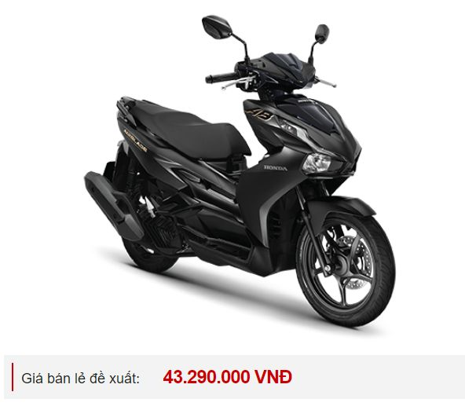

[🏠 Trang chủ](../../README.md) › [Air Blade](../../dong-xe/air-blade.md) › **BO0791**

# BO0791 · AirBlade 125 2022 K3A màu đen vàng, phiên bản đặc biệt

| | |
|---|---|
| **Mã bộ** | `BO0791` |
| **Tên bộ** | Bộ nhựa (Dàn áo) AirBlade 125 2022 K3A màu đen vàng, phiên bản đặc biệt |
| **Đời xe** | Air Blade 125 phiên bản Đặc Biệt - Màu Đen Vàng |
| **Model** | ACA125CBFP |
| **Dòng xe** | Air Blade |
| **Số chi tiết** | 30 |

## Chi tiết trong bộ

| STT | Mã chi tiết | Tên chi tiết | Dùng chung | Mã thay thế | Ghi chú |
|---:|---|---|:---:|---|---|
| 1 | [`53115K2ZV00ZB`](../../tra-ma/531.md#53115k2zv00zb) | Bộ nắp sau tay lái \*NHB25\* |  |  |  |
| 2 | [`64310K1FV00ZD`](../../tra-ma/6431.md#64310k1fv00zd) | Mặt nạ trước \*NHB25M\* |  |  |  |
| 3 | [`83650K3AV10ZA`](../../tra-ma/8365.md#83650k3av10za) | Bộ ốp sườn trái \*NHA76\* |  |  |  |
| 4 | [`64600K3AV10ZA`](../../tra-ma/6460.md#64600k3av10za) | Mặt nạ trước trái \*NHA76\* |  |  |  |
| 5 | [`83550K3AV10ZA`](../../tra-ma/8355.md#83550k3av10za) | Bộ ốp sườn phải \*NH76\* |  |  |  |
| 6 | [`64500K3AV10ZA`](../../tra-ma/645.md#64500k3av10za) | Mặt nạ trước phải \*NHA76\* |  |  |  |
| 7 | [`64340K1FV00ZC`](../../tra-ma/6434.md#64340k1fv00zc) | Ốp nhựa trung tâm \*NHB25M\* |  |  |  |
| 8 | [`64335K1FV00ZC`](../../tra-ma/6433.md#64335k1fv00zc) | Ốp khóa khẩn cấp \*NHB25M\* |  |  |  |
| 9 | [`53205K2ZV00ZB`](../../tra-ma/5320.md#53205k2zv00zb) | Nắp trước tay lái \*NHB25\* |  |  |  |
| 10 | [`64302K1FV00ZJ`](../../tra-ma/6430.md#64302k1fv00zj) | Mặt nạ trước \*NHA76M\* |  |  |  |
| 11 | [`64420K2ZV00ZD`](../../tra-ma/6442.md#64420k2zv00zd) | Ốp sườn sàn trái \*NHB25\* |  |  |  |
| 12 | [`64431K1FV00ZA`](../../tra-ma/6443.md#64431k1fv00za) | Ốp trước bên trong bên trái \*Y234\* |  |  |  |
| 13 | [`64330K1FV01ZC`](../../tra-ma/6433.md#64330k1fv01zc) | Ốp ống yếm chính \*NHB25M\* |  |  |  |
| 14 | [`64410K2ZV00ZD`](../../tra-ma/6441.md#64410k2zv00zd) | Ốp sàn phải \*NHB25\* |  |  |  |
| 15 | [`64421K1FV00ZA`](../../tra-ma/6442.md#64421k1fv00za) | Ốp trước bên trong bên phải \*Y234\* |  |  |  |
| 16 | [`64530K2ZV00ZA`](../../tra-ma/645.md#64530k2zv00za) | Tấm ốp sàn dưới \*NH1\* |  |  |  |
| 17 | [`61110K3AV00ZA`](../../tra-ma/611.md#61110k3av00za) | Bộ chắn bùn trước \*NHA76\* |  |  |  |
| 18 | [`80200K2ZV00ZA`](../../tra-ma/802.md#80200k2zv00za) | Bộ chắn bùn sau phía trên \*NH1\* |  |  |  |
| 19 | [`64304K1FV00ZA`](../../tra-ma/6430.md#64304k1fv00za) | Ốp trang trí mặt trước \*NH1\* |  |  |  |
| 20 | [`53207K1FV00ZG`](../../tra-ma/5320.md#53207k1fv00zg) | Trang trí nắp tay lái \*NHA76M\* |  |  |  |
| 21 | [`64430K1FV00ZB`](../../tra-ma/6443.md#64430k1fv00zb) | Bộ nắp bình xăng \*NHB25M\* |  |  |  |
| 22 | [`64434K2ZV00ZA`](../../tra-ma/6443.md#64434k2zv00za) | Tấm chắn bugi \*NH1\* |  |  |  |
| 23 | [`64321K2ZV00ZA`](../../tra-ma/6432.md#64321k2zv00za) | Tấm bắt sàn trái \*NH1\* |  |  |  |
| 24 | [`64311K2ZV00ZA`](../../tra-ma/6431.md#64311k2zv00za) | Tấm bắt sàn phải \*NH1\* |  |  |  |
| 25 | [`53204K1GV00`](../../tra-ma/5320.md#53204k1gv00) | Nắp mặt đồng hồ tốc độ |  |  |  |
| 26 | [`64337K1FV00`](../../tra-ma/6433.md#64337k1fv00) | Ốp khóa khẩn cấp |  |  |  |
| 27 | [`80110K2ZV00`](../../tra-ma/8011.md#80110k2zv00) | Chắn bùn A sau |  |  |  |
| 28 | [`80101K2ZV00`](../../tra-ma/8010.md#80101k2zv00) | Chắn bùn sau bên trong |  |  |  |
| 29 | [`83751K2ZV00ZK`](../../tra-ma/837.md#83751k2zv00zk) | Ốp đuôi đèn phía trên \*NHA76\* |  |  |  |
| 30 | [`80102K2ZV00`](../../tra-ma/8010.md#80102k2zv00) | Ốp bình chứa dung dịch làm mát |  |  |  |

## Mã thiếu bổ sung

_Không tính sẵn trong bộ, thêm khi khách cần._

| Mã | Tên |
|---|---|
| [`51500K1GV01`](../../tra-ma/515.md#51500k1gv01) |  |
| [`51400K1FV01`](../../tra-ma/514.md#51400k1fv01) |  |

Cập nhật 11/11/2026
