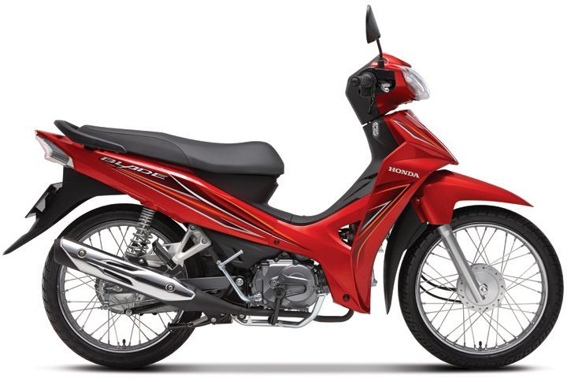

[🏠 Trang chủ](../../README.md) › [Blade](../../dong-xe/blade.md) › **BO0592**

# BO0592 · Blade 2014 đen đỏ R340 K57

| | |
|---|---|
| **Mã bộ** | `BO0592` |
| **Tên bộ** | Bộ nhựa (Dàn áo) Blade 2014 đen đỏ R340 K57 |
| **Đời xe** | K57 Balde số 2014 màu đen đỏ - R340 |
| **Model** | J13 |
| **Dòng xe** | Blade |
| **Số chi tiết** | 17 |

## Chi tiết trong bộ

| STT | Mã chi tiết | Tên chi tiết | Dùng chung | Mã thay thế | Ghi chú |
|---:|---|---|:---:|---|---|
| 1 | [`53205K57V10ZA`](../../tra-ma/5320.md#53205k57v10za) | Ốp tay lái trước R340C |  |  |  |
| 2 | [`53250K57V00ZA`](../../tra-ma/5325.md#53250k57v00za) | Ốp tay lái sau | ✔ |  |  |
| 3 | [`61100K57V00ZA`](../../tra-ma/611.md#61100k57v00za) | Chắn bùn A trước R340C |  |  |  |
| 4 | [`61200KWW640ZB`](../../tra-ma/612.md#61200kww640zb) | Chắn bùn B trước \*NH1\* | ✔ |  |  |
| 5 | [`64200K57V10ZD`](../../tra-ma/642.md#64200k57v10zd) | Bộ ốp trước trên \*R340\* |  |  |  |
| 6 | [`64320K57V00`](../../tra-ma/6432.md#64320k57v00) | Ốp ống yếm chính | ✔ |  |  |
| 7 | [`64340K57V00`](../../tra-ma/6434.md#64340k57v00) | Ốp trung tâm | ✔ |  |  |
| 8 | [`64460K57V10ZB`](../../tra-ma/6446.md#64460k57v10zb) | Bộ ốp ống yếm bên phải \*R340\* |  |  |  |
| 9 | [`64465K57V10ZB`](../../tra-ma/6446.md#64465k57v10zb) | Bộ ốp ống yếm bên trái \*R340C\* |  |  |  |
| 10 | [`64560K57V00ZA`](../../tra-ma/645.md#64560k57v00za) | Ốp dưới sườn phải | ✔ |  |  |
| 11 | [`64565K57V00ZA`](../../tra-ma/645.md#64565k57v00za) | Ốp dưới sườn trái | ✔ |  |  |
| 12 | [`64600K57V10ZB`](../../tra-ma/6460.md#64600k57v10zb) | Bộ ốp sườn phải \*R340\* |  |  |  |
| 13 | [`64650K57V10ZB`](../../tra-ma/6465.md#64650k57v10zb) | Bộ ốp sườn trái |  |  |  |
| 14 | [`64750K57V10ZB`](../../tra-ma/647.md#64750k57v10zb) | Bộ cánh yếm phải \*R340\* |  |  |  |
| 15 | [`64770K57V10ZB`](../../tra-ma/647.md#64770k57v10zb) | Bộ cánh yếm trái \*R340\* |  |  |  |
| 16 | [`80110K57V00ZC`](../../tra-ma/8011.md#80110k57v00zc) | Bộ chắn bùn sau | ✔ |  |  |
| 17 | [`83500K57V00ZA`](../../tra-ma/8350.md#83500k57v00za) | Bộ ốp đuôi sau xe |  |  |  |

Cập nhật 11/11/2026
