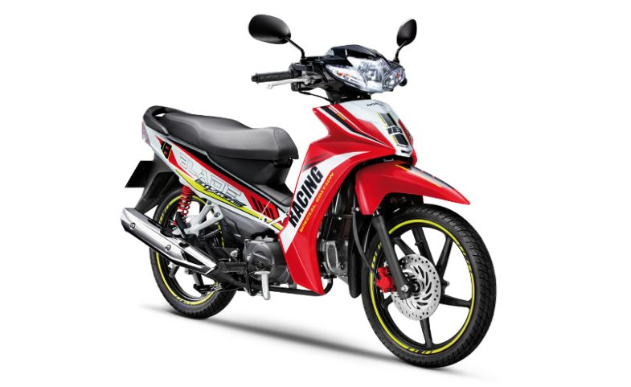

[🏠 Trang chủ](../../README.md) › [Blade](../../dong-xe/blade.md) › **BO0621**

# BO0621 · Blade 2018 đỏ RACING R263 K57

| | |
|---|---|
| **Mã bộ** | `BO0621` |
| **Tên bộ** | Bộ nhựa (Dàn áo) Blade 2018 đỏ RACING R263 K57 |
| **Đời xe** | K57 Balde số 2018 màu đỏ - R263 |
| **Model** | J25 |
| **Dòng xe** | Blade |
| **Số chi tiết** | 17 |

## Chi tiết trong bộ

| STT | Mã chi tiết | Tên chi tiết | Dùng chung | Mã thay thế | Ghi chú |
|---:|---|---|:---:|---|---|
| 1 | [`53205K57A00ZC`](../../tra-ma/5320.md#53205k57a00zc) | Nắp trước tay lái \*NHB25M\* |  | [`53205K57V00ZD`](../../tra-ma/5320.md#53205k57v00zd) |  |
| 2 | [`53250K57A00ZA`](../../tra-ma/5325.md#53250k57a00za) | Bộ ốp nhựa sau tay lái \*NH1\* | ✔ |  |  |
| 3 | [`61000K57A60ZA`](../../tra-ma/610.md#61000k57a60za) | Bộ chắn bùn trước A \*R263\* |  |  |  |
| 4 | [`61200KWW640ZB`](../../tra-ma/612.md#61200kww640zb) | Chắn bùn B trước \*NH1\* | ✔ |  |  |
| 5 | [`64200K57A60ZA`](../../tra-ma/642.md#64200k57a60za) | Bộ ốp trước trên \*NHB55P\* |  | [`64200K57V50ZC`](../../tra-ma/642.md#64200k57v50zc) |  |
| 6 | [`64320K57V00`](../../tra-ma/6432.md#64320k57v00) | Ốp ống yếm chính | ✔ |  |  |
| 7 | [`64340K57A00`](../../tra-ma/6434.md#64340k57a00) | Ốp trung tâm | ✔ |  |  |
| 8 | [`64460K57A60ZA`](../../tra-ma/6446.md#64460k57a60za) | Bộ ốp ống yếm phải \*NHB55P\* |  |  |  |
| 9 | [`64465K57A60ZA`](../../tra-ma/6446.md#64465k57a60za) | Bộ ốp ống yếm trái \*NHB55P\* |  |  |  |
| 10 | [`64560K57V00ZA`](../../tra-ma/645.md#64560k57v00za) | Ốp dưới sườn phải | ✔ |  |  |
| 11 | [`64565K57V00ZA`](../../tra-ma/645.md#64565k57v00za) | Ốp dưới sườn trái | ✔ |  |  |
| 12 | [`64600K57A60ZA`](../../tra-ma/6460.md#64600k57a60za) | Bộ ốp sườn phải \*NHB55P\* |  |  |  |
| 13 | [`64650K57A60ZA`](../../tra-ma/6465.md#64650k57a60za) | Bộ ốp sườn trái \*NHB55P\* |  |  |  |
| 14 | [`64750K57A60ZA`](../../tra-ma/647.md#64750k57a60za) | Bộ cánh yếm phải \*R263\* |  |  |  |
| 15 | [`64770K57A60ZA`](../../tra-ma/647.md#64770k57a60za) | Bộ cánh yếm trái \*R263\* |  |  |  |
| 16 | [`80110K57V00ZC`](../../tra-ma/8011.md#80110k57v00zc) | Bộ chắn bùn sau | ✔ |  |  |
| 17 | [`83500K57V00ZB`](../../tra-ma/8350.md#83500k57v00zb) | Bộ ốp đuôi sau xe |  |  |  |

Cập nhật 11/11/2026
