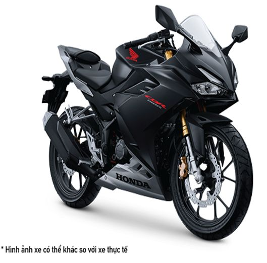

[🏠 Trang chủ](../../README.md) › [CBR](../../dong-xe/cbr.md) › **BO1047**

# BO1047 · CBR 2022 xám NH436 bản đặc biệt

| | |
|---|---|
| **Mã bộ** | `BO1047` |
| **Tên bộ** | Bộ nhựa (Dàn áo) CBR 2022 xám NH436 bản đặc biệt |
| **Đời xe** | CBR 2022 xám NH436 bản đặc biệt |
| **Model** | CBR150RAM |
| **Dòng xe** | CBR |
| **Số chi tiết** | 26 |

## Chi tiết trong bộ

| STT | Mã chi tiết | Tên chi tiết | Dùng chung | Mã thay thế | Ghi chú |
|---:|---|---|:---:|---|---|
| 1 | [`61000K45NM0ZE`](../../tra-ma/610.md#61000k45nm0ze) | Bộ chắn bùn trước \*NH436\* |  |  |  |
| 2 | [`64150K45NL0`](../../tra-ma/641.md#64150k45nl0) | Giá đỡ ốp trên trước |  |  |  |
| 3 | [`64211K45NL0ZD`](../../tra-ma/642.md#64211k45nl0zd) | Ốp trước trên \*NH436\* |  |  |  |
| 4 | [`64221K45GN0`](../../tra-ma/642.md#64221k45gn0) | Ốp mặt nạ trước phải |  |  |  |
| 5 | [`64231K45GN0`](../../tra-ma/642.md#64231k45gn0) | Ốp mặt nạ trước trái |  |  |  |
| 6 | [`64245K45NL0ZA`](../../tra-ma/642.md#64245k45nl0za) | Ốp dưới trước \*NH436M\* |  |  |  |
| 7 | [`64251K45NL0`](../../tra-ma/642.md#64251k45nl0) | Tấm ốp trước đồng hồ |  |  |  |
| 8 | [`64300K45A40ZA`](../../tra-ma/6430.md#64300k45a40za) | Ốp trung tâm phải \*NH436\* |  |  |  |
| 9 | [`64321K45NL0`](../../tra-ma/6432.md#64321k45nl0) | Ốp bên phải |  |  |  |
| 10 | [`64331K45NL0`](../../tra-ma/6433.md#64331k45nl0) | Ốp giữa trong bên phải |  |  |  |
| 11 | [`64340K45NL0ZA`](../../tra-ma/6434.md#64340k45nl0za) | Ốp dưới phải \*NH229\* |  |  |  |
| 12 | [`64400K45A40ZA`](../../tra-ma/6440.md#64400k45a40za) | Ốp trung tâm trái \*NH436\* |  |  |  |
| 13 | [`64421K45NL0`](../../tra-ma/6442.md#64421k45nl0) | Ốp trái |  |  |  |
| 14 | [`64431K45NL0`](../../tra-ma/6443.md#64431k45nl0) | Ốp giữa trong bên trái |  |  |  |
| 15 | [`64440K45NL0ZA`](../../tra-ma/6444.md#64440k45nl0za) | Ốp dưới trái \*NH229\* |  |  |  |
| 16 | [`67111K45NL0`](../../tra-ma/671.md#67111k45nl0) | Kính chắn gió |  |  |  |
| 17 | [`80111K45NL0`](../../tra-ma/8011.md#80111k45nl0) | Chắn bùn sau B |  |  |  |
| 18 | [`80121K45N40`](../../tra-ma/8012.md#80121k45n40) | Chắn bùn sau trên A |  |  |  |
| 19 | [`80131K45N40`](../../tra-ma/8013.md#80131k45n40) | Chắn bùn sau dưới A |  |  |  |
| 20 | [`83110K45A40ZA`](../../tra-ma/831.md#83110k45a40za) | Ốp sau phải \*NH1\* |  |  |  |
| 21 | [`83120K45A40ZA`](../../tra-ma/831.md#83120k45a40za) | Ốp sau trái \*NH1\* |  |  |  |
| 22 | [`83130K45NL0ZA`](../../tra-ma/831.md#83130k45nl0za) | Ốp trung tâm sau \*NH229\* |  |  |  |
| 23 | [`83141K45NL0ZD`](../../tra-ma/831.md#83141k45nl0zd) | Ốp khóa yên \*NH436M\* |  |  |  |
| 24 | [`83155K45NL0ZB`](../../tra-ma/831.md#83155k45nl0zb) | Ốp trung tâm bình xăng \*NH436M\* |  |  |  |
| 25 | [`83160K45NX0ZA`](../../tra-ma/831.md#83160k45nx0za) | Ốp bình xăng phải \*NH436\* |  |  |  |
| 26 | [`83170K45NX0ZA`](../../tra-ma/831.md#83170k45nx0za) | Ốp bình xăng trái \*NH436\* |  |  |  |

Cập nhật 11/11/2026
