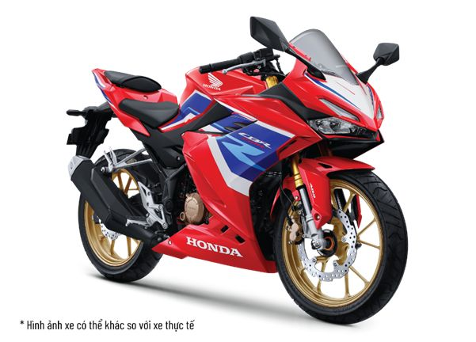

[🏠 Trang chủ](../../README.md) › [CBR](../../dong-xe/cbr.md) › **BO1051**

# BO1051 · CBR 2023 đỏ R258 bản thể thao

| | |
|---|---|
| **Mã bộ** | `BO1051` |
| **Tên bộ** | Bộ nhựa (Dàn áo) CBR 2023 đỏ R258 bản thể thao |
| **Đời xe** | CBR 2023 BẢN THỂ THAO R258 ĐỎ |
| **Model** | CBR150RAP |
| **Dòng xe** | CBR |
| **Số chi tiết** | 26 |

## Chi tiết trong bộ

| STT | Mã chi tiết | Tên chi tiết | Dùng chung | Mã thay thế | Ghi chú |
|---:|---|---|:---:|---|---|
| 1 | [`33741MS6921`](../../tra-ma/337.md#33741ms6921) | Tấm phản quang phải sau |  |  |  |
| 2 | [`61000K45A90ZB`](../../tra-ma/610.md#61000k45a90zb) | Bộ chắn bùn trước \*R258\* |  |  |  |
| 3 | [`64200K45A60ZB`](../../tra-ma/642.md#64200k45a60zb) | Bộ ốp trước trên \*R258\* |  |  |  |
| 4 | [`64221K45GN0`](../../tra-ma/642.md#64221k45gn0) | Ốp mặt nạ trước phải |  |  |  |
| 5 | [`64231K45GN0`](../../tra-ma/642.md#64231k45gn0) | Ốp mặt nạ trước trái |  |  |  |
| 6 | [`64240K45NZ0ZB`](../../tra-ma/642.md#64240k45nz0zb) | Bộ ốp dưới trước \*NH436M\* |  |  |  |
| 7 | [`64251K45NL0`](../../tra-ma/642.md#64251k45nl0) | Tấm ốp trước đồng hồ |  |  |  |
| 8 | [`64300K45A60ZA`](../../tra-ma/6430.md#64300k45a60za) | Ốp trung tâm phải \*R258\* |  |  |  |
| 9 | [`64321K45NL0`](../../tra-ma/6432.md#64321k45nl0) | Ốp bên phải |  |  |  |
| 10 | [`64331K45NL0`](../../tra-ma/6433.md#64331k45nl0) | Ốp giữa trong bên phải |  |  |  |
| 11 | [`64340K45A50ZC`](../../tra-ma/6434.md#64340k45a50zc) | Ốp ống yếm dưới phải \*R258\* |  |  |  |
| 12 | [`64400K45A60ZA`](../../tra-ma/6440.md#64400k45a60za) | Ốp trung tâm trái \*R258\* |  |  |  |
| 13 | [`64421K45NL0`](../../tra-ma/6442.md#64421k45nl0) | Ốp trái |  |  |  |
| 14 | [`64431K45NL0`](../../tra-ma/6443.md#64431k45nl0) | Ốp giữa trong bên trái |  |  |  |
| 15 | [`64440K45A50ZC`](../../tra-ma/6444.md#64440k45a50zc) | Bộ ốp dưới trái \*R258\* |  |  |  |
| 16 | [`67111K45NL0`](../../tra-ma/671.md#67111k45nl0) | Kính chắn gió |  |  |  |
| 17 | [`80111K45NL0`](../../tra-ma/8011.md#80111k45nl0) | Chắn bùn sau B |  |  |  |
| 18 | [`80121K45N40`](../../tra-ma/8012.md#80121k45n40) | Chắn bùn sau trên A |  |  |  |
| 19 | [`80131K45N40`](../../tra-ma/8013.md#80131k45n40) | Chắn bùn sau dưới A |  |  |  |
| 20 | [`83110K45A60ZA`](../../tra-ma/831.md#83110k45a60za) | Bộ ốp sau phải \*R258\* |  |  |  |
| 21 | [`83120K45A60ZA`](../../tra-ma/831.md#83120k45a60za) | Bộ ốp sau trái \*R258\* |  |  |  |
| 22 | [`83130K45A50ZB`](../../tra-ma/831.md#83130k45a50zb) | Bộ ốp trung tâm sau \*R258\* |  |  |  |
| 23 | [`83141K45NL0ZC`](../../tra-ma/831.md#83141k45nl0zc) | Ốp khóa yên \*R258\* |  |  |  |
| 24 | [`83155K45NL0ZA`](../../tra-ma/831.md#83155k45nl0za) | Ốp giữa bình xăng \*R258\* |  |  |  |
| 25 | [`83160K45A60ZA`](../../tra-ma/831.md#83160k45a60za) | Bộ ốp bình xăng phải \*R258\* |  |  |  |
| 26 | [`83170K45A60ZA`](../../tra-ma/831.md#83170k45a60za) | Bộ ốp bình xăng bên trái \*R258\* |  |  |  |

Cập nhật 11/11/2026
