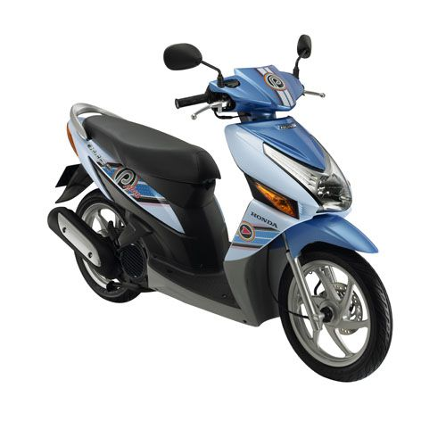

[🏠 Trang chủ](../../README.md) › [Click](../../dong-xe/click.md) › **BO0588**

# BO0588 · Click 2010-2011 Xanh B207P

| | |
|---|---|
| **Mã bộ** | `BO0588` |
| **Tên bộ** | Bộ nhựa (Dàn áo) Click 2010-2011 Xanh B207P |
| **Đời xe** | CLICK Năm 2010-2011 Màu Xanh B207P |
| **Model** | C5 |
| **Dòng xe** | Click |
| **Số chi tiết** | 18 |

## Chi tiết trong bộ

| STT | Mã chi tiết | Tên chi tiết | Dùng chung | Mã thay thế | Ghi chú |
|---:|---|---|:---:|---|---|
| 1 | [`53206KVB950ZA`](../../tra-ma/5320.md#53206kvb950za) | Nắp tay lái sau \*NH1\* |  |  |  |
| 2 | [`53210KVB760ZB`](../../tra-ma/5321.md#53210kvb760zb) | Bộ nắp tay lái trước \*B207P\* |  |  |  |
| 3 | [`61100KVB950ZB`](../../tra-ma/611.md#61100kvb950zb) | Chắn bùn trước \*B194P\* |  |  |  |
| 4 | [`64300KVB760ZB`](../../tra-ma/6430.md#64300kvb760zb) | Bộ ốp trước \*B207P\* |  |  |  |
| 5 | [`64305KVB900ZB`](../../tra-ma/6430.md#64305kvb900zb) | ốp sàn phải \*NH187R\* |  |  |  |
| 6 | [`64306KVB900ZB`](../../tra-ma/6430.md#64306kvb900zb) | ốp sàn trái \*NH187R\* |  |  |  |
| 7 | [`64308KVB900ZB`](../../tra-ma/6430.md#64308kvb900zb) | ốp dưới \*NH187R\* |  |  |  |
| 8 | [`64310KVBN70ZA`](../../tra-ma/6431.md#64310kvbn70za) | ốp sàn \*NH1\* |  |  |  |
| 9 | [`64320KVBV00ZD`](../../tra-ma/6432.md#64320kvbv00zd) | Bộ mặt nạ trước \*B194P\* |  |  |  |
| 10 | [`80110KVB930ZA`](../../tra-ma/8011.md#80110kvb930za) | Bộ đuôi chắn bùn sau \*TYPE1\* |  | [`80105KVB930`](../../tra-ma/8010.md#80105kvb930) |  |
| 11 | [`80151KVB900ZA`](../../tra-ma/8015.md#80151kvb900za) | ốp thân giữa \*NH1\* |  |  |  |
| 12 | [`81131KVB951ZA`](../../tra-ma/8113.md#81131kvb951za) | ốp yếm \*NH1\* |  |  |  |
| 13 | [`83450KVB760ZB`](../../tra-ma/834.md#83450kvb760zb) | Bộ ốp sườn phải \*B207P\* |  |  |  |
| 14 | [`83520KVB900ZA`](../../tra-ma/8352.md#83520kvb900za) | ốp sườn cạnh phải \*NH1\* |  |  |  |
| 15 | [`83550KVB760ZB`](../../tra-ma/8355.md#83550kvb760zb) | Bộ ốp sườn trái \*B207P\* |  |  |  |
| 16 | [`83620KVB900ZA`](../../tra-ma/8362.md#83620kvb900za) | ốp sườn cạnh trái \*NH1\* |  |  |  |
| 17 | [`83750KVB950ZN`](../../tra-ma/837.md#83750kvb950zn) | ốp giữa đuôi sau \*B207P\* |  |  |  |
| 18 | [`83751KVB950ZN`](../../tra-ma/837.md#83751kvb950zn) | ốp giữa đuôi sau dưới \*B207P\* |  |  |  |

Cập nhật 11/11/2026
