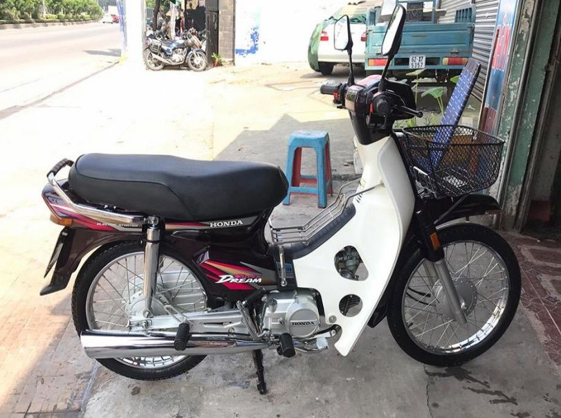

[🏠 Trang chủ](../../README.md) › [Dream](../../dong-xe/dream.md) › **BO0561**

# BO0561 · DREAM 1997

| | |
|---|---|
| **Mã bộ** | `BO0561` |
| **Tên bộ** | Bộ nhựa (Dàn áo) DREAM 1997 |
| **Đời xe** | GBGT-Super Dream |
| **Model** | D |
| **Dòng xe** | Dream |
| **Số chi tiết** | 18 |

## Chi tiết trong bộ

| STT | Mã chi tiết | Tên chi tiết | Dùng chung | Mã thay thế | Ghi chú |
|---:|---|---|:---:|---|---|
| 1 | [`33741GBGB40`](../../tra-ma/337.md#33741gbgb40) | Tấm phản quang phải |  |  |  |
| 2 | [`33742GBGB40`](../../tra-ma/337.md#33742gbgb40) | Tấm phản quang trái |  |  |  |
| 3 | [`53104GN5900ZM`](../../tra-ma/531.md#53104gn5900zm) | Nắp trên tay lái \*R150CU\* |  |  |  |
| 4 | [`53105GN5940ZA`](../../tra-ma/531.md#53105gn5940za) | Nắp dưới tay lái \*R150CU\* |  |  |  |
| 5 | [`61100KVV900ZC`](../../tra-ma/611.md#61100kvv900zc) | Chắn bùn trước \*R150CU\* |  |  |  |
| 6 | [`61150GN5890ZB`](../../tra-ma/611.md#61150gn5890zb) | Ốp giảm xóc trước phải \*R150CU\* |  |  |  |
| 7 | [`61160GN5890ZB`](../../tra-ma/611.md#61160gn5890zb) | Ốp giảm xóc trước trái \*R150CU |  |  |  |
| 8 | [`64301GBGB20ZB`](../../tra-ma/6430.md#64301gbgb20zb) | Yếm xe \*NH138\* |  |  |  |
| 9 | [`64310GBGB20ZC`](../../tra-ma/6431.md#64310gbgb20zc) | Mặt nạ trước \*R150CU\* |  |  |  |
| 10 | [`87101GBGB20`](../../tra-ma/871.md#87101gbgb20) | Biểu tượng mặt nạ trước |  |  |  |
| 11 | [`80100GN5900ABZM`](../../tra-ma/8010.md#80100gn5900abzm) | Chắn bùn sau \*R150CU\* |  |  |  |
| 12 | [`80110GN5900`](../../tra-ma/8011.md#80110gn5900) | Chắn bùn đuôi sau |  |  |  |
| 13 | [`83500GN5910ZJ`](../../tra-ma/8350.md#83500gn5910zj) | Cốp phải \*R150CU\* |  |  |  |
| 14 | [`83600GN5900ZK`](../../tra-ma/8360.md#83600gn5900zk) | Cốp trái \*R150CU\* |  |  |  |
| 15 | [`87121GN5900`](../../tra-ma/871.md#87121gn5900) | Ốp nhựa sườn phải |  |  |  |
| 16 | [`87122GN5900`](../../tra-ma/871.md#87122gn5900) | Ốp nhựa sườn trái |  |  |  |
| 17 | [`33414GN5901`](../../tra-ma/334.md#33414gn5901) | ốp nắp xi nhan trước phải |  |  |  |
| 18 | [`33464GS4000`](../../tra-ma/334.md#33464gs4000) | Ốp nắp xi nhan trước trái |  |  |  |

Cập nhật 11/11/2026
