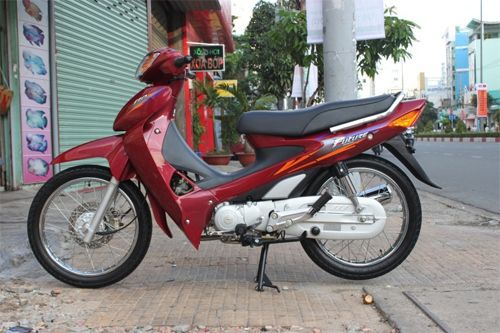

[🏠 Trang chủ](../../README.md) › [Future](../../dong-xe/future.md) › **BO0444**

# BO0444 · Future 1 2001 Đỏ Sẫm R203

| | |
|---|---|
| **Mã bộ** | `BO0444` |
| **Tên bộ** | Bộ nhựa (Dàn áo) Future 1 2001 Đỏ Sẫm R203 |
| **Đời xe** | Future I năm 1999-2001 Màu Đỏ Sẫm R203 |
| **Model** | E,G |
| **Dòng xe** | Future |
| **Số chi tiết** | 19 |

## Chi tiết trong bộ

| STT | Mã chi tiết | Tên chi tiết | Dùng chung | Mã thay thế | Ghi chú |
|---:|---|---|:---:|---|---|
| 1 | [`53205KFL890ZF`](../../tra-ma/5320.md#53205kfl890zf) | Nắp trước tay lái \*R203M\* |  |  |  |
| 2 | [`53206KFL890ZF`](../../tra-ma/5320.md#53206kfl890zf) | Nắp sau tay lái \*R203M\* |  |  |  |
| 3 | [`61100KFL890ZF`](../../tra-ma/611.md#61100kfl890zf) | Chắn bùn trước \*R203M\* |  |  |  |
| 4 | [`61200KFL890ZF`](../../tra-ma/612.md#61200kfl890zf) | ốp giảm xóc trước phải \*R203M\* |  |  |  |
| 5 | [`61400KFL890ZF`](../../tra-ma/614.md#61400kfl890zf) | ốp giảm xóc trước trái \*R203M\* |  |  |  |
| 6 | [`64300KFL830ZE`](../../tra-ma/6430.md#64300kfl830ze) | Bộ mặt nạ trước \*R203M\* |  |  |  |
| 7 | [`64320KFL710ZA`](../../tra-ma/6432.md#64320kfl710za) | Ốp ống yếm chính \*NH158R\* | ✔ | [`64320KFL890ZA`](../../tra-ma/6432.md#64320kfl890za) |  |
| 8 | [`64350KFL890ZA`](../../tra-ma/6435.md#64350kfl890za) | ốp giữa yếm | ✔ |  |  |
| 9 | [`64400KFL890ZF`](../../tra-ma/6440.md#64400kfl890zf) | ốp ống yếm chính \*R203M\* |  |  |  |
| 10 | [`64430KFL890ZF`](../../tra-ma/6443.md#64430kfl890zf) | Cánh yếm phải \*R203M\* |  |  |  |
| 11 | [`64440KFL890ZF`](../../tra-ma/6444.md#64440kfl890zf) | Cánh yếm trái \*R203M\* |  |  |  |
| 12 | [`64600KFL830ZE`](../../tra-ma/6460.md#64600kfl830ze) | Bộ ốp sườn phải \*R203M\* |  |  |  |
| 13 | [`64650KFL830ZE`](../../tra-ma/6465.md#64650kfl830ze) | Bộ ốp sườn trái \*R203M\* |  |  |  |
| 14 | [`80100KFL890`](../../tra-ma/8010.md#80100kfl890) | Chắn bùn sau | ✔ |  |  |
| 15 | [`83400KFL890ZE`](../../tra-ma/834.md#83400kfl890ze) | Bộ cốp phải \*R203\* |  |  |  |
| 16 | [`83450KFL890ZE`](../../tra-ma/834.md#83450kfl890ze) | Bộ cốp trái \*R203M\* |  |  |  |
| 17 | [`83550KFL890ZA`](../../tra-ma/8355.md#83550kfl890za) | ốp cốp phải \*NH146M\* | ✔ |  |  |
| 18 | [`83650KFL890ZA`](../../tra-ma/8365.md#83650kfl890za) | ốp cốp trái \*NH146M\* | ✔ |  |  |
| 19 | [`83700KFL830ZE`](../../tra-ma/837.md#83700kfl830ze) | Bộ ốp đuôi sau \*R203M\* |  |  |  |

Cập nhật 11/11/2026
