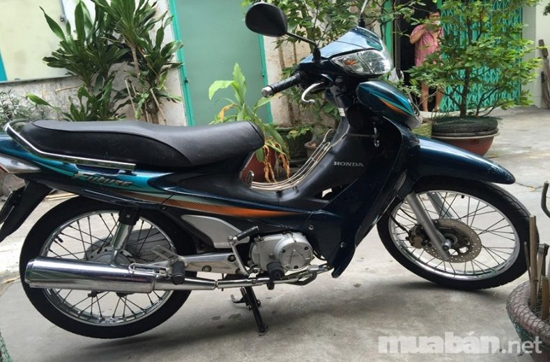

[🏠 Trang chủ](../../README.md) › [Future](../../dong-xe/future.md) › **BO0446**

# BO0446 · Future 1 2003 Xanh Lục B142P

| | |
|---|---|
| **Mã bộ** | `BO0446` |
| **Tên bộ** | Bộ nhựa (Dàn áo) Future 1 2003 Xanh Lục B142P |
| **Đời xe** | Future I năm 2003 Màu Xanh Lục B-142P |
| **Model** | K |
| **Dòng xe** | Future |
| **Số chi tiết** | 19 |

## Chi tiết trong bộ

| STT | Mã chi tiết | Tên chi tiết | Dùng chung | Mã thay thế | Ghi chú |
|---:|---|---|:---:|---|---|
| 1 | [`53205KFL890ZG`](../../tra-ma/5320.md#53205kfl890zg) | Nắp trước tay lái \*B142P\* |  |  |  |
| 2 | [`53206KFL890ZG`](../../tra-ma/5320.md#53206kfl890zg) | Nắp sau tay lái \*B142P\* |  |  |  |
| 3 | [`61100KFL890ZG`](../../tra-ma/611.md#61100kfl890zg) | Chắn bùn trước \*B142P\* |  |  |  |
| 4 | [`61200KFL890ZG`](../../tra-ma/612.md#61200kfl890zg) | ốp giảm xóc trước phải \*B142P\* |  |  |  |
| 5 | [`61400KFL890ZG`](../../tra-ma/614.md#61400kfl890zg) | ốp giảm xóc trước trái \*B142P\* |  |  |  |
| 6 | [`64300KFL710ZB`](../../tra-ma/6430.md#64300kfl710zb) | Bộ mặt nạ trước \*B142P\* |  |  |  |
| 7 | [`64320KFL710ZA`](../../tra-ma/6432.md#64320kfl710za) | Ốp ống yếm chính \*NH158R\* | ✔ | [`64320KFL890ZA`](../../tra-ma/6432.md#64320kfl890za) |  |
| 8 | [`64350KFL890ZA`](../../tra-ma/6435.md#64350kfl890za) | ốp giữa yếm | ✔ |  |  |
| 9 | [`64400KFL890ZG`](../../tra-ma/6440.md#64400kfl890zg) | ốp ống yếm chính \*B142P\* |  |  |  |
| 10 | [`64430KFL890ZG`](../../tra-ma/6443.md#64430kfl890zg) | Cánh yếm phải \*B142P\* |  |  |  |
| 11 | [`64440KFL890ZG`](../../tra-ma/6444.md#64440kfl890zg) | Cánh yếm trái \*B142P\* |  |  |  |
| 12 | [`64600KFL710ZB`](../../tra-ma/6460.md#64600kfl710zb) | Bộ ốp sườn phải \*B142P\* |  |  |  |
| 13 | [`64650KFL710ZB`](../../tra-ma/6465.md#64650kfl710zb) | Bộ ốp sườn trái b142 |  |  |  |
| 14 | [`80100KFL890`](../../tra-ma/8010.md#80100kfl890) | Chắn bùn sau | ✔ |  |  |
| 15 | [`83400KFL710ZB`](../../tra-ma/834.md#83400kfl710zb) | Bộ cốp phải b142 |  |  |  |
| 16 | [`83450KFL710ZB`](../../tra-ma/834.md#83450kfl710zb) | Bộ cốp trái \*B142P\* |  |  |  |
| 17 | [`83550KFL890ZA`](../../tra-ma/8355.md#83550kfl890za) | ốp cốp phải \*NH146M\* | ✔ |  |  |
| 18 | [`83650KFL890ZA`](../../tra-ma/8365.md#83650kfl890za) | ốp cốp trái \*NH146M\* | ✔ |  |  |
| 19 | [`83700KFL710ZA`](../../tra-ma/837.md#83700kfl710za) | Bộ ốp đuôi sau \*B142P\* |  |  |  |

Cập nhật 11/11/2026
