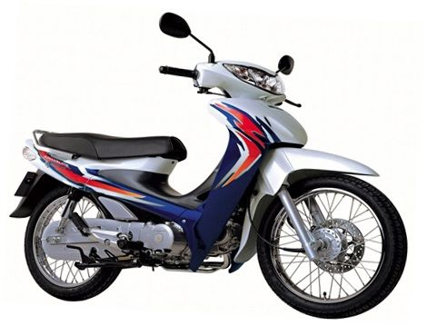

[🏠 Trang chủ](../../README.md) › [Future](../../dong-xe/future.md) › **BO0449**

# BO0449 · Future 1 2004 xanh trắng đen NH193

| | |
|---|---|
| **Mã bộ** | `BO0449` |
| **Tên bộ** | Bộ nhựa (Dàn áo) Future 1 2004 xanh trắng đen NH193 |
| **Đời xe** | Future I năm 2004 Màu Xanh Trắng đen NH-193 |
| **Model** | N |
| **Dòng xe** | Future |
| **Số chi tiết** | 19 |

## Chi tiết trong bộ

| STT | Mã chi tiết | Tên chi tiết | Dùng chung | Mã thay thế | Ghi chú |
|---:|---|---|:---:|---|---|
| 1 | [`53205KFL890ZH`](../../tra-ma/5320.md#53205kfl890zh) | Nắp trước tay lái \*NH193P\* |  |  |  |
| 2 | [`53206KFL890ZD`](../../tra-ma/5320.md#53206kfl890zd) | Nắp sau tay lái \*PB171MU\* |  |  |  |
| 3 | [`61100KFL890ZH`](../../tra-ma/611.md#61100kfl890zh) | Chắn bùn trước \*NH193P\* |  |  |  |
| 4 | [`61200KFL890ZH`](../../tra-ma/612.md#61200kfl890zh) | ốp giảm xóc trước phải \*NH193P |  |  |  |
| 5 | [`61400KFL890ZH`](../../tra-ma/614.md#61400kfl890zh) | ốp giảm xóc trước trái \*NH193P |  |  |  |
| 6 | [`64300KFL720ZA`](../../tra-ma/6430.md#64300kfl720za) | Bộ mặt nạ trước \*NH1\*93 |  |  |  |
| 7 | [`64320KFL710ZA`](../../tra-ma/6432.md#64320kfl710za) | Ốp ống yếm chính \*NH158R\* | ✔ | [`64320KFL890ZA`](../../tra-ma/6432.md#64320kfl890za) |  |
| 8 | [`64350KFL890ZA`](../../tra-ma/6435.md#64350kfl890za) | ốp giữa yếm | ✔ |  |  |
| 9 | [`64400KFL890ZD`](../../tra-ma/6440.md#64400kfl890zd) | ốp ống yếm chính \*PB171MU\* |  |  |  |
| 10 | [`64460KFL720ZA`](../../tra-ma/6446.md#64460kfl720za) | Bộ cánh yếm phải \*NH193P\* |  |  |  |
| 11 | [`64470KFL720ZA`](../../tra-ma/6447.md#64470kfl720za) | Bộ cánh yếm trái \*NH193P\* |  |  |  |
| 12 | [`64600KFL720ZA`](../../tra-ma/6460.md#64600kfl720za) | Bộ ốp sườn phải \*NH193P\* |  |  |  |
| 13 | [`64650KFL720ZA`](../../tra-ma/6465.md#64650kfl720za) | Bộ ốp sườn trái \*NH193P\* |  |  |  |
| 14 | [`80100KFL890`](../../tra-ma/8010.md#80100kfl890) | Chắn bùn sau | ✔ |  |  |
| 15 | [`83400KFL720ZA`](../../tra-ma/834.md#83400kfl720za) | Bộ cốp phải \*NH193P\* |  |  |  |
| 16 | [`83450KFL720ZA`](../../tra-ma/834.md#83450kfl720za) | Bộ cốp trái \*NH193P\* |  |  |  |
| 17 | [`83550KFL890ZA`](../../tra-ma/8355.md#83550kfl890za) | ốp cốp phải \*NH146M\* | ✔ |  |  |
| 18 | [`83650KFL890ZA`](../../tra-ma/8365.md#83650kfl890za) | ốp cốp trái \*NH146M\* | ✔ |  |  |
| 19 | [`83700KFL720ZA`](../../tra-ma/837.md#83700kfl720za) | Bộ ốp đuôi sau \*NH193P\* |  |  |  |

Cập nhật 11/11/2026
