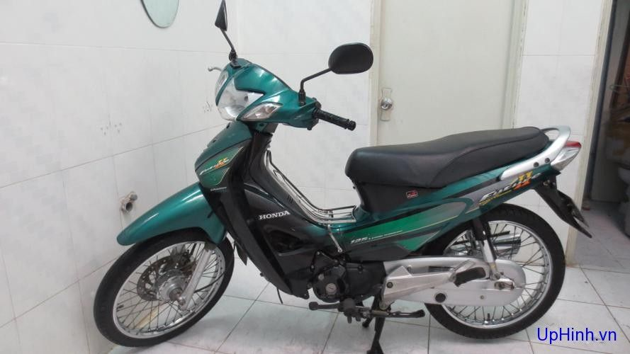

[🏠 Trang chủ](../../README.md) › [Future](../../dong-xe/future.md) › **BO0452**

# BO0452 · Future II 2004 Xanh lục đen BG107M

| | |
|---|---|
| **Mã bộ** | `BO0452` |
| **Tên bộ** | Bộ nhựa (Dàn áo) Future II 2004 Xanh lục đen BG107M |
| **Đời xe** | Future II năm 2004 Màu Xanh lục đen BG-107 |
| **Model** | R |
| **Dòng xe** | Future |
| **Số chi tiết** | 18 |

## Chi tiết trong bộ

| STT | Mã chi tiết | Tên chi tiết | Dùng chung | Mã thay thế | Ghi chú |
|---:|---|---|:---:|---|---|
| 1 | [`53205KPHB31ZN`](../../tra-ma/5320.md#53205kphb31zn) | Nắp trước tay lái \*BG107M\* |  |  |  |
| 2 | [`53206KTM901`](../../tra-ma/5320.md#53206ktm901) | Nắp sau tay lái | ✔ |  |  |
| 3 | [`61100KPH900YB`](../../tra-ma/611.md#61100kph900yb) | Chắn bùn A trước \*BG107M\* |  |  |  |
| 4 | [`61200KPH900`](../../tra-ma/612.md#61200kph900) | Chắn bùn B trước | ✔ |  |  |
| 5 | [`64200KTM900ZG`](../../tra-ma/642.md#64200ktm900zg) | Bộ ốp yếm phải \*BG107M\* |  |  |  |
| 6 | [`64250KTM900ZG`](../../tra-ma/642.md#64250ktm900zg) | Bộ ốp yếm trái BG107 |  |  |  |
| 7 | [`64300KPH690ZH`](../../tra-ma/6430.md#64300kph690zh) | Bộ mặt nạ trước \*BG107M\* |  |  |  |
| 8 | [`64310KPH900ZF`](../../tra-ma/6431.md#64310kph900zf) | Tấm nhựa phía dưới \*NH359M\* |  |  |  |
| 9 | [`64320KTM640`](../../tra-ma/6432.md#64320ktm640) | ốp ống yếm chính | ✔ |  |  |
| 10 | [`64325KPH900YB`](../../tra-ma/6432.md#64325kph900yb) | ốp nhựa trung tâm \*BG107M\* |  |  |  |
| 11 | [`64435KPH900`](../../tra-ma/6443.md#64435kph900) | ốp nhựa phải bắt tấm yếm xe | ✔ |  |  |
| 12 | [`64445KPH900`](../../tra-ma/6444.md#64445kph900) | ốp nhựa trái bắt tấm yếm xe | ✔ |  |  |
| 13 | [`64600KTM900ZC`](../../tra-ma/6460.md#64600ktm900zc) | Bộ ốp sườn phải BG107 |  |  |  |
| 14 | [`64650KTM900ZC`](../../tra-ma/6465.md#64650ktm900zc) | Bộ ốp sườn trái BG107 |  |  |  |
| 15 | [`64700KTM900ZG`](../../tra-ma/647.md#64700ktm900zg) | Bộ cánh yếm phải \*BG107M\* |  |  |  |
| 16 | [`64750KTM900ZG`](../../tra-ma/647.md#64750ktm900zg) | Bộ cánh yếm trái \*BG107M\* |  |  |  |
| 17 | [`80100KPH900`](../../tra-ma/8010.md#80100kph900) | Chắn bùn sau | ✔ |  |  |
| 18 | [`83510KPH900YG`](../../tra-ma/8351.md#83510kph900yg) | ốp đuôi sau \*BG107M\* |  |  |  |

Cập nhật 11/11/2026
