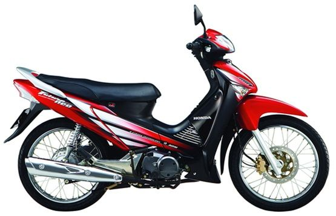

[🏠 Trang chủ](../../README.md) › [Future](../../dong-xe/future.md) › **BO0455**

# BO0455 · Funeo 2005 KTM Đỏ đen R313c

| | |
|---|---|
| **Mã bộ** | `BO0455` |
| **Tên bộ** | Bộ nhựa (Dàn áo) Funeo 2005 KTM Đỏ đen R313c |
| **Đời xe** | Future neo năm 2005 Màu Đỏ đen R313c |
| **Model** | U |
| **Dòng xe** | Future |
| **Số chi tiết** | 26 |

## Chi tiết trong bộ

| STT | Mã chi tiết | Tên chi tiết | Dùng chung | Mã thay thế | Ghi chú |
|---:|---|---|:---:|---|---|
| 1 | [`53205KTM950ZR`](../../tra-ma/5320.md#53205ktm950zr) | Nắp trước tay lái \*R313C\* |  |  |  |
| 2 | [`53206KTM970`](../../tra-ma/5320.md#53206ktm970) | Nắp sau tay lái | ✔ |  |  |
| 3 | [`53270KTM970ZA`](../../tra-ma/5327.md#53270ktm970za) | Bộ ốp đồng hồ tốc độ \*NH411M\* | ✔ | [`53270KVL900ZA`](../../tra-ma/5327.md#53270kvl900za) |  |
| 4 | [`61100KTM970ZD`](../../tra-ma/611.md#61100ktm970zd) | Chắn bùn A trước \*R313C\* |  |  |  |
| 5 | [`61200KTM970`](../../tra-ma/612.md#61200ktm970) | Chắn bùn B trước | ✔ |  |  |
| 6 | [`64200KTM970ZA`](../../tra-ma/642.md#64200ktm970za) | Bộ ốp yếm phải \*R313C\* |  |  |  |
| 7 | [`64250KTM970ZA`](../../tra-ma/642.md#64250ktm970za) | Bộ ốp yếm trái \*R313C\* |  | [`64250KVLV00ZA`](../../tra-ma/642.md#64250kvlv00za) |  |
| 8 | [`64300KTM970ZA`](../../tra-ma/6430.md#64300ktm970za) | Bộ mặt nạ trước NHA76M | ✔ |  |  |
| 9 | [`64310KPH700ZU`](../../tra-ma/6431.md#64310kph700zu) | Tấm ốp động cơ \*NHA69P\* | ✔ |  |  |
| 10 | [`64320KPH700`](../../tra-ma/6432.md#64320kph700) | ốp ống yếm chính | ✔ | [`64320KVL930ZA`](../../tra-ma/6432.md#64320kvl930za) |  |
| 11 | [`64325KPH700`](../../tra-ma/6432.md#64325kph700) | ốp nhựa trung tâm | ✔ | [`64320KPH700`](../../tra-ma/6432.md#64320kph700) |  |
| 12 | [`64340KPH700`](../../tra-ma/6434.md#64340kph700) | Bộ ốp thân trước(Trung tâm) | ✔ |  |  |
| 13 | [`64405KPH700ZD`](../../tra-ma/6440.md#64405kph700zd) | Tấm thông gió yếm phải \*NH411M | ✔ |  |  |
| 14 | [`64435KPH700`](../../tra-ma/6443.md#64435kph700) | ốp trong yếm bên phải | ✔ |  |  |
| 15 | [`64445KPH700`](../../tra-ma/6444.md#64445kph700) | ốp trong yếm bên trái | ✔ |  |  |
| 16 | [`64455KPH700ZD`](../../tra-ma/6445.md#64455kph700zd) | Tấm thông gió yếm trái \*NH411M | ✔ |  |  |
| 17 | [`64500KTM970ZD`](../../tra-ma/645.md#64500ktm970zd) | Mặt nạ trước \*R313C\* |  | [`64500KTM970ZH`](../../tra-ma/645.md#64500ktm970zh) |  |
| 18 | [`64520KTM970ZA`](../../tra-ma/645.md#64520ktm970za) | Tấm thông gió mặt nạ trước \*NH | ✔ |  |  |
| 19 | [`64600KTM970ZA`](../../tra-ma/6460.md#64600ktm970za) | Bộ ốp sườn phải \*R313C\* |  |  |  |
| 20 | [`64650KTM970ZA`](../../tra-ma/6465.md#64650ktm970za) | Bộ ốp sườn trái \*R313C\* |  |  |  |
| 21 | [`64700KTM970ZA`](../../tra-ma/647.md#64700ktm970za) | Bộ cánh yếm phải \*R313C\* |  |  |  |
| 22 | [`64750KTM970ZA`](../../tra-ma/647.md#64750ktm970za) | Bộ cánh yếm trái \*R313C\* |  |  |  |
| 23 | [`64800KTM970ZA`](../../tra-ma/648.md#64800ktm970za) | Bộ cốp bên phải \*R313C\* |  |  |  |
| 24 | [`64850KTM970ZA`](../../tra-ma/648.md#64850ktm970za) | Bộ cốp bên trái \*R313C\* |  |  |  |
| 25 | [`80100KPH700`](../../tra-ma/8010.md#80100kph700) | Chắn bùn sau | ✔ |  |  |
| 26 | [`83600KTM970ZA`](../../tra-ma/8360.md#83600ktm970za) | Bộ ốp đuôi sau \*R313C\* |  | [`83600KVLV00ZF`](../../tra-ma/8360.md#83600kvlv00zf) |  |

Cập nhật 11/11/2026
