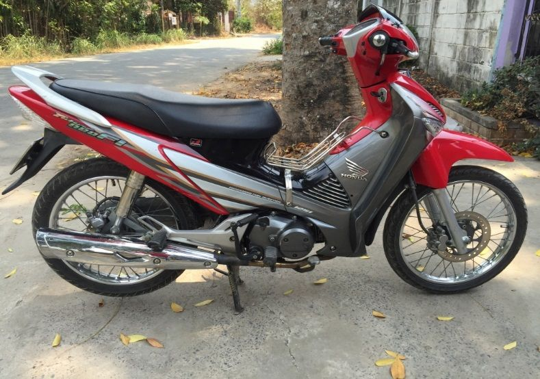

[🏠 Trang chủ](../../README.md) › [Future](../../dong-xe/future.md) › **BO0474**

# BO0474 · Funeo FI 2007 KVL Đỏ R315P

| | |
|---|---|
| **Mã bộ** | `BO0474` |
| **Tên bộ** | Bộ nhựa (Dàn áo) Funeo FI 2007 KVL Đỏ R315P |
| **Đời xe** | Future neo FI năm 2006 Màu Đỏ R315P |
| **Model** | U3 |
| **Dòng xe** | Future |
| **Số chi tiết** | 27 |

## Chi tiết trong bộ

| STT | Mã chi tiết | Tên chi tiết | Dùng chung | Mã thay thế | Ghi chú |
|---:|---|---|:---:|---|---|
| 1 | [`53205KTM980ZC`](../../tra-ma/5320.md#53205ktm980zc) | Nắp trước tay lái \*R315P\* |  |  |  |
| 2 | [`53206KVL930ZC`](../../tra-ma/5320.md#53206kvl930zc) | Nắp sau tay lái \*R315P\* |  |  |  |
| 3 | [`53270KTM970ZA`](../../tra-ma/5327.md#53270ktm970za) | Bộ ốp đồng hồ tốc độ \*NH411M\* | ✔ | [`53270KVL900ZA`](../../tra-ma/5327.md#53270kvl900za) |  |
| 4 | [`61100KTM970ZH`](../../tra-ma/611.md#61100ktm970zh) | Chắn bùn A trước \*R315P\* |  |  |  |
| 5 | [`61200KTM970`](../../tra-ma/612.md#61200ktm970) | Chắn bùn B trước | ✔ |  |  |
| 6 | [`64110KTM980`](../../tra-ma/641.md#64110ktm980) | Bộ tấm chắn đồng hồ |  |  |  |
| 7 | [`64200KVL940ZA`](../../tra-ma/642.md#64200kvl940za) | Bộ ốp ống yếm phải \*R315P\* |  |  |  |
| 8 | [`64250KVL940ZA`](../../tra-ma/642.md#64250kvl940za) | Bộ ốp ống yếm trái \*R315P\* | ✔ |  |  |
| 9 | [`64300KVL940`](../../tra-ma/6430.md#64300kvl940) | Mặt nạ trước (mạ crom) | ✔ |  |  |
| 10 | [`64310KPH700ZV`](../../tra-ma/6431.md#64310kph700zv) | Tấm ốpđộng cơ \*NHA62M\* |  |  |  |
| 11 | [`64320KVL930ZB`](../../tra-ma/6432.md#64320kvl930zb) | ốp trên ống chính \*R315P\* |  |  |  |
| 12 | [`64325KVL930ZA`](../../tra-ma/6432.md#64325kvl930za) | ốp nhựa trung tâm \*NHA69P\* |  | [`64320KVL930ZA`](../../tra-ma/6432.md#64320kvl930za) |  |
| 13 | [`64340KVL930ZA`](../../tra-ma/6434.md#64340kvl930za) | Bộ ốp thân trước \*NHA69P\* |  | [`64340KPH700`](../../tra-ma/6434.md#64340kph700) |  |
| 14 | [`64405KVL930`](../../tra-ma/6440.md#64405kvl930) | Tấm thông gió phải \*NH411M\* | ✔ |  |  |
| 15 | [`64435KPH700`](../../tra-ma/6443.md#64435kph700) | ốp trong yếm bên phải | ✔ |  |  |
| 16 | [`64445KPH700`](../../tra-ma/6444.md#64445kph700) | ốp trong yếm bên trái | ✔ |  |  |
| 17 | [`64455KVL930`](../../tra-ma/6445.md#64455kvl930) | Tấm thông gió trái \*NH411M\* | ✔ |  |  |
| 18 | [`64500KTM970ZH`](../../tra-ma/645.md#64500ktm970zh) | Mặt nạ trước \*R315P\* |  |  |  |
| 19 | [`64520KVL930`](../../tra-ma/645.md#64520kvl930) | Tấm thông gió phía trước \*NH41 | ✔ |  |  |
| 20 | [`64600KVL940ZA`](../../tra-ma/6460.md#64600kvl940za) | Bộ ốp sườn phải \*R315P\* |  |  |  |
| 21 | [`64650KVL940ZA`](../../tra-ma/6465.md#64650kvl940za) | Bộ ốp sườn trái \*R315P\* |  |  |  |
| 22 | [`64700KVL940ZC`](../../tra-ma/647.md#64700kvl940zc) | Bộ cánh yếm phải \*R315P\* |  |  |  |
| 23 | [`64750KVL940ZC`](../../tra-ma/647.md#64750kvl940zc) | Bộ cánh yếm trái \*R315P\* |  |  |  |
| 24 | [`64800KVL940ZA`](../../tra-ma/648.md#64800kvl940za) | Bộ ốp bên phải \*R315P-NHA69P\* |  |  |  |
| 25 | [`64850KVL940ZA`](../../tra-ma/648.md#64850kvl940za) | Bộ cốp trái \*R315P\*,\*NHA69P\* |  |  |  |
| 26 | [`80100KPH700`](../../tra-ma/8010.md#80100kph700) | Chắn bùn sau | ✔ |  |  |
| 27 | [`83600KVLV00ZH`](../../tra-ma/8360.md#83600kvlv00zh) | Bộ ốp đuôi sau \*R315P\* |  |  |  |

Cập nhật 11/11/2026
