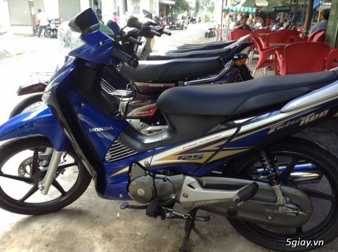

[🏠 Trang chủ](../../README.md) › [Future](../../dong-xe/future.md) › **BO0489**

# BO0489 · Funeo 2008 KYL có mào Xanh đen bạc B206

| | |
|---|---|
| **Mã bộ** | `BO0489` |
| **Tên bộ** | Bộ nhựa (Dàn áo) Funeo 2008 KYL có mào Xanh đen bạc B206 |
| **Đời xe** | Future neo năm 2008 Màu Xanh đen bạc B206 |
| **Model** | U8 |
| **Dòng xe** | Future |
| **Số chi tiết** | 27 |

## Chi tiết trong bộ

| STT | Mã chi tiết | Tên chi tiết | Dùng chung | Mã thay thế | Ghi chú |
|---:|---|---|:---:|---|---|
| 1 | [`53205KTM980ZH`](../../tra-ma/5320.md#53205ktm980zh) | Nắp trước tay lái \*B206M\* |  |  |  |
| 2 | [`53206KTM970`](../../tra-ma/5320.md#53206ktm970) | Nắp sau tay lái | ✔ |  |  |
| 3 | [`53270KPH701ZA`](../../tra-ma/5327.md#53270kph701za) | Bộ ốp đồng hồ tốc độ \*NH411M\* | ✔ | [`53270KVL900ZA`](../../tra-ma/5327.md#53270kvl900za) |  |
| 4 | [`61100KTM970ZQ`](../../tra-ma/611.md#61100ktm970zq) | Chắn bùn A trước \*B206M\* |  |  |  |
| 5 | [`61200KTM970`](../../tra-ma/612.md#61200ktm970) | Chắn bùn B trước | ✔ |  |  |
| 6 | [`64110KTM980`](../../tra-ma/641.md#64110ktm980) | Bộ tấm chắn đồng hồ | ✔ |  |  |
| 7 | [`64200KYL920ZD`](../../tra-ma/642.md#64200kyl920zd) | Bộ ốp yếm phải \*B206M\* |  |  |  |
| 8 | [`64250KYL920ZD`](../../tra-ma/642.md#64250kyl920zd) | Bộ ốp yếm trái \*B206M\* |  |  |  |
| 9 | [`64300KYL900`](../../tra-ma/6430.md#64300kyl900) | Bộ mặt nạ trước trên | ✔ |  |  |
| 10 | [`64310KPH700YC`](../../tra-ma/6431.md#64310kph700yc) | Tấm ốp động cơ \*B206M\* |  |  |  |
| 11 | [`64320KPH700`](../../tra-ma/6432.md#64320kph700) | ốp ống yếm chính | ✔ | [`64320KVL930ZA`](../../tra-ma/6432.md#64320kvl930za) |  |
| 12 | [`64325KPH700`](../../tra-ma/6432.md#64325kph700) | ốp nhựa trung tâm | ✔ | [`64320KPH700`](../../tra-ma/6432.md#64320kph700) |  |
| 13 | [`64340KPH700`](../../tra-ma/6434.md#64340kph700) | Bộ ốp thân trước(Trung tâm) | ✔ |  |  |
| 14 | [`64405KPH700ZD`](../../tra-ma/6440.md#64405kph700zd) | Tấm thông gió yếm phải \*NH411M | ✔ |  |  |
| 15 | [`64435KPH700`](../../tra-ma/6443.md#64435kph700) | ốp trong yếm bên phải | ✔ |  |  |
| 16 | [`64445KPH700`](../../tra-ma/6444.md#64445kph700) | ốp trong yếm bên trái | ✔ |  |  |
| 17 | [`64455KPH700ZD`](../../tra-ma/6445.md#64455kph700zd) | Tấm thông gió yếm trái \*NH411M | ✔ |  |  |
| 18 | [`64500KTM970ZM`](../../tra-ma/645.md#64500ktm970zm) | Mặt nạ trước \*B206M\* |  |  |  |
| 19 | [`64520KTM970ZA`](../../tra-ma/645.md#64520ktm970za) | Tấm thông gió mặt nạ trước \*NH | ✔ |  |  |
| 20 | [`64600KYL920ZD`](../../tra-ma/6460.md#64600kyl920zd) | Bộ ốp sườn phải \*B206M\* |  |  |  |
| 21 | [`64650KYL920ZD`](../../tra-ma/6465.md#64650kyl920zd) | Bộ ốp sườn trái \*B206M\* |  |  |  |
| 22 | [`64700KYL920ZD`](../../tra-ma/647.md#64700kyl920zd) | Bộ cánh yếm phải \*B206M\* |  |  |  |
| 23 | [`64750KYL920ZD`](../../tra-ma/647.md#64750kyl920zd) | Bộ cánh yếm trái \*B206M\* |  |  |  |
| 24 | [`64800KYL920ZD`](../../tra-ma/648.md#64800kyl920zd) | Bộ ốp cốp phải \*B206M\* |  |  |  |
| 25 | [`64850KYL920ZD`](../../tra-ma/648.md#64850kyl920zd) | Bộ ốp cốp trái \*B206M\* |  |  |  |
| 26 | [`80100KPH700`](../../tra-ma/8010.md#80100kph700) | Chắn bùn sau | ✔ |  |  |
| 27 | [`83600KVL900ZQ`](../../tra-ma/8360.md#83600kvl900zq) | Bộ ốp đuôi sau \*B206M\* |  |  |  |

Cập nhật 11/11/2026
