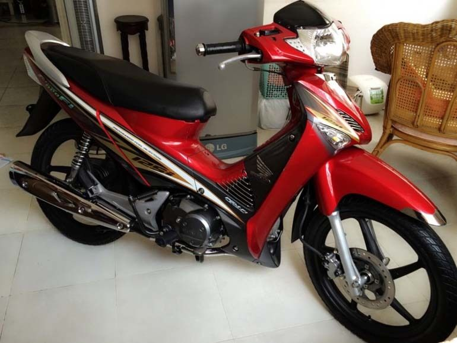

[🏠 Trang chủ](../../README.md) › [Future](../../dong-xe/future.md) › **BO0495**

# BO0495 · Funeo FI 2008 KYL Đỏ Xám 313T

| | |
|---|---|
| **Mã bộ** | `BO0495` |
| **Tên bộ** | Bộ nhựa (Dàn áo) Funeo FI 2008 KYL Đỏ Xám 313T |
| **Đời xe** | Future neo năm 2008 Màu Đỏ Xám 313T |
| **Model** | X1,X2 |
| **Dòng xe** | Future |
| **Số chi tiết** | 27 |

## Chi tiết trong bộ

| STT | Mã chi tiết | Tên chi tiết | Dùng chung | Mã thay thế | Ghi chú |
|---:|---|---|:---:|---|---|
| 1 | [`53205KTM980ZG`](../../tra-ma/5320.md#53205ktm980zg) | Nắp trước tay lái \*R313C\* |  |  |  |
| 2 | [`53206KVL930ZD`](../../tra-ma/5320.md#53206kvl930zd) | Nắp sau tay lái \*R313C\* | ✔ |  |  |
| 3 | [`53270KPH701ZA`](../../tra-ma/5327.md#53270kph701za) | Bộ ốp đồng hồ tốc độ \*NH411M\* | ✔ | [`53270KVL900ZA`](../../tra-ma/5327.md#53270kvl900za) |  |
| 4 | [`61100KTM970ZD`](../../tra-ma/611.md#61100ktm970zd) | Chắn bùn A trước \*R313C\* |  |  |  |
| 5 | [`61200KTM970`](../../tra-ma/612.md#61200ktm970) | Chắn bùn B trước | ✔ |  |  |
| 6 | [`64110KTM980`](../../tra-ma/641.md#64110ktm980) | Bộ tấm chắn đồng hồ | ✔ |  |  |
| 7 | [`64200KYL900ZD`](../../tra-ma/642.md#64200kyl900zd) | Bộ ốp yếm phải \*R313C\* |  |  |  |
| 8 | [`64250KYL900ZD`](../../tra-ma/642.md#64250kyl900zd) | Bộ ốp yếm trái \*R313C\* |  |  |  |
| 9 | [`64300KYL900`](../../tra-ma/6430.md#64300kyl900) | Bộ mặt nạ trước trên | ✔ |  |  |
| 10 | [`64310KPH700ZV`](../../tra-ma/6431.md#64310kph700zv) | Tấm ốpđộng cơ \*NHA62M\* |  |  |  |
| 11 | [`64320KVL930ZD`](../../tra-ma/6432.md#64320kvl930zd) | ốp trên ống chính \*R313C\* |  |  |  |
| 12 | [`64325KVL930ZC`](../../tra-ma/6432.md#64325kvl930zc) | ốp nhựa trung tâm \*R313C\* |  |  |  |
| 13 | [`64340KYL900ZC`](../../tra-ma/6434.md#64340kyl900zc) | Bộ ốp thân trước \*R313C\* |  | [`64350KVL930ZC`](../../tra-ma/6435.md#64350kvl930zc) |  |
| 14 | [`64405KVL930`](../../tra-ma/6440.md#64405kvl930) | Tấm thông gió phải \*NH411M\* | ✔ |  |  |
| 15 | [`64435KPH700`](../../tra-ma/6443.md#64435kph700) | ốp trong yếm bên phải | ✔ |  |  |
| 16 | [`64445KPH700`](../../tra-ma/6444.md#64445kph700) | ốp trong yếm bên trái | ✔ |  |  |
| 17 | [`64455KVL930`](../../tra-ma/6445.md#64455kvl930) | Tấm thông gió trái \*NH411M\* | ✔ |  |  |
| 18 | [`64500KTM970ZD`](../../tra-ma/645.md#64500ktm970zd) | Mặt nạ trước \*R313C\* |  | [`64500KTM970ZH`](../../tra-ma/645.md#64500ktm970zh) |  |
| 19 | [`64520KVL930`](../../tra-ma/645.md#64520kvl930) | Tấm thông gió phía trước \*NH41 | ✔ |  |  |
| 20 | [`64600KYL900ZB`](../../tra-ma/6460.md#64600kyl900zb) | Bộ ốp sườn phải \*R313C\* |  |  |  |
| 21 | [`64650KYL900ZB`](../../tra-ma/6465.md#64650kyl900zb) | Bộ ốp sườn trái \*R313C\* |  |  |  |
| 22 | [`64700KYL900ZB`](../../tra-ma/647.md#64700kyl900zb) | Bộ cánh yếm phải \*R313C\* |  |  |  |
| 23 | [`64750KYL900ZB`](../../tra-ma/647.md#64750kyl900zb) | Bộ cánh yếm trái \*R313C\* |  |  |  |
| 24 | [`64800KYL900ZA`](../../tra-ma/648.md#64800kyl900za) | Bộ ốp cốp phải s/s |  |  |  |
| 25 | [`64850KYL900ZA`](../../tra-ma/648.md#64850kyl900za) | Bộ ốp cốp trái s/s |  |  |  |
| 26 | [`80100KPH700`](../../tra-ma/8010.md#80100kph700) | Chắn bùn sau | ✔ |  |  |
| 27 | [`83600KVL900ZE`](../../tra-ma/8360.md#83600kvl900ze) | Bộ ốp đuôi sau \*R313C\* |  | [`83600KVLV00ZF`](../../tra-ma/8360.md#83600kvlv00zf) |  |

Cập nhật 11/11/2026
