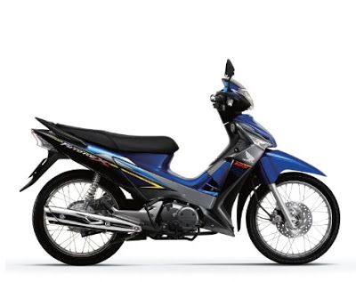

[🏠 Trang chủ](../../README.md) › [Future](../../dong-xe/future.md) › **BO0506**

# BO0506 · Future ko FI 2011 KYL Xanh B206M

| | |
|---|---|
| **Mã bộ** | `BO0506` |
| **Tên bộ** | Bộ nhựa (Dàn áo) Future ko FI 2011 KYL Xanh B206M |
| **Đời xe** | Future X năm 2011 Màu Xanh đậm B206 |
| **Model** | R3,R4 |
| **Dòng xe** | Future |
| **Số chi tiết** | 23 |

## Chi tiết trong bộ

| STT | Mã chi tiết | Tên chi tiết | Dùng chung | Mã thay thế | Ghi chú |
|---:|---|---|:---:|---|---|
| 1 | [`53203KYL840ZD`](../../tra-ma/5320.md#53203kyl840zd) | Nắp trên tay lái phải \*B206M\* |  |  |  |
| 2 | [`53204KYL840ZA`](../../tra-ma/5320.md#53204kyl840za) | Nắp trên tay lái trái \*B206M\* |  |  |  |
| 3 | [`53205KYL840ZB`](../../tra-ma/5320.md#53205kyl840zb) | Nắp trước tay lái \*NHB25M\* | ✔ |  |  |
| 4 | [`53206KYL840`](../../tra-ma/5320.md#53206kyl840) | Nắp sau tay lái | ✔ |  |  |
| 5 | [`53207KTM970ZA`](../../tra-ma/5320.md#53207ktm970za) | Nắp ốp đồng hồ \*NH411M\* | ✔ | [`53270KVL900ZA`](../../tra-ma/5327.md#53270kvl900za) |  |
| 6 | [`61100KVLN00ZQ`](../../tra-ma/611.md#61100kvln00zq) | Chắn bùn A trước \*B206M\* |  |  |  |
| 7 | [`61200KTL640`](../../tra-ma/612.md#61200ktl640) | Chắn bùn B trước | ✔ |  |  |
| 8 | [`64200KYL720ZA`](../../tra-ma/642.md#64200kyl720za) | Bộ ốp yếm phải \*B206M\* |  |  |  |
| 9 | [`64250KYL720ZA`](../../tra-ma/642.md#64250kyl720za) | Bộ ốp yếm trái \*B206M\* |  |  |  |
| 10 | [`64300KYL720ZA`](../../tra-ma/6430.md#64300kyl720za) | Bộ mặt nạ trước \*B206M\* |  | [`64300KYL860ZC`](../../tra-ma/6430.md#64300kyl860zc) |  |
| 11 | [`64325KVL930ZJ`](../../tra-ma/6432.md#64325kvl930zj) | ốp nhựa trung tâm \*B206M\* | ✔ |  |  |
| 12 | [`64330KVLN00`](../../tra-ma/6433.md#64330kvln00) | Bộ ốp ống yếm trên | ✔ | [`64320KPH700`](../../tra-ma/6432.md#64320kph700) |  |
| 13 | [`64340KYL900ZJ`](../../tra-ma/6434.md#64340kyl900zj) | Bộ ốp thân trước \*B206M\* | ✔ |  |  |
| 14 | [`64406KYL840ZE`](../../tra-ma/6440.md#64406kyl840ze) | Tấm thông gió ốp yếm phải \*B20 | ✔ |  |  |
| 15 | [`64430KVLN00`](../../tra-ma/6443.md#64430kvln00) | Cánh yếm phải | ✔ |  |  |
| 16 | [`64440KVLN00`](../../tra-ma/6444.md#64440kvln00) | Cánh yếm trái | ✔ |  |  |
| 17 | [`64456KYL840ZE`](../../tra-ma/6445.md#64456kyl840ze) | Tấm thông gió ốp yếm trái \*B20 | ✔ |  |  |
| 18 | [`64600KYL720ZA`](../../tra-ma/6460.md#64600kyl720za) | Bộ ốp sườn phải \*B206M\* |  |  |  |
| 19 | [`64650KYL720ZA`](../../tra-ma/6465.md#64650kyl720za) | Bộ ốp sườn trái \*B206M\* |  |  |  |
| 20 | [`64800KYL720ZA`](../../tra-ma/648.md#64800kyl720za) | Bộ ốp cốp phải \*B206M\* |  |  |  |
| 21 | [`64850KYL720ZA`](../../tra-ma/648.md#64850kyl720za) | Bộ ốp cốp trái \*B206M\* |  |  |  |
| 22 | [`80100KPH700`](../../tra-ma/8010.md#80100kph700) | Chắn bùn sau | ✔ |  |  |
| 23 | [`83600KYL700ZB`](../../tra-ma/8360.md#83600kyl700zb) | Bộ ốp đuôi sau \*NHA96P-B206M\* |  |  |  |

Cập nhật 11/11/2026
