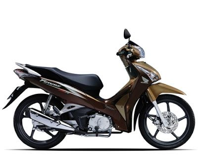

[🏠 Trang chủ](../../README.md) › [Future](../../dong-xe/future.md) › **BO0509**

# BO0509 · Future 125 có FI 2011 KYZ  Nâu YR303

| | |
|---|---|
| **Mã bộ** | `BO0509` |
| **Tên bộ** | Bộ nhựa (Dàn áo) Future 125 có FI 2011 KYZ  Nâu YR303 |
| **Đời xe** | Future 125 năm 2012 Màu Nâu YR303 |
| **Model** | X7,X8 |
| **Dòng xe** | Future |
| **Số chi tiết** | 21 |

## Chi tiết trong bộ

| STT | Mã chi tiết | Tên chi tiết | Dùng chung | Mã thay thế | Ghi chú |
|---:|---|---|:---:|---|---|
| 1 | [`50606KYZ900`](../../tra-ma/506.md#50606kyz900) | Tấm bảo vệ giá để chân sau phả | ✔ |  |  |
| 2 | [`50706KYZ900`](../../tra-ma/507.md#50706kyz900) | Tấm bảo vệ giá để chân sau trá | ✔ |  |  |
| 3 | [`53206KYZV00ZA`](../../tra-ma/5320.md#53206kyzv00za) | Nắp sau tay lái \*Y208M\* |  |  |  |
| 4 | [`53210KYZV20ZA`](../../tra-ma/5321.md#53210kyzv20za) | Bộ nắp trước tay lái \*Y208M\* |  |  |  |
| 5 | [`53280KYZV01ZA`](../../tra-ma/5328.md#53280kyzv01za) | Bộ ốp trên nắp trước tay lái | ✔ |  |  |
| 6 | [`61100KYZ900ZL`](../../tra-ma/611.md#61100kyz900zl) | Chắn bùn trước \*Y208M\* |  |  |  |
| 7 | [`61200KYZ900`](../../tra-ma/612.md#61200kyz900) | Chắn bùn B trước | ✔ |  |  |
| 8 | [`64200KYZV20ZD`](../../tra-ma/642.md#64200kyzv20zd) | Bộ ốp yếm phải \*YR303\* |  |  |  |
| 9 | [`64250KYZV20ZD`](../../tra-ma/642.md#64250kyzv20zd) | Bộ ốp yếm trái \*YR303\* |  |  |  |
| 10 | [`64300KYZV00ZA`](../../tra-ma/6430.md#64300kyzv00za) | Bộ mặt nạ trước \*Y208M\* |  |  |  |
| 11 | [`64320KYZV00`](../../tra-ma/6432.md#64320kyzv00) | ốp trên ống chính trên | ✔ |  |  |
| 12 | [`64325KYZ900ZQ`](../../tra-ma/6432.md#64325kyz900zq) | ốp trên ống chính dưới \*Y208M\* |  |  |  |
| 13 | [`64350KYZ900`](../../tra-ma/6435.md#64350kyz900) | ốp thân trước (Ốp trung tâm) | ✔ |  |  |
| 14 | [`64405KYZV00ZA`](../../tra-ma/6440.md#64405kyzv00za) | Tấm thông gió ốp yếm phải \*Y20 |  |  |  |
| 15 | [`64455KYZV00ZA`](../../tra-ma/6445.md#64455kyzv00za) | Tấm thông gió ốp yếm trái \*Y20 |  |  |  |
| 16 | [`64510KYZ900`](../../tra-ma/645.md#64510kyz900) | Tấm chắn bùn trước bên trong | ✔ |  |  |
| 17 | [`64600KYZV20ZD`](../../tra-ma/6460.md#64600kyzv20zd) | Bộ ốp sườn phải \*YR303\* |  |  |  |
| 18 | [`64650KYZV20ZD`](../../tra-ma/6465.md#64650kyzv20zd) | Bộ ốp sườn trái \*YR303\* |  |  |  |
| 19 | [`80105KYZ900`](../../tra-ma/8010.md#80105kyz900) | Nắp đuôi sau dưới | ✔ |  |  |
| 20 | [`80200KYZV00ZA`](../../tra-ma/802.md#80200kyzv00za) | Bộ chắn bùn sau \*ALL\* | ✔ | [`80100KYZV00`](../../tra-ma/8010.md#80100kyzv00) |  |
| 21 | [`83510KYZ900ZK`](../../tra-ma/8351.md#83510kyz900zk) | ốp đuôi sau \*YR303M\* |  |  |  |

Cập nhật 11/11/2026
