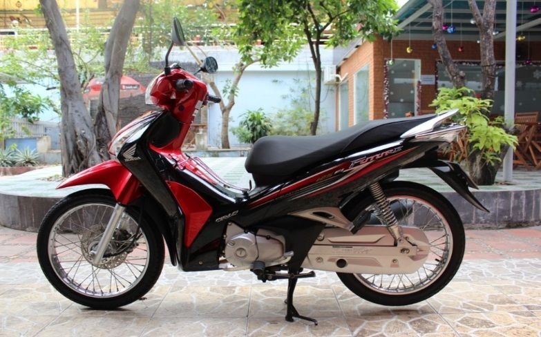

[🏠 Trang chủ](../../README.md) › [Future](../../dong-xe/future.md) › **BO0520**

# BO0520 · Future 125 có FI 2013 KYZ Đen Đỏ NHB25K

| | |
|---|---|
| **Mã bộ** | `BO0520` |
| **Tên bộ** | Bộ nhựa (Dàn áo) Future 125 có FI 2013 KYZ Đen Đỏ NHB25K |
| **Đời xe** | Future 125 năm 2013 Màu Đen Đỏ NHB25K |
| **Model** | X9,F1 |
| **Dòng xe** | Future |
| **Số chi tiết** | 21 |

## Chi tiết trong bộ

| STT | Mã chi tiết | Tên chi tiết | Dùng chung | Mã thay thế | Ghi chú |
|---:|---|---|:---:|---|---|
| 1 | [`50606KYZ900`](../../tra-ma/506.md#50606kyz900) | Tấm bảo vệ giá để chân sau phả | ✔ |  |  |
| 2 | [`50706KYZ900`](../../tra-ma/507.md#50706kyz900) | Tấm bảo vệ giá để chân sau trá | ✔ |  |  |
| 3 | [`53206KYZV00ZF`](../../tra-ma/5320.md#53206kyzv00zf) | Nắp tay lái sau \*R340C\* |  |  |  |
| 4 | [`53210KYZV20ZF`](../../tra-ma/5321.md#53210kyzv20zf) | Bộ nắp trước tay lái \*R340C\* |  |  |  |
| 5 | [`53280KYZV01ZA`](../../tra-ma/5328.md#53280kyzv01za) | Bộ ốp trên nắp trước tay lái | ✔ |  |  |
| 6 | [`61100KYZ900ZV`](../../tra-ma/611.md#61100kyz900zv) | Chắn bùn trước \*R340C\* |  |  |  |
| 7 | [`61200KYZ900`](../../tra-ma/612.md#61200kyz900) | Chắn bùn B trước | ✔ |  |  |
| 8 | [`64200KYZV70ZC`](../../tra-ma/642.md#64200kyzv70zc) | Bộ ốp yếm phải \*NHB25K\* |  |  |  |
| 9 | [`64250KYZV70ZC`](../../tra-ma/642.md#64250kyzv70zc) | Bộ ốp yếm trái \*NHB25K\* |  |  |  |
| 10 | [`64300KYZV60ZC`](../../tra-ma/6430.md#64300kyzv60zc) | Bộ mặt nạ trước \*NHB25K\* |  |  |  |
| 11 | [`64320KYZV00`](../../tra-ma/6432.md#64320kyzv00) | ốp trên ống chính trên | ✔ |  |  |
| 12 | [`64325KYZ900YA`](../../tra-ma/6432.md#64325kyz900ya) | ốp trên ống chính dưới \*R340C\* |  |  |  |
| 13 | [`64350KYZ900`](../../tra-ma/6435.md#64350kyz900) | ốp thân trước (Ốp trung tâm) | ✔ |  |  |
| 14 | [`64405KYZV00ZF`](../../tra-ma/6440.md#64405kyzv00zf) | Tấm thông gió ốp yếm phải \*R34 |  |  |  |
| 15 | [`64455KYZV00ZF`](../../tra-ma/6445.md#64455kyzv00zf) | Tấm thông gió ốp yếm trái \*R34 |  |  |  |
| 16 | [`64510KYZ900`](../../tra-ma/645.md#64510kyz900) | Tấm chắn bùn trước bên trong | ✔ |  |  |
| 17 | [`64600KYZV70ZC`](../../tra-ma/6460.md#64600kyzv70zc) | Bộ ốp sườn phải \*NHB25K\* |  |  |  |
| 18 | [`64650KYZV70ZC`](../../tra-ma/6465.md#64650kyzv70zc) | Bộ ốp sườn trái \*NHB25K\* |  |  |  |
| 19 | [`80105KYZ900`](../../tra-ma/8010.md#80105kyz900) | Nắp đuôi sau dưới | ✔ |  |  |
| 20 | [`80200KYZV00ZA`](../../tra-ma/802.md#80200kyzv00za) | Bộ chắn bùn sau \*ALL\* | ✔ | [`80100KYZV00`](../../tra-ma/8010.md#80100kyzv00) |  |
| 21 | [`83510KYZ900ZP`](../../tra-ma/8351.md#83510kyz900zp) | ốp đuôi sau \*NHB25M\* |  |  |  |

Cập nhật 11/11/2026
