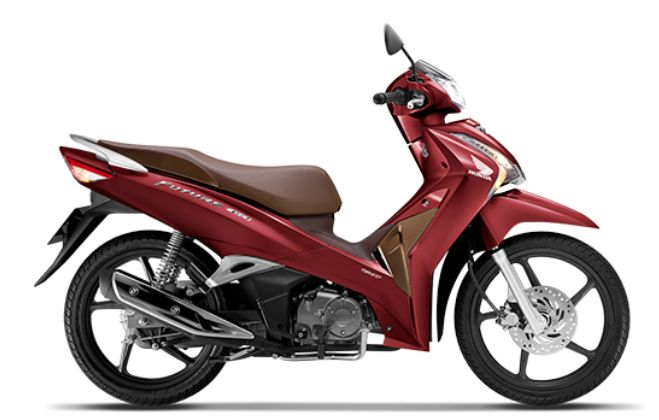

[🏠 Trang chủ](../../README.md) › [Future](../../dong-xe/future.md) › **BO0853**

# BO0853 · Future 125 2020 K73 Đỏ Nâu Đen R350C

| | |
|---|---|
| **Mã bộ** | `BO0853` |
| **Tên bộ** | Bộ nhựa (Dàn áo) Future 125 2020 K73 Đỏ Nâu Đen R350C |
| **Đời xe** | Future 125 năm 2020 Đỏ Nâu Đen (R350C) Vành Đúc (K73P) |
| **Model** | F6 |
| **Dòng xe** | Future |
| **Số chi tiết** | 22 |

## Chi tiết trong bộ

| STT | Mã chi tiết | Tên chi tiết | Dùng chung | Mã thay thế | Ghi chú |
|---:|---|---|:---:|---|---|
| 1 | [`53210K73V40ZB`](../../tra-ma/5321.md#53210k73v40zb) | Bộ nắp trước tay lái \*R350C\* |  |  |  |
| 2 | [`64330K73V40ZA`](../../tra-ma/6433.md#64330k73v40za) | Bộ ốp trước trên phía trong \*NH1\* | ✔ |  |  |
| 3 | [`64650K73V70ZB`](../../tra-ma/6465.md#64650k73v70zb) | Bộ ốp sườn trái \*R350C\* |  |  |  |
| 4 | [`64250K73V80ZF`](../../tra-ma/642.md#64250k73v80zf) | Bộ ốp yếm trái \*TYPE2\* |  |  |  |
| 5 | [`64600K73V70ZB`](../../tra-ma/6460.md#64600k73v70zb) | Bộ ốp sườn phải \*R350C\* |  |  |  |
| 6 | [`64200K73V80ZF`](../../tra-ma/642.md#64200k73v80zf) | Bộ ốp yếm phải \*TYPE2\* |  |  |  |
| 7 | [`64360K73V40ZE`](../../tra-ma/6436.md#64360k73v40ze) | Bộ ốp thân giữa sau \*YR286R\* | ✔ |  |  |
| 8 | [`64350K73V40ZE`](../../tra-ma/6435.md#64350k73v40ze) | Bộ ốp thân giữa trước \*YR286R\* | ✔ |  |  |
| 9 | [`64510K73V40ZA`](../../tra-ma/645.md#64510k73v40za) | Bộ ốp trước dưới \*NH1\* | ✔ |  |  |
| 10 | [`64313K73V40ZB`](../../tra-ma/6431.md#64313k73v40zb) | Bộ ốp trước trên \*R350C\* |  |  |  |
| 11 | [`64320K73V40ZB`](../../tra-ma/6432.md#64320k73v40zb) | Ốp ống yếm chính \*R350C\* |  |  |  |
| 12 | [`53206K73V80ZA`](../../tra-ma/5320.md#53206k73v80za) | Nắp sau tay lái \*R350C\* |  |  |  |
| 13 | [`83510K73V40ZB`](../../tra-ma/8351.md#83510k73v40zb) | Ốp đuôi sau \*R350C\* |  |  |  |
| 14 | [`61100KYZ900ZU`](../../tra-ma/611.md#61100kyz900zu) | Chắn bùn trước \*R350C\* | ✔ |  |  |
| 15 | [`80200K73V40ZA`](../../tra-ma/802.md#80200k73v40za) | Bộ chắn bùn sau \*NH1\* |  |  |  |
| 16 | [`64455K73V40ZK`](../../tra-ma/6445.md#64455k73v40zk) | Tấm thông gió yếm trái \*Y218M\* | ✔ |  |  |
| 17 | [`64405K73V40ZK`](../../tra-ma/6440.md#64405k73v40zk) | Tấm thông gió yếm phải \*Y218M\* | ✔ |  |  |
| 18 | [`50606KYZ900`](../../tra-ma/506.md#50606kyz900) | Tấm bảo vệ giá để chân sau phả |  |  |  |
| 19 | [`50706KYZ900`](../../tra-ma/507.md#50706kyz900) | Tấm bảo vệ giá để chân sau trá |  |  |  |
| 20 | [`53280K73V40`](../../tra-ma/5328.md#53280k73v40) | Bộ nắp trước tay lái |  |  |  |
| 21 | [`61200KYZ900`](../../tra-ma/612.md#61200kyz900) | Chắn bùn B trước |  |  |  |
| 22 | [`64305K73V40`](../../tra-ma/6430.md#64305k73v40) | Nẹp ốp trước trên |  |  |  |

Cập nhật 11/11/2026
