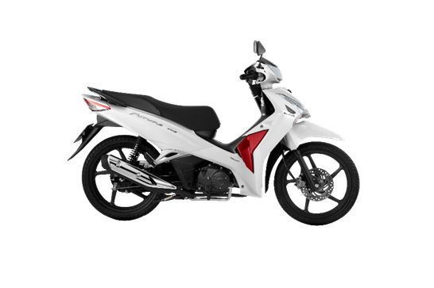

[🏠 Trang chủ](../../README.md) › [Future](../../dong-xe/future.md) › **BO1046**

# BO1046 · Fu125 2026 trắng đen đỏ NHB55 bản cao cấp đĩa đúc

| | |
|---|---|
| **Mã bộ** | `BO1046` |
| **Tên bộ** | Bộ nhựa (Dàn áo) Fu125 2026 trắng đen đỏ NHB55 bản cao cấp đĩa đúc |
| **Đời xe** | FU 125 2026 bản cao cấp màu Trắng đen đỏ NHB55 Phanh đĩa -vành đúc) |
| **Model** | AFS125CSFT |
| **Dòng xe** | Future |
| **Số chi tiết** | 23 |

## Chi tiết trong bộ

| STT | Mã chi tiết | Tên chi tiết | Dùng chung | Mã thay thế | Ghi chú |
|---:|---|---|:---:|---|---|
| 1 | [`50606KYZ900`](../../tra-ma/506.md#50606kyz900) | TẤM BẢO VỆ GIÁ ĐỂ CHÂN SAU PHẢ |  |  |  |
| 2 | [`50706KYZ900`](../../tra-ma/507.md#50706kyz900) | TẤM BẢO VỆ GIÁ ĐỂ CHÂN SAU TRÁ |  |  |  |
| 3 | [`53205K73V40ZH`](../../tra-ma/5320.md#53205k73v40zh) | NẮP TRƯỚC TAY LÁI \*NHB55P\* |  |  |  |
| 4 | [`53206K73V80ZD`](../../tra-ma/5320.md#53206k73v80zd) | NẮP SAU TAY LÁI \*NHB25M\* |  |  |  |
| 5 | [`53280K73V40`](../../tra-ma/5328.md#53280k73v40) | BỘ NẮP TRƯỚC TAY LÁI |  |  |  |
| 6 | [`61100KYZ900YE`](../../tra-ma/611.md#61100kyz900ye) | CHẮN BÙN TRƯỚC A \*NHB55P\* |  |  |  |
| 7 | [`61200KYZ900`](../../tra-ma/612.md#61200kyz900) | CHẮN BÙN B TRƯỚC |  |  |  |
| 8 | [`64200K73VH0ZD`](../../tra-ma/642.md#64200k73vh0zd) | BỘ ỐP YẾM PHẢI \*TYPE3\* |  |  |  |
| 9 | [`64250K73VH0ZD`](../../tra-ma/642.md#64250k73vh0zd) | BỘ ỐP YẾM TRÁI \*TYPE3\* |  |  |  |
| 10 | [`64305K73V40`](../../tra-ma/6430.md#64305k73v40) | NẸP ỐP TRƯỚC TRÊN |  |  |  |
| 11 | [`64313K73V40ZK`](../../tra-ma/6431.md#64313k73v40zk) | ỐP MẶT NẠ TRƯỚC \*NHB55P\* |  |  |  |
| 12 | [`64320K73V40ZE`](../../tra-ma/6432.md#64320k73v40ze) | ỐP ỐNG YẾM CHÍNH \*NHB25M\* |  |  |  |
| 13 | [`64330K73V40ZA`](../../tra-ma/6433.md#64330k73v40za) | BỘ ỐP TRƯỚC TRÊN PHÍA TRONG \*NH1\* |  |  |  |
| 14 | [`64350K73V40ZC`](../../tra-ma/6435.md#64350k73v40zc) | BỘ ỐP THÂN GIỮA TRƯỚC \*NH1\* |  |  |  |
| 15 | [`64360K73V40ZC`](../../tra-ma/6436.md#64360k73v40zc) | BỘ ỐP THÂN GIỮA SAU \*NH1\* |  |  |  |
| 16 | [`64405K73V40ZJ`](../../tra-ma/6440.md#64405k73v40zj) | TẤM THÔNG GIÓ YẾM PHẢI \*R350C\* |  |  |  |
| 17 | [`64455K73V40ZJ`](../../tra-ma/6445.md#64455k73v40zj) | TẤM THÔNG GIÓ YẾM TRÁI \*R350C\* |  |  |  |
| 18 | [`64510K73V40ZA`](../../tra-ma/645.md#64510k73v40za) | BỘ ỐP TRƯỚC DƯỚI \*NH1\* |  |  |  |
| 19 | [`64600K73VH0ZC`](../../tra-ma/6460.md#64600k73vh0zc) | BỘ ỐP SƯỜN PHẢI \*TYPE3\* |  |  |  |
| 20 | [`64650K73VH0ZC`](../../tra-ma/6465.md#64650k73vh0zc) | BỘ ỐP SƯỜN TRÁI \*TYPE3\* |  |  |  |
| 21 | [`80105K73V40`](../../tra-ma/8010.md#80105k73v40) | NẮP ĐUÔI SAU DƯỚI |  |  |  |
| 22 | [`80200K73V40ZA`](../../tra-ma/802.md#80200k73v40za) | BỘ CHẮN BÙN SAU \*NH1\* |  |  |  |
| 23 | [`83510K73V40ZK`](../../tra-ma/8351.md#83510k73v40zk) | ỐP ĐUÔI XE \*NHB55P\* |  |  |  |

Cập nhật 11/11/2026
