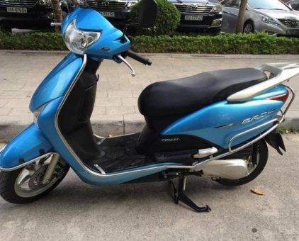

[🏠 Trang chủ](../../README.md) › [Lead](../../dong-xe/lead.md) › **BO0391**

# BO0391 · Lead 110 2012 GGE Xanh B203

| | |
|---|---|
| **Mã bộ** | `BO0391` |
| **Tên bộ** | Bộ nhựa (Dàn áo) Lead 110 2012 GGE Xanh B203 |
| **Đời xe** | Lead 2012 màu Xanh - B 203 |
| **Model** | S6,S7 |
| **Dòng xe** | Lead |
| **Số chi tiết** | 25 |

## Chi tiết trong bộ

| STT | Mã chi tiết | Tên chi tiết | Dùng chung | Mã thay thế | Ghi chú |
|---:|---|---|:---:|---|---|
| 1 | [`50621GGE940`](../../tra-ma/506.md#50621gge940) | ốp dưới sàn xe | ✔ |  |  |
| 2 | [`53210GGEA10ZD`](../../tra-ma/5321.md#53210ggea10zd) | Bộ nắp trước tay lái \*B203\* |  |  |  |
| 3 | [`53250GGE900`](../../tra-ma/5325.md#53250gge900) | Nắp sau tay lái | ✔ |  |  |
| 4 | [`61100GGE900ZP`](../../tra-ma/611.md#61100gge900zp) | Chắn bùn trước \*B203M\* |  |  |  |
| 5 | [`64300GGE900ZN`](../../tra-ma/6430.md#64300gge900zn) | Bộ mặt nạ trước \*B203M\* |  |  |  |
| 6 | [`64301GGE900ZP`](../../tra-ma/6430.md#64301gge900zp) | Ốp nhựa trước \*B203M\* |  |  |  |
| 7 | [`64310GGE900`](../../tra-ma/6431.md#64310gge900) | ốp sàn để chân | ✔ |  |  |
| 8 | [`80105GGE900`](../../tra-ma/8010.md#80105gge900) | Chắn bùn sau | ✔ |  |  |
| 9 | [`80121GGE900`](../../tra-ma/8012.md#80121gge900) | Nắp chụp đèn soi biển số | ✔ |  |  |
| 10 | [`80151GGE900`](../../tra-ma/8015.md#80151gge900) | ốp nhựa trung tâm | ✔ |  |  |
| 11 | [`80152GGE900`](../../tra-ma/8015.md#80152gge900) | Nắp ngoài bình xăng | ✔ |  |  |
| 12 | [`80161GGE900`](../../tra-ma/8016.md#80161gge900) | Núm nắp bình xăng | ✔ |  |  |
| 13 | [`81131GGE900`](../../tra-ma/8113.md#81131gge900) | ốp khoang chứa đồ trước | ✔ |  |  |
| 14 | [`81141GGE900`](../../tra-ma/8114.md#81141gge900) | Nắp khoang chứa đồ trước | ✔ |  |  |
| 15 | [`83502GGE900ZP`](../../tra-ma/8350.md#83502gge900zp) | Ốp đuôi sau trên \*B203M\* |  |  |  |
| 16 | [`83505GGEA10ZB`](../../tra-ma/8350.md#83505ggea10zb) | Bộ ốp sườn phải \*B203\* |  |  |  |
| 17 | [`83510GGE900ZP`](../../tra-ma/8351.md#83510gge900zp) | Ốp sàn bên phải \*B203M\* |  |  |  |
| 18 | [`83525GGE900ZA`](../../tra-ma/8352.md#83525gge900za) | ốp trung tâm phải TYPE1 | ✔ |  |  |
| 19 | [`83603GGE900ZN`](../../tra-ma/8360.md#83603gge900zn) | Bộ ốp đuôi sau dưới \*B203M\* |  |  |  |
| 20 | [`83605GGEA10ZB`](../../tra-ma/8360.md#83605ggea10zb) | Bộ ốp sườn trái \*B203\* |  |  |  |
| 21 | [`83610GGE900ZP`](../../tra-ma/8361.md#83610gge900zp) | Ốp sàn bên trái \*B-203M\* |  |  |  |
| 22 | [`83521GGE900`](../../tra-ma/8352.md#83521gge900) | Nắp ốp trung tâm phải Lead 110, màu nhựa đen. |  |  |  |
| 23 | [`83621GGE900`](../../tra-ma/8362.md#83621gge900) | Nắp ốp trung tâm trái Lead 110, màu nhựa đen. |  |  |  |
| 24 | [`64305GFM970`](../../tra-ma/6430.md#64305gfm970) | Tấm đệm ốp nhựa trước NH1 Lead 110, màu nhựa đen. |  |  |  |
| 25 | [`83625GGE900ZA`](../../tra-ma/8362.md#83625gge900za) | ốp trung tâm trái TYPE1 | ✔ |  |  |

Cập nhật 11/11/2026
