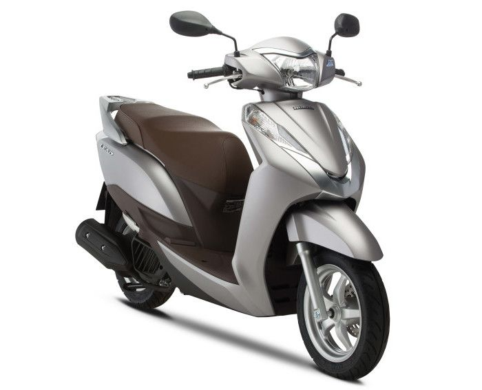

[🏠 Trang chủ](../../README.md) › [Lead](../../dong-xe/lead.md) › **BO0405**

# BO0405 · Lead 125 2015 K12 Bạc NHB18M

| | |
|---|---|
| **Mã bộ** | `BO0405` |
| **Tên bộ** | Bộ nhựa (Dàn áo) Lead 125 2015 K12 Bạc NHB18M |
| **Đời xe** | Lead 125 2015 màu Bạc - NHB 18 |
| **Model** | S10H2,S11H3 |
| **Dòng xe** | Lead |
| **Số chi tiết** | 27 |

## Chi tiết trong bộ

| STT | Mã chi tiết | Tên chi tiết | Dùng chung | Mã thay thế | Ghi chú |
|---:|---|---|:---:|---|---|
| 1 | [`53203K12930ZJ`](../../tra-ma/5320.md#53203k12930zj) | Nắp trên tay lái \*NHB18M\* |  |  |  |
| 2 | [`53207K12900ZA`](../../tra-ma/5320.md#53207k12900za) | Trang trí nắp tay lái \*NH-B24M |  |  |  |
| 3 | [`53215K12940ZJ`](../../tra-ma/5321.md#53215k12940zj) | Nắp sau tay lái \*NHB18M\* |  |  |  |
| 4 | [`61200K12900ZN`](../../tra-ma/612.md#61200k12900zn) | Bộ chắn bùn trước \*NHB18M\* |  |  |  |
| 5 | [`64300K12900ZP`](../../tra-ma/6430.md#64300k12900zp) | Ốp mặt nạ trước \*NHB18M\* |  |  |  |
| 6 | [`64305K12900ZA`](../../tra-ma/6430.md#64305k12900za) | Nẹp tấm thông gió trước \*NH-B2 | ✔ |  |  |
| 7 | [`64310K12900ZB`](../../tra-ma/6431.md#64310k12900zb) | Ốp sàn để chân \*YR286R\* | ✔ |  |  |
| 8 | [`64315K12900`](../../tra-ma/6431.md#64315k12900) | Ốp dưới | ✔ |  |  |
| 9 | [`64320K12900`](../../tra-ma/6432.md#64320k12900) | Ốp trước bên trong | ✔ |  |  |
| 10 | [`64350K12900ZP`](../../tra-ma/6435.md#64350k12900zp) | Ốp trước phải \*NHB18M\* |  |  |  |
| 11 | [`64360K12900ZP`](../../tra-ma/6436.md#64360k12900zp) | Ốp trước trái \*NHB18M\* |  |  |  |
| 12 | [`80105K12900`](../../tra-ma/8010.md#80105k12900) | Chắn bùn sau | ✔ |  |  |
| 13 | [`80106K12900`](../../tra-ma/8010.md#80106k12900) | Chắn bùn sau bên trong |  |  |  |
| 14 | [`80151K12900ZB`](../../tra-ma/8015.md#80151k12900zb) | Ốp nhựa trung tâm \*YR286R\* | ✔ |  |  |
| 15 | [`80160K12900ZB`](../../tra-ma/8016.md#80160k12900zb) | Nắp mở bình xăng \*YR286R\* | ✔ |  |  |
| 16 | [`81140K12930ZJ`](../../tra-ma/8114.md#81140k12930zj) | Ốp trên bên trong \*NHB18M\* |  |  |  |
| 17 | [`81141K12900ZP`](../../tra-ma/8114.md#81141k12900zp) | Nắp khoang chứa đồ \*NHB18M\* |  |  |  |
| 18 | [`81142K12900`](../../tra-ma/8114.md#81142k12900) | Hộp chứa đồ bên trong | ✔ |  |  |
| 19 | [`81150K12900ZB`](../../tra-ma/8115.md#81150k12900zb) | Ốp dưới bên trong YR286R | ✔ |  |  |
| 20 | [`83500K12900ZP`](../../tra-ma/8350.md#83500k12900zp) | Ốp sườn phải \*NHB18M\* |  |  |  |
| 21 | [`83503K12900ZP`](../../tra-ma/8350.md#83503k12900zp) | Ốp đuôi sau dưới \*NHB18M\* |  |  |  |
| 22 | [`83510K12900ZP`](../../tra-ma/8351.md#83510k12900zp) | Ốp sàn bên phải \*NHB18M\* |  |  |  |
| 23 | [`83520K12900ZB`](../../tra-ma/8352.md#83520k12900zb) | Ốp trung tâm bên phải \*YR286R\* | ✔ |  |  |
| 24 | [`83600K12900ZP`](../../tra-ma/8360.md#83600k12900zp) | Ốp sườn trái \*NHB18M\* |  |  |  |
| 25 | [`83603K12960ZC`](../../tra-ma/8360.md#83603k12960zc) | Bộ ốp giữa đuôi sau \*NHB18M\* |  |  |  |
| 26 | [`83610K12900ZP`](../../tra-ma/8361.md#83610k12900zp) | Ốp sàn bên trái \*NHB18M\* |  |  |  |
| 27 | [`83620K12900ZB`](../../tra-ma/8362.md#83620k12900zb) | Ốp trung tâm bên trái \*YR286R\* | ✔ |  |  |

Cập nhật 11/11/2026
