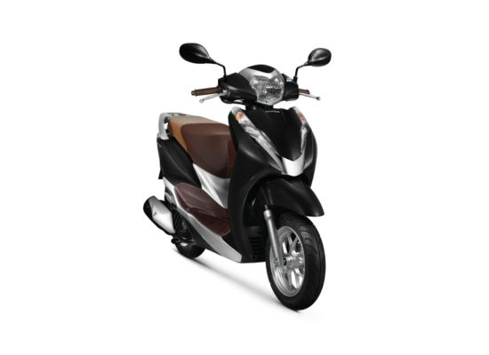

[🏠 Trang chủ](../../README.md) › [Lead](../../dong-xe/lead.md) › **BO0425**

# BO0425 · Lead 125 2018 K12 Đen nâu bạc NHB25M

| | |
|---|---|
| **Mã bộ** | `BO0425` |
| **Tên bộ** | Bộ nhựa (Dàn áo) Lead 125 2018 K12 Đen nâu bạc NHB25M |
| **Đời xe** | Lead 125 Năm 2018 mới màu Đen nâu bạc - NB25E |
| **Model** | S13H5l1 |
| **Dòng xe** | Lead |
| **Số chi tiết** | 29 |

## Chi tiết trong bộ

| STT | Mã chi tiết | Tên chi tiết | Dùng chung | Mã thay thế | Ghi chú |
|---:|---|---|:---:|---|---|
| 1 | [`53203K12V00ZJ`](../../tra-ma/5320.md#53203k12v00zj) | Bộ nắp trước tay lái \*NHB25M\* |  |  |  |
| 2 | [`53206K12V00ZH`](../../tra-ma/5320.md#53206k12v00zh) | Ốp sau tay lái \*NH-B25\* |  |  |  |
| 3 | [`53207K12V00`](../../tra-ma/5320.md#53207k12v00) | Trang trí nắp tay lái | ✔ |  |  |
| 4 | [`61200K12V20ZA`](../../tra-ma/612.md#61200k12v20za) | Bộ chắn bùn trước \*NHB25M\* |  |  |  |
| 5 | [`64300K12V20ZH`](../../tra-ma/6430.md#64300k12v20zh) | Ốp mặt nạ trước \*NHB25M\* |  |  |  |
| 6 | [`64305K12V00`](../../tra-ma/6430.md#64305k12v00) | Tấm đệm ốp nhựa trước | ✔ |  |  |
| 7 | [`64310K12V00ZA`](../../tra-ma/6431.md#64310k12v00za) | Ốp sàn để chân \*YR286R\* |  |  |  |
| 8 | [`64315K12V00`](../../tra-ma/6431.md#64315k12v00) | Ốp dưới | ✔ |  |  |
| 9 | [`64320K12V00`](../../tra-ma/6432.md#64320k12v00) | Ốp trước bên trong | ✔ |  |  |
| 10 | [`64350K12V00ZH`](../../tra-ma/6435.md#64350k12v00zh) | Ốp trước phải \*NHB25M\* |  |  |  |
| 11 | [`64360K12V00ZH`](../../tra-ma/6436.md#64360k12v00zh) | Ốp trước trái \*NHB25M\* |  |  |  |
| 12 | [`80105K12V00ZA`](../../tra-ma/8010.md#80105k12v00za) | Chắn bùn sau \*YR286R\* |  |  |  |
| 13 | [`80106K12900`](../../tra-ma/8010.md#80106k12900) | Chắn bùn sau bên trong |  |  |  |
| 14 | [`80151K12V00ZD`](../../tra-ma/8015.md#80151k12v00zd) | Ốp nhựa trung tâm trên \*NH411M\* |  |  |  |
| 15 | [`80152K12V00ZA`](../../tra-ma/8015.md#80152k12v00za) | Ốp nhựa trung tâm dưới \*YR286R\* |  |  |  |
| 16 | [`80160K12V00ZA`](../../tra-ma/8016.md#80160k12v00za) | Nắp bình xăng \*YR286R\* |  |  |  |
| 17 | [`81140K12V00ZE`](../../tra-ma/8114.md#81140k12v00ze) | Ốp trên bên trong  \*NHB25M\* |  |  |  |
| 18 | [`81142K12V00ZA`](../../tra-ma/8114.md#81142k12v00za) | Hộp chứa đồ bên trong \*YR286R\* |  |  |  |
| 19 | [`81145K12V00ZH`](../../tra-ma/8114.md#81145k12v00zh) | Nắp khẩn cấp \*NHB25M\* |  |  |  |
| 20 | [`81150K12V00ZA`](../../tra-ma/8115.md#81150k12v00za) | Ốp dưới bên trong \*YR286R\* |  |  |  |
| 21 | [`81160K12V00ZH`](../../tra-ma/8116.md#81160k12v00zh) | Nắp khoang chứa đồ \*NHB25M\* |  |  |  |
| 22 | [`83503K12V00ZG`](../../tra-ma/8350.md#83503k12v00zg) | Ốp đuôi sau dưới \*NHB25M\* |  |  |  |
| 23 | [`83510K12V00ZD`](../../tra-ma/8351.md#83510k12v00zd) | Ốp sàn bên phải \*NH411M\* |  |  |  |
| 24 | [`83511K12V00ZA`](../../tra-ma/8351.md#83511k12v00za) | Ốp để chân phải \*NH1\* | ✔ |  |  |
| 25 | [`83550K12V20ZF`](../../tra-ma/8355.md#83550k12v20zf) | Bộ ốp sườn phải \*NHB25M\* |  |  |  |
| 26 | [`83603K12V20ZA`](../../tra-ma/8360.md#83603k12v20za) | Bộ ốp giữa đuôi sau \*NHB25M\* |  |  |  |
| 27 | [`83610K12V00ZD`](../../tra-ma/8361.md#83610k12v00zd) | Ốp sàn bên trái \*NH411M\* |  |  |  |
| 28 | [`83611K12V00ZA`](../../tra-ma/8361.md#83611k12v00za) | Ốp để chân trái \*NH1\* | ✔ |  |  |
| 29 | [`83650K12V20ZF`](../../tra-ma/8365.md#83650k12v20zf) | Bộ ốp  sườn trái \*NHB25M\* |  |  |  |

Cập nhật 11/11/2026
