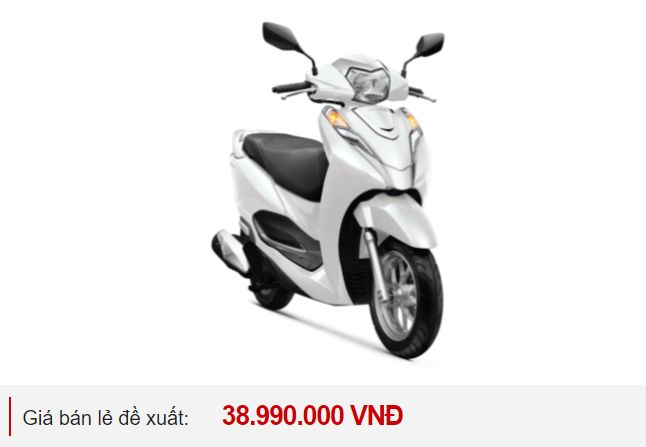

[🏠 Trang chủ](../../README.md) › [Lead](../../dong-xe/lead.md) › **BO0781**

# BO0781 · Lead 125 2022 K2T Trắng \*NHB35P\* (K2TA), phiên bản tiêu chuẩn

| | |
|---|---|
| **Mã bộ** | `BO0781` |
| **Tên bộ** | Bộ nhựa (Dàn áo) Lead 125 2022 K2T Trắng \*NHB35P\* (K2TA), phiên bản tiêu chuẩn |
| **Đời xe** | LEAD 125 năm 2022 TRẮNG (NHB35P)  (K2TA) Phiên bản Tiêu Chuẩn |
| **Model** | S15H7I3 |
| **Dòng xe** | Lead |
| **Số chi tiết** | 32 |

## Chi tiết trong bộ

| STT | Mã chi tiết | Tên chi tiết | Dùng chung | Mã thay thế | Ghi chú |
|---:|---|---|:---:|---|---|
| 1 | [`53205K12V00ZS`](../../tra-ma/5320.md#53205k12v00zs) | Nắp trước tay lái \*NHB35P\* | ✔ |  |  |
| 2 | [`53206K12V00ZS`](../../tra-ma/5320.md#53206k12v00zs) | Nắp sau tay lái \*NHB35P\* | ✔ | [`53207K12V00`](../../tra-ma/5320.md#53207k12v00) |  |
| 3 | [`53207K12V00`](../../tra-ma/5320.md#53207k12v00) |  |  | [`64302K2TV00`](../../tra-ma/6430.md#64302k2tv00) |  |
| 4 | [`53215K12V00ZB`](../../tra-ma/5321.md#53215k12v00zb) | Nắp mặt đồng hồ tốc độ \*NH411M\* |  | [`64305K12V00`](../../tra-ma/6430.md#64305k12v00) |  |
| 5 | [`61200K2TV10ZA`](../../tra-ma/612.md#61200k2tv10za) | Bộ chắn bùn trước \*NHB35\* |  | [`64320K2TV00`](../../tra-ma/6432.md#64320k2tv00) |  |
| 6 | [`64300K2TV00ZD`](../../tra-ma/6430.md#64300k2tv00zd) | Bộ mặt nạ trước \*NHB35\* |  | [`64315K2TV00`](../../tra-ma/6431.md#64315k2tv00) |  |
| 7 | [`64302K2TV00`](../../tra-ma/6430.md#64302k2tv00) |  | ✔ | [`80107K2TV00`](../../tra-ma/8010.md#80107k2tv00) |  |
| 8 | [`64310K2TV00ZB`](../../tra-ma/6431.md#64310k2tv00zb) | Ốp sàn \*NH1\* |  |  |  |
| 9 | [`64315K2TV00`](../../tra-ma/6431.md#64315k2tv00) |  |  |  |  |
| 10 | [`64320K2TV00`](../../tra-ma/6432.md#64320k2tv00) |  |  |  |  |
| 11 | [`64350K12V00ZS`](../../tra-ma/6435.md#64350k12v00zs) | Ốp trước phải \*NHB35P\* |  |  |  |
| 12 | [`64360K12V00ZS`](../../tra-ma/6436.md#64360k12v00zs) | Ốp trước trái \*NHB35P\* | ✔ |  |  |
| 13 | [`80105K2TV00ZB`](../../tra-ma/8010.md#80105k2tv00zb) | Chắn bùn sau \*NH1\* | ✔ |  |  |
| 14 | [`80107K2TV00`](../../tra-ma/8010.md#80107k2tv00) |  |  |  |  |
| 15 | [`80151K12V00ZQ`](../../tra-ma/8015.md#80151k12v00zq) | Ốp nhựa trung tâm trên \*NHB35P\* |  |  |  |
| 16 | [`80152K2TV00ZB`](../../tra-ma/8015.md#80152k2tv00zb) | Ốp nhựa trung tâm dưới \*NH1\* | ✔ |  |  |
| 17 | [`80160K12V00ZB`](../../tra-ma/8016.md#80160k12v00zb) | Nắp bình xăng \*NH1\* |  |  |  |
| 18 | [`81140K12V00ZS`](../../tra-ma/8114.md#81140k12v00zs) | Ốp trên bên trong \*NHB35P\* |  |  |  |
| 19 | [`81142K2TV10ZB`](../../tra-ma/8114.md#81142k2tv10zb) |  |  |  |  |
| 20 | [`81144K12V00ZA`](../../tra-ma/8114.md#81144k12v00za) | Núm nắp bình xăng \*NH1\* |  |  |  |
| 21 | [`81145K12V00ZS`](../../tra-ma/8114.md#81145k12v00zs) | Nắp khẩn cấp \*NHB35P\* | ✔ |  |  |
| 22 | [`81150K2TV00ZB`](../../tra-ma/8115.md#81150k2tv00zb) | Ốp dưới bên trong \*NH1\* | ✔ |  |  |
| 23 | [`81160K12V00ZS`](../../tra-ma/8116.md#81160k12v00zs) | Nắp hộc chứa đồ \*NHB35P\* |  |  |  |
| 24 | [`83503K12V00ZR`](../../tra-ma/8350.md#83503k12v00zr) | Ốp đuôi sau dưới \*NHB35P\* |  |  |  |
| 25 | [`83510K2TV00ZD`](../../tra-ma/8351.md#83510k2tv00zd) | Ốp sàn bên phải \*NHB35P\* |  |  |  |
| 26 | [`83511K2TV00ZA`](../../tra-ma/8351.md#83511k2tv00za) | Ốp để chân sau phải \*NH1\* |  |  |  |
| 27 | [`83550K2TV10ZA`](../../tra-ma/8355.md#83550k2tv10za) |  |  |  |  |
| 28 | [`83603K2TV10ZA`](../../tra-ma/8360.md#83603k2tv10za) | Bộ ốp giữa đuôi sau \*NHB35\* |  |  |  |
| 29 | [`83610K2TV00ZD`](../../tra-ma/8361.md#83610k2tv00zd) | Ốp sàn bên trái \*NHB35P\* |  |  |  |
| 30 | [`83611K2TV00ZA`](../../tra-ma/8361.md#83611k2tv00za) | Ốp để chân sau trái \*NH1\* |  |  |  |
| 31 | [`83650K2TV10ZA`](../../tra-ma/8365.md#83650k2tv10za) |  |  |  |  |
| 32 | [`64305K12V00`](../../tra-ma/6430.md#64305k12v00) |  |  |  |  |

## Mã thiếu bổ sung

_Không tính sẵn trong bộ, thêm khi khách cần._

| Mã | Tên |
|---|---|
| [`64302K2TV00`](../../tra-ma/6430.md#64302k2tv00) | Trang trí mặt nạ trước |
| [`64305K12V00`](../../tra-ma/6430.md#64305k12v00) | Tấm đệm ốp nhựa trước  chung Lead 125 năm 2018, 2019 |
| [`64320K2TV00`](../../tra-ma/6432.md#64320k2tv00) | Ốp trong phía trước Lead 2022, |
| [`64315K2TV00`](../../tra-ma/6431.md#64315k2tv00) | Ốp phía dưới Lead 2022, |
| [`80107K2TV00`](../../tra-ma/8010.md#80107k2tv00) | Chắn bùn sau bên trong |
| [`81142K2TV10ZB`](../../tra-ma/8114.md#81142k2tv10zb) | Tấm đệm ốp nhựa trước  chung Lead 125 năm 2018, 2019 |

Cập nhật 11/11/2026
