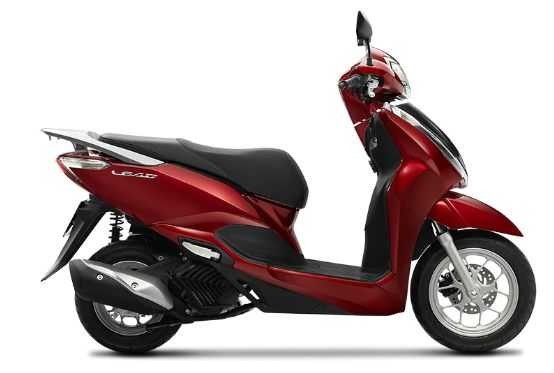

[🏠 Trang chủ](../../README.md) › [Lead](../../dong-xe/lead.md) › **BO0952**

# BO0952 · Lead 125, 2025, phiên bản cao cấp màu đỏ R368C

| | |
|---|---|
| **Mã bộ** | `BO0952` |
| **Tên bộ** | Bộ nhựa (Dàn áo) Lead 125, 2025, phiên bản cao cấp màu đỏ R368C |
| **Đời xe** | LEAD 125 năm 2025, phiên bản cao cấp đỏ R368C |
| **Dòng xe** | Lead |
| **Số chi tiết** | 35 |

## Chi tiết trong bộ

| STT | Mã chi tiết | Tên chi tiết | Dùng chung | Mã thay thế | Ghi chú |
|---:|---|---|:---:|---|---|
| 1 | [`81142K2TV40ZA`](../../tra-ma/8114.md#81142k2tv40za) | Hộp chứa đồ bên trong\*NH1\* |  |  |  |
| 2 | [`53215K2TV30ZA`](../../tra-ma/5321.md#53215k2tv30za) | Nắp mặt đồng hồ tốc độ \*NH411M\* |  |  |  |
| 3 | [`80152K2TV00ZB`](../../tra-ma/8015.md#80152k2tv00zb) | Ốp nhựa trung tâm dưới \*NH1\* |  |  |  |
| 4 | [`64301K2TV30ZE`](../../tra-ma/6430.md#64301k2tv30ze) | Ốp mặt nạ trước \*NHB25M\* |  |  |  |
| 5 | [`81140K2TV30ZB`](../../tra-ma/8114.md#81140k2tv30zb) | Ốp trong \*NH1\* |  |  |  |
| 6 | [`83611K2TV00ZA`](../../tra-ma/8361.md#83611k2tv00za) | Ốp để chân sau trái \*NH1\* |  |  |  |
| 7 | [`83511K2TV00ZA`](../../tra-ma/8351.md#83511k2tv00za) | Ốp để chân sau phải \*NH1\* |  |  |  |
| 8 | [`80105K2TV30ZB`](../../tra-ma/8010.md#80105k2tv30zb) | Chắn bùn sau\*NH1\* |  |  |  |
| 9 | [`81143K2TV30ZA`](../../tra-ma/8114.md#81143k2tv30za) | Bản lề nắp hộc đồ\*NH1\* |  |  |  |
| 10 | [`81144K3MT01ZC`](../../tra-ma/8114.md#81144k3mt01zc) | Núm nắp bình xăng \*NH1\* |  |  |  |
| 11 | [`81141K2TV30ZB`](../../tra-ma/8114.md#81141k2tv30zb) | Nắp khoang chứa đồ\*NH1\* |  |  |  |
| 12 | [`81160K2TV30ZB`](../../tra-ma/8116.md#81160k2tv30zb) | Nắp khoang chứa đồ\*NH1\* |  |  |  |
| 13 | [`80160K12V00ZB`](../../tra-ma/8016.md#80160k12v00zb) | Nắp bình xăng \*NH1\* |  |  |  |
| 14 | [`81145K2TV30ZB`](../../tra-ma/8114.md#81145k2tv30zb) | Nắp khẩn cấp\*NH1\* |  |  |  |
| 15 | [`64310K2TV30ZB`](../../tra-ma/6431.md#64310k2tv30zb) | Ốp sàn để chân\*NH1\* |  |  |  |
| 16 | [`53207K2TV30`](../../tra-ma/5320.md#53207k2tv30) | Trang trí nắp tay lái |  |  |  |
| 17 | [`61200K2TV30`](../../tra-ma/612.md#61200k2tv30) | Chắn bùn B trước |  |  |  |
| 18 | [`64305K2TV30`](../../tra-ma/6430.md#64305k2tv30) | Nẹp trang trí trước |  |  |  |
| 19 | [`64320K2TV30`](../../tra-ma/6432.md#64320k2tv30) | Ốp trước bên trong |  |  |  |
| 20 | [`64315K2TV00`](../../tra-ma/6431.md#64315k2tv00) | Ốp phía dưới |  |  |  |
| 21 | [`80107K2TV00`](../../tra-ma/8010.md#80107k2tv00) | Chắn bùn sau bên trong |  |  |  |
| 22 | [`83650K2TV30ZG`](../../tra-ma/8365.md#83650k2tv30zg) | Bộ ốp sườn trái \*R368C\* |  |  |  |
| 23 | [`83550K2TV30ZH`](../../tra-ma/8355.md#83550k2tv30zh) | Bộ ốp sườn phải \*R368C\* |  |  |  |
| 24 | [`83603K12V00ZH`](../../tra-ma/8360.md#83603k12v00zh) | Bộ ốp giữa đuôi sau \*R368\* |  |  |  |
| 25 | [`80151K12V00ZB`](../../tra-ma/8015.md#80151k12v00zb) | Ốp nhựa trung tâm trên \*R368C\* |  |  |  |
| 26 | [`53205K2TV30ZA`](../../tra-ma/5320.md#53205k2tv30za) | Nắp trước tay lái\*R368C\* |  |  |  |
| 27 | [`83610K2TV00ZM`](../../tra-ma/8361.md#83610k2tv00zm) | Ốp sàn bên trái\*R368C\* |  |  |  |
| 28 | [`64360K2TV30ZA`](../../tra-ma/6436.md#64360k2tv30za) | Ốp trước trái\*R368C\* |  |  |  |
| 29 | [`83510K2TV00ZM`](../../tra-ma/8351.md#83510k2tv00zm) | Ốp sàn bên phải\*R368C\* |  |  |  |
| 30 | [`64350K2TV30ZA`](../../tra-ma/6435.md#64350k2tv30za) | Ốp trước phải\*R368C\* |  |  |  |
| 31 | [`53206K2TV30ZA`](../../tra-ma/5320.md#53206k2tv30za) | Nắp sau tay lái\*R368C\* |  |  |  |
| 32 | [`83503K2TV30ZA`](../../tra-ma/8350.md#83503k2tv30za) | Ốp đuôi sau dưới\*R368C\* |  |  |  |
| 33 | [`61100K2TV30ZA`](../../tra-ma/611.md#61100k2tv30za) | Chắn bùn A trước\*R368C\* |  |  |  |
| 34 | [`64300K2TV30ZB`](../../tra-ma/6430.md#64300k2tv30zb) | Bộ ốp ống yếm trái \*NHA76M\* |  |  |  |
| 35 | [`81170K2TV30ZA`](../../tra-ma/8117.md#81170k2tv30za) | Trang trí ốp trong\*R368C\* |  |  |  |

Cập nhật 11/11/2026
