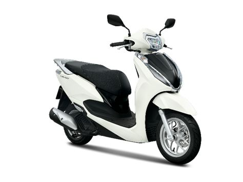

[🏠 Trang chủ](../../README.md) › [Lead](../../dong-xe/lead.md) › **BO1024**

# BO1024 · Lead 2026 trắng đen NHD14 bản cao cấp

| | |
|---|---|
| **Mã bộ** | `BO1024` |
| **Tên bộ** | Bộ nhựa (Dàn áo) Lead 2026 trắng đen NHD14 bản cao cấp |
| **Đời xe** | Lead 2026 cao cấp màu Trắng đen NHD14 |
| **Model** | NHX125 (NHX125T)............5V |
| **Dòng xe** | Lead |
| **Số chi tiết** | 35 |

## Chi tiết trong bộ

| STT | Mã chi tiết | Tên chi tiết | Dùng chung | Mã thay thế | Ghi chú |
|---:|---|---|:---:|---|---|
| 1 | [`53205K2TV30ZJ`](../../tra-ma/5320.md#53205k2tv30zj) | NẮP TRƯỚC TAY LÁI\*NHD14\* |  | [`18318K2TV30ZA`](../../tra-ma/183.md#18318k2tv30za) |  |
| 2 | [`53206K2TV30ZJ`](../../tra-ma/5320.md#53206k2tv30zj) | NẮP SAU TAY LÁI\*NHD14\* |  | [`77200K2TV30ZC`](../../tra-ma/772.md#77200k2tv30zc) |  |
| 3 | [`53207K2TV30`](../../tra-ma/5320.md#53207k2tv30) | Trang trí nắp tay lái |  |  |  |
| 4 | [`53215K2TV30ZA`](../../tra-ma/5321.md#53215k2tv30za) | Nắp mặt đồng hồ tốc độ \*NH411M\* |  |  |  |
| 5 | [`61100K2TV30ZJ`](../../tra-ma/611.md#61100k2tv30zj) | CHẮN BÙN A TRƯỚC\*NHD14\* |  |  |  |
| 6 | [`61200K2TV30`](../../tra-ma/612.md#61200k2tv30) | Chắn bùn B trước |  |  |  |
| 7 | [`64300K2TV30ZB`](../../tra-ma/6430.md#64300k2tv30zb) | Bộ ốp ống yếm trái \*NHA76M\* |  |  |  |
| 8 | [`64301K2TV30ZE`](../../tra-ma/6430.md#64301k2tv30ze) | Ốp mặt nạ trước \*NHB25M\* |  |  |  |
| 9 | [`64305K2TV30`](../../tra-ma/6430.md#64305k2tv30) | Nẹp trang trí trước |  |  |  |
| 10 | [`64310K2TV30ZB`](../../tra-ma/6431.md#64310k2tv30zb) | Ốp sàn để chân\*NH1\* |  |  |  |
| 11 | [`64315K2TV00`](../../tra-ma/6431.md#64315k2tv00) | Ốp phía dưới |  |  |  |
| 12 | [`64320K2TV30`](../../tra-ma/6432.md#64320k2tv30) | Ốp trước bên trong |  |  |  |
| 13 | [`64350K2TV30ZJ`](../../tra-ma/6435.md#64350k2tv30zj) | ỐP TRƯỚC PHẢI\*NHD14\* |  |  |  |
| 14 | [`64360K2TV30ZJ`](../../tra-ma/6436.md#64360k2tv30zj) | ỐP TRƯỚC TRÁI\*NHD14\* |  |  |  |
| 15 | [`80105K2TV30ZB`](../../tra-ma/8010.md#80105k2tv30zb) | Chắn bùn sau\*NH1\* |  |  |  |
| 16 | [`80107K2TV00`](../../tra-ma/8010.md#80107k2tv00) | Chắn bùn sau bên trong |  |  |  |
| 17 | [`80151K12V00ZF`](../../tra-ma/8015.md#80151k12v00zf) | Ốp nhựa trung tâm trên \*NHB25M\* |  |  |  |
| 18 | [`80152K2TV00ZB`](../../tra-ma/8015.md#80152k2tv00zb) | Ốp nhựa trung tâm dưới \*NH1\* |  |  |  |
| 19 | [`80160K12V00ZB`](../../tra-ma/8016.md#80160k12v00zb) | Nắp bình xăng \*NH1\* |  |  |  |
| 20 | [`81140K2TV30ZB`](../../tra-ma/8114.md#81140k2tv30zb) | Ốp trong \*NH1\* |  |  |  |
| 21 | [`81141K2TV30ZB`](../../tra-ma/8114.md#81141k2tv30zb) | Nắp khoang chứa đồ\*NH1\* |  |  |  |
| 22 | [`81142K2TV40ZA`](../../tra-ma/8114.md#81142k2tv40za) | Hộp chứa đồ bên trong\*NH1\* |  |  |  |
| 23 | [`81143K2TV30ZA`](../../tra-ma/8114.md#81143k2tv30za) | Bản lề nắp hộc đồ\*NH1\* |  |  |  |
| 24 | [`81144K3MT01ZC`](../../tra-ma/8114.md#81144k3mt01zc) | Núm nắp bình xăng \*NH1\* |  |  |  |
| 25 | [`81145K2TV30ZB`](../../tra-ma/8114.md#81145k2tv30zb) | Nắp khẩn cấp\*NH1\* |  |  |  |
| 26 | [`81160K2TV30ZB`](../../tra-ma/8116.md#81160k2tv30zb) | Nắp khoang chứa đồ\*NH1\* |  |  |  |
| 27 | [`81170K2TV30ZJ`](../../tra-ma/8117.md#81170k2tv30zj) | TRANG TRÍ ỐP TRONG\*NHD14\* |  |  |  |
| 28 | [`83503K2TV30ZJ`](../../tra-ma/8350.md#83503k2tv30zj) | ỐP ĐUÔI SAU DƯỚI\*NHD14\* |  |  |  |
| 29 | [`83510K2TV00ZQ`](../../tra-ma/8351.md#83510k2tv00zq) | ỐP SÀN BÊN PHẢI \*NHD14\* |  |  |  |
| 30 | [`83511K2TV00ZA`](../../tra-ma/8351.md#83511k2tv00za) | Ốp để chân sau phải \*NH1\* |  |  |  |
| 31 | [`83550K2TV90ZF`](../../tra-ma/8355.md#83550k2tv90zf) | BỘ ỐP SƯỜN PHẢI \*TYPE2\* |  |  |  |
| 32 | [`83603K2TV90ZM`](../../tra-ma/8360.md#83603k2tv90zm) | BỘ ỐP GIỮA ĐUÔI SAU \*TYPE2\* |  |  |  |
| 33 | [`83610K2TV00ZQ`](../../tra-ma/8361.md#83610k2tv00zq) | ỐP SÀN BÊN TRÁI \*NHD14\* |  |  |  |
| 34 | [`83611K2TV00ZA`](../../tra-ma/8361.md#83611k2tv00za) | Ốp để chân sau trái \*NH1\* |  |  |  |
| 35 | [`83650K2TV90ZF`](../../tra-ma/8365.md#83650k2tv90zf) | BỘ ỐP SƯỜN TRÁI \*TYPE2\* |  |  |  |

Cập nhật 11/11/2026
