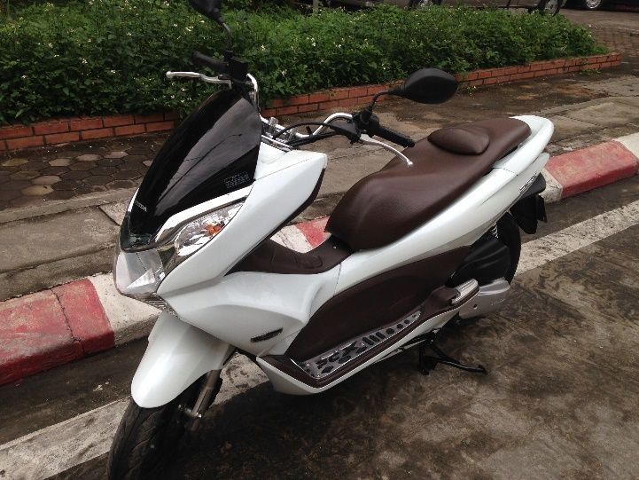

[🏠 Trang chủ](../../README.md) › [PCX](../../dong-xe/pcx.md) › **BO0352**

# BO0352 · PCX 125 2010 Trắng NHA96P

| | |
|---|---|
| **Mã bộ** | `BO0352` |
| **Tên bộ** | Bộ nhựa (Dàn áo) PCX 125 2010 Trắng NHA96P |
| **Đời xe** | PCX 125 năm 2010 Màu Trắng NHA96P |
| **Model** | P1 |
| **Dòng xe** | PCX |
| **Số chi tiết** | 24 |

## Chi tiết trong bộ

| STT | Mã chi tiết | Tên chi tiết | Dùng chung | Mã thay thế | Ghi chú |
|---:|---|---|:---:|---|---|
| 1 | [`33601KWN901`](../../tra-ma/336.md#33601kwn901) | Chắn bùn sau |  |  |  |
| 2 | [`61110KWN930ZJ`](../../tra-ma/611.md#61110kwn930zj) | Bộ chắn bùn trước \*NHA96P\* |  |  |  |
| 3 | [`64305KWN930`](../../tra-ma/6430.md#64305kwn930) | Nẹp đèn pha |  |  |  |
| 4 | [`64311KWN900ZA`](../../tra-ma/6431.md#64311kwn900za) | Sàn để chân phải \*YR286R\* |  |  |  |
| 5 | [`64321KWN900ZA`](../../tra-ma/6432.md#64321kwn900za) | Sàn để chân trái \*YR286R\* |  |  |  |
| 6 | [`64336KWN900ZA`](../../tra-ma/6433.md#64336kwn900za) | Tấm ốp trước đồng hồ \*NH1\* |  |  |  |
| 7 | [`64337KWN900ZF`](../../tra-ma/6433.md#64337kwn900zf) | Tấm ốp sau đồng hồ \*NHA96P\* |  |  |  |
| 8 | [`64338KWN900ZF`](../../tra-ma/6433.md#64338kwn900zf) | Nắp ốp sau trục cổ lái \*NHA96P |  |  |  |
| 9 | [`64400KWN900ZB`](../../tra-ma/6440.md#64400kwn900zb) | Bộ ống yếm trung tâm \*YR286R\* |  |  |  |
| 10 | [`64405KWN900ZA`](../../tra-ma/6440.md#64405kwn900za) | Nắp mở bình xăng \*YR286R\* |  |  |  |
| 11 | [`64431KWN900ZF`](../../tra-ma/6443.md#64431kwn900zf) | Tấm ốp sàn phải \*NHA96P\* |  |  |  |
| 12 | [`64432KWN900ZF`](../../tra-ma/6443.md#64432kwn900zf) | Tấm ốp sàn trái \*NHA96P\* |  |  |  |
| 13 | [`64500KWN931ZF`](../../tra-ma/645.md#64500kwn931zf) | Bộ ốp trước bên phải \*NHA96P\* |  | [`64500KWN932ZF`](../../tra-ma/645.md#64500kwn932zf) |  |
| 14 | [`64510KWN931ZF`](../../tra-ma/645.md#64510kwn931zf) | Bộ ốp trước bên trái \*NHA96P\* |  |  |  |
| 15 | [`64520KWN900ZA`](../../tra-ma/645.md#64520kwn900za) | Tấm thông gió trước \*NH1\* |  |  |  |
| 16 | [`64530KWN901`](../../tra-ma/645.md#64530kwn901) | Tấm ốp sàn dưới |  |  |  |
| 17 | [`67100KWN871ZA`](../../tra-ma/671.md#67100kwn871za) | Bộ tấm chắn đồng hồ tốc độ |  |  |  |
| 18 | [`81130KWN900ZB`](../../tra-ma/8113.md#81130kwn900zb) | Bộ ốp trước bên trong \*YR286R\* |  |  |  |
| 19 | [`81138KWN930ZA`](../../tra-ma/8113.md#81138kwn930za) | Nắp phải khóa điện \*YR286R\* |  |  |  |
| 20 | [`81141KWN900ZA`](../../tra-ma/8114.md#81141kwn900za) | Nắp hộc đồ trước trái \*YR286R\* |  |  |  |
| 21 | [`81143KWN900`](../../tra-ma/8114.md#81143kwn900) | Bản lề nắp hộc đồ trước trái |  |  |  |
| 22 | [`83550KWN902ZH`](../../tra-ma/8355.md#83550kwn902zh) | Bộ ốp sườn phải \*NHA96P\* |  |  |  |
| 23 | [`83650KWN902ZH`](../../tra-ma/8365.md#83650kwn902zh) | Bộ ốp sườn trái \*NHA96P\* |  |  |  |
| 24 | [`84155KWN970ZB`](../../tra-ma/841.md#84155kwn970zb) | Bộ tấm ốp tay dắt sau \*NHA96P\* |  |  |  |

Cập nhật 11/11/2026
