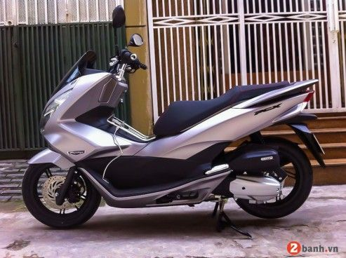

[🏠 Trang chủ](../../README.md) › [PCX](../../dong-xe/pcx.md) › **BO0369**

# BO0369 · PCX 125 2015 Bạc Mờ NHB18M

| | |
|---|---|
| **Mã bộ** | `BO0369` |
| **Tên bộ** | Bộ nhựa (Dàn áo) PCX 125 2015 Bạc Mờ NHB18M |
| **Đời xe** | PCX 125 năm 2015 Màu Bạc Mờ NH-B18M |
| **Model** | P6 |
| **Dòng xe** | PCX |
| **Số chi tiết** | 28 |

## Chi tiết trong bộ

| STT | Mã chi tiết | Tên chi tiết | Dùng chung | Mã thay thế | Ghi chú |
|---:|---|---|:---:|---|---|
| 1 | [`61000K35V00ZE`](../../tra-ma/610.md#61000k35v00ze) | Bộ chắn bùn trước\*NHB18M\* |  |  |  |
| 2 | [`64300K36T00ZP`](../../tra-ma/6430.md#64300k36t00zp) | Bộ ốp trang trí mặt trước \*NHB18M\* |  |  |  |
| 3 | [`64311K35V00ZA`](../../tra-ma/6431.md#64311k35v00za) | Tấm bắt sàn phải\*NH1\* |  |  |  |
| 4 | [`64321K35V00ZA`](../../tra-ma/6432.md#64321k35v00za) | Tấm bắt sàn trái\*NH1\* |  |  |  |
| 5 | [`64336K35V00ZA`](../../tra-ma/6433.md#64336k35v00za) | Tấm ốp trước đồng hồ\*NH1\* |  |  |  |
| 6 | [`64337K35V00ZA`](../../tra-ma/6433.md#64337k35v00za) | Tấm ốp sau đồng hồ\*NH1\* |  |  |  |
| 7 | [`64400K35V00ZA`](../../tra-ma/6440.md#64400k35v00za) | Tấm ốp trung tâm\*NH1\* |  |  |  |
| 8 | [`64405K35V00ZA`](../../tra-ma/6440.md#64405k35v00za) | Nắp mở bình xăng\*NH1\* |  |  |  |
| 9 | [`64431K35V00ZE`](../../tra-ma/6443.md#64431k35v00ze) | Tấm ốp sàn phải\*NHB18M\* |  |  |  |
| 10 | [`64432K35V00ZE`](../../tra-ma/6443.md#64432k35v00ze) | Tấm ốp sàn trái\*NHB18M\* |  |  |  |
| 11 | [`64500K35V30ZA`](../../tra-ma/645.md#64500k35v30za) | Bộ ốp trước bên phải \*NHB18M\* |  |  |  |
| 12 | [`64521K35V00ZA`](../../tra-ma/645.md#64521k35v00za) | Ốp trước bên dưới\*NH1\* |  |  |  |
| 13 | [`64530KWN711`](../../tra-ma/645.md#64530kwn711) | Tấm ốp sàn dưới |  |  |  |
| 14 | [`64600K35V30ZA`](../../tra-ma/6460.md#64600k35v30za) | Bộ ốp trước bên trái \*NHB18M\* |  |  |  |
| 15 | [`67100K35V00ZA`](../../tra-ma/671.md#67100k35v00za) | Bộ tấm chắn đồng hồ tốc độ TYPE1 |  |  |  |
| 16 | [`80105K35V00`](../../tra-ma/8010.md#80105k35v00) | Chắn bùn sau |  |  |  |
| 17 | [`80110K35V00ZA`](../../tra-ma/8011.md#80110k35v00za) | Bộ nắp đèn soi biển số\*NH1\* |  |  |  |
| 18 | [`81131K35V30ZA`](../../tra-ma/8113.md#81131k35v30za) | Ốp bên trong \*NH1\* |  |  |  |
| 19 | [`81132K35V00`](../../tra-ma/8113.md#81132k35v00) | Hốc trên bên trong |  |  |  |
| 20 | [`81133K35V00`](../../tra-ma/8113.md#81133k35v00) | Hốc dưới bên trong |  |  |  |
| 21 | [`81137K35V30ZD`](../../tra-ma/8113.md#81137k35v30zd) | Nắp khẩn cấp \*NHB18M\* |  |  |  |
| 22 | [`81138K35V30ZF`](../../tra-ma/8113.md#81138k35v30zf) | Ốp bên trong phải \*NHB18M\* |  |  |  |
| 23 | [`81139K35V00ZE`](../../tra-ma/8113.md#81139k35v00ze) | Ốp bên trong trái\*NHB18M\* |  |  |  |
| 24 | [`81141K35V00ZE`](../../tra-ma/8114.md#81141k35v00ze) | Nắp khoang chứa đồ\*NHB18M\* |  |  |  |
| 25 | [`83550K35V10ZA`](../../tra-ma/8355.md#83550k35v10za) | Bộ ốp sườn phải\*NHB18M\* |  |  |  |
| 26 | [`83650K35V10ZA`](../../tra-ma/8365.md#83650k35v10za) | Bộ ốp sườn trái\*NHB18M\* |  |  |  |
| 27 | [`84151K35V00ZE`](../../tra-ma/841.md#84151k35v00ze) | Ốp tay dắt sau\*NHB18M\* |  |  |  |
| 28 | [`84152K35V00ZE`](../../tra-ma/841.md#84152k35v00ze) | Nắp nhựa ốp tay dắt sau\*NHB18M\* |  |  |  |

Cập nhật 11/11/2026
