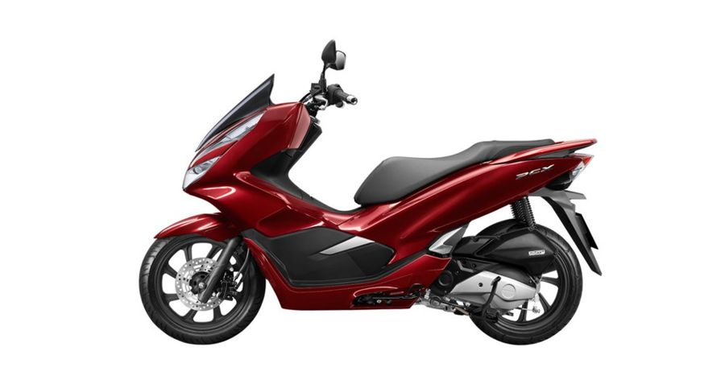

[🏠 Trang chủ](../../README.md) › [PCX](../../dong-xe/pcx.md) › **BO0375**

# BO0375 · PCX 125 2018 Đỏ R368C

| | |
|---|---|
| **Mã bộ** | `BO0375` |
| **Tên bộ** | Bộ nhựa (Dàn áo) PCX 125 2018 Đỏ R368C |
| **Đời xe** | PCX 125 năm 2018 Màu Đỏ R368C |
| **Model** | P7 |
| **Dòng xe** | PCX |
| **Số chi tiết** | 29 |

## Chi tiết trong bộ

| STT | Mã chi tiết | Tên chi tiết | Dùng chung | Mã thay thế | Ghi chú |
|---:|---|---|:---:|---|---|
| 1 | [`61000K96V00ZM`](../../tra-ma/610.md#61000k96v00zm) | Bộ chắn bùn trước \*R368C\* |  |  |  |
| 2 | [`64305K97T00ZF`](../../tra-ma/6430.md#64305k97t00zf) | Trang trí phía trước \*R368C\* |  |  |  |
| 3 | [`64311K97T00ZA`](../../tra-ma/6431.md#64311k97t00za) | Tấm bắt sàn phải \*NH1\* |  |  |  |
| 4 | [`64321K97T00ZA`](../../tra-ma/6432.md#64321k97t00za) | Tấm bắt sàn trái \*NH1\* |  |  |  |
| 5 | [`64336K97T00ZA`](../../tra-ma/6433.md#64336k97t00za) | Tấm ốp trước đồng hồ \*NH1\* |  |  |  |
| 6 | [`64337K97T00ZA`](../../tra-ma/6433.md#64337k97t00za) | Tấm ốp sau đồng hồ \*NH1\* |  |  |  |
| 7 | [`64405K97T00ZA`](../../tra-ma/6440.md#64405k97t00za) | Nắp ngoài bình xăng \*NH1\* |  |  |  |
| 8 | [`64410K97T00ZA`](../../tra-ma/6441.md#64410k97t00za) | Ốp nhựa trung tâm \*NH1\* |  |  |  |
| 9 | [`64431K97T00ZC`](../../tra-ma/6443.md#64431k97t00zc) | Bộ ốp sàn phải \*R368C\* |  |  |  |
| 10 | [`64432K97T00ZC`](../../tra-ma/6443.md#64432k97t00zc) | Bộ ốp sàn trái \*R368C\* |  |  |  |
| 11 | [`64501K97T00ZB`](../../tra-ma/645.md#64501k97t00zb) | Ốp trước bên phải \*R368C\* |  |  |  |
| 12 | [`64502K96V00ZB`](../../tra-ma/645.md#64502k96v00zb) | Ốp trước bên trái \*R368C\* |  |  |  |
| 13 | [`64521K97T00`](../../tra-ma/645.md#64521k97t00) | Tấm chắn bùn trước bên trong |  |  |  |
| 14 | [`64530K97T00`](../../tra-ma/645.md#64530k97t00) | Ốp dưới |  |  |  |
| 15 | [`67100K96V00ZA`](../../tra-ma/671.md#67100k96v00za) | Bộ tấm chắn đồng hồ tốc độ \*TYPE1\* |  |  |  |
| 16 | [`80101K97T00`](../../tra-ma/8010.md#80101k97t00) | Chắn bùn A sau |  |  |  |
| 17 | [`80115K97T00`](../../tra-ma/8011.md#80115k97t00) | Nắp bảo vệ mặt đèn |  |  |  |
| 18 | [`81131K97T00ZA`](../../tra-ma/8113.md#81131k97t00za) | Tấm ốp bên trong trước \*NH1\* |  |  |  |
| 19 | [`81132K96V00`](../../tra-ma/8113.md#81132k96v00) | Hộc đựng bên trong |  |  |  |
| 20 | [`81133K97T00`](../../tra-ma/8113.md#81133k97t00) | Ốp bản lề |  |  |  |
| 21 | [`81137K97T00ZF`](../../tra-ma/8113.md#81137k97t00zf) | Nắp khẩn cấp \*R368C\* |  |  |  |
| 22 | [`81138K97T00ZB`](../../tra-ma/8113.md#81138k97t00zb) | Ốp bên trong phải \*R368C\* |  |  |  |
| 23 | [`81140K96V00ZA`](../../tra-ma/8114.md#81140k96v00za) | Ốp bên trong \*NH1\* |  |  |  |
| 24 | [`81141K96V00ZB`](../../tra-ma/8114.md#81141k96v00zb) | Nắp khoang chứa đồ \*R368C\* |  |  |  |
| 25 | [`81143K97T00ZA`](../../tra-ma/8114.md#81143k97t00za) | Bản lề nắp hốc đồ \*NH1\* |  |  |  |
| 26 | [`83550K96V00ZD`](../../tra-ma/8355.md#83550k96v00zd) | Ốp sườn phải \*R368C\* |  |  |  |
| 27 | [`83650K96V00ZD`](../../tra-ma/8365.md#83650k96v00zd) | Ốp sườn trái \*R368C\* |  |  |  |
| 28 | [`84151K97T00ZB`](../../tra-ma/841.md#84151k97t00zb) | Ốp tay dắt sau \*R368C\* |  |  |  |
| 29 | [`84152K97T00ZF`](../../tra-ma/841.md#84152k97t00zf) | Nắp nhựa ốp tay dắt sau \*R368C\* |  |  |  |

Cập nhật 11/11/2026
