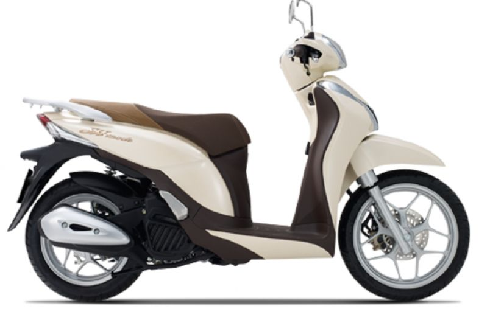

[🏠 Trang chủ](../../README.md) › [SH Mode](../../dong-xe/sh-mode.md) › **BO0751**

# BO0751 · SH mode 2019 K29 màu vàng kem lam YR229, phiên bản thường phanh CBS

| | |
|---|---|
| **Mã bộ** | `BO0751` |
| **Tên bộ** | Bộ nhựa (Dàn áo) SH mode 2019 K29 màu vàng kem lam YR229, phiên bản thường phanh CBS |
| **Đời xe** | SH Mode 125 Đời 2019. Phiên Bản Thường, Phanh CBS Màu Vàng Kem Lam Ỷ229 |
| **Model** | K29M/O6 |
| **Dòng xe** | SH Mode |
| **Số chi tiết** | 35 |

## Chi tiết trong bộ

| STT | Mã chi tiết | Tên chi tiết | Dùng chung | Mã thay thế | Ghi chú |
|---:|---|---|:---:|---|---|
| 1 | [`53205K29900ZR`](../../tra-ma/5320.md#53205k29900zr) | Nắp trước giá bắt tay lái |  |  |  |
| 2 | [`53206K29960ZJ`](../../tra-ma/5320.md#53206k29960zj) | Nắp sau tay lái |  |  |  |
| 3 | [`53207K29900`](../../tra-ma/5320.md#53207k29900) | Nắp ốp đồng hồ |  |  |  |
| 4 | [`61000K29V80ZB`](../../tra-ma/610.md#61000k29v80zb) | Bộ chắn bùn trước Y229 |  |  |  |
| 5 | [`61200K29900ZB`](../../tra-ma/612.md#61200k29900zb) | Chắn bùn bên trong trước phải\* |  |  |  |
| 6 | [`61300K29900ZB`](../../tra-ma/613.md#61300k29900zb) | Chắn bùn bên trong trước trái\* |  |  |  |
| 7 | [`64301K29900ZS`](../../tra-ma/6430.md#64301k29900zs) | Ốp trước bên phải |  |  |  |
| 8 | [`64303K29V80ZB`](../../tra-ma/6430.md#64303k29v80zb) | Bộ mặt nạ trước |  |  |  |
| 9 | [`64305K29910`](../../tra-ma/6430.md#64305k29910) | Trang trí phía trước |  |  |  |
| 10 | [`64308K29960`](../../tra-ma/6430.md#64308k29960) | Ốp trước phía dưới |  |  |  |
| 11 | [`64315K29900ZA`](../../tra-ma/6431.md#64315k29900za) | Bộ ốp sàn\*YR286R\* |  |  |  |
| 12 | [`64321K29900ZS`](../../tra-ma/6432.md#64321k29900zs) | Ốp sàn bên phải |  |  |  |
| 13 | [`64322K29900ZS`](../../tra-ma/6432.md#64322k29900zs) | Ốp sàn bên trái |  |  |  |
| 14 | [`64340K29900ZA`](../../tra-ma/6434.md#64340k29900za) | ốp sàn dưới\*YR286R\* | ✔ |  |  |
| 15 | [`64401K29900ZS`](../../tra-ma/6440.md#64401k29900zs) | Ốp trước bên trái |  |  |  |
| 16 | [`80101K29900ZB`](../../tra-ma/8010.md#80101k29900zb) | Chắn bùn A sau\*NH1\* |  |  |  |
| 17 | [`80103K29900`](../../tra-ma/8010.md#80103k29900) | Chắn bùn C sau |  |  |  |
| 18 | [`80110K29900ZB`](../../tra-ma/8011.md#80110k29900zb) | Bộ nắp đèn soi biển số\*\* |  |  |  |
| 19 | [`80151K29900ZA`](../../tra-ma/8015.md#80151k29900za) | Ốp nhựa trung tâm\*YR286R\* |  |  |  |
| 20 | [`81131K29960ZJ`](../../tra-ma/8113.md#81131k29960zj) | Ốp trên bên trong |  |  |  |
| 21 | [`81141K29960ZA`](../../tra-ma/8114.md#81141k29960za) | Ốp dưới bên trong \*YR286R\* |  |  |  |
| 22 | [`81142K29960ZB`](../../tra-ma/8114.md#81142k29960zb) | Nắp khẩn cấp thông minh \*NH1\* |  |  |  |
| 23 | [`83200K29V80ZE`](../../tra-ma/832.md#83200k29v80ze) | Bộ ốp sườn phải Y229 |  |  |  |
| 24 | [`83300K29V80ZE`](../../tra-ma/833.md#83300k29v80ze) | Bộ ốp sườn trái Y229 |  |  |  |
| 25 | [`83430K29900`](../../tra-ma/834.md#83430k29900) | Ốp cần để chân sau phải |  |  |  |
| 26 | [`83440K29900`](../../tra-ma/834.md#83440k29900) | Ốp cần để chân sau trái |  |  |  |
| 27 | [`83520K29900ZA`](../../tra-ma/8352.md#83520k29900za) | Ốp dưới sườn phải\*YR286R\* |  |  |  |
| 28 | [`83530K29900`](../../tra-ma/8353.md#83530k29900) | Nắp ốp xi nhan sau phải | ✔ |  |  |
| 29 | [`83620K29900ZA`](../../tra-ma/8362.md#83620k29900za) | Ốp dưới sườn trái\*YR286R\* |  |  |  |
| 30 | [`83630K29900`](../../tra-ma/8363.md#83630k29900) | Nắp ốp xi nhan sau trái |  |  |  |
| 31 | [`80102K29900`](../../tra-ma/8010.md#80102k29900) | Chắn bùn B sau |  |  |  |
| 32 | [`80105K29900`](../../tra-ma/8010.md#80105k29900) | Nắp chắn bùn B sau |  |  |  |
| 33 | [`80106K29900`](../../tra-ma/8010.md#80106k29900) | Chắn bùn sau bên trong |  |  |  |
| 34 | [`83750K29900ZR`](../../tra-ma/837.md#83750k29900zr) | Ốp A trung tâm sau | ✔ |  |  |
| 35 | [`83760K29900ZQ`](../../tra-ma/837.md#83760k29900zq) | Ốp B trung tâm sau |  |  |  |

Cập nhật 11/11/2026
