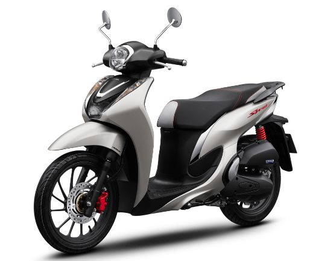

[🏠 Trang chủ](../../README.md) › [SH Mode](../../dong-xe/sh-mode.md) › **BO0914**

# BO0914 · SH mode 2024 Phiên bản đặc biệt màu bạc đen NHB18

| | |
|---|---|
| **Mã bộ** | `BO0914` |
| **Tên bộ** | Bộ nhựa (Dàn áo) SH mode 2024 Phiên bản đặc biệt màu bạc đen NHB18 |
| **Đời xe** | SH mode năm 2024 Phiên bản đặc biệt  màu bạc đen NHB18 |
| **Dòng xe** | SH Mode |
| **Số chi tiết** | 46 |

## Chi tiết trong bộ

| STT | Mã chi tiết | Tên chi tiết | Dùng chung | Mã thay thế | Ghi chú |
|---:|---|---|:---:|---|---|
| 1 | [`81136K1NV00ZB`](../../tra-ma/8113.md#81136k1nv00zb) | Chốt cài móc hộp chứa đồ \*NH1\* |  |  |  |
| 2 | [`83440K1NV00ZB`](../../tra-ma/834.md#83440k1nv00zb) | Ốp cần để chân sau trái \*NH1\* |  |  |  |
| 3 | [`83430K1NV00ZB`](../../tra-ma/834.md#83430k1nv00zb) | Ốp cần để chân sau phải \*NH1\* |  |  |  |
| 4 | [`53209K1NV00ZH`](../../tra-ma/5320.md#53209k1nv00zh) | Ốp sau tay lái B \*NHA76M\* |  |  |  |
| 5 | [`83460K1NV00ZB`](../../tra-ma/834.md#83460k1nv00zb) | Ốp B để chân sau bên trái \*NH1\* |  |  |  |
| 6 | [`83450K1NV00ZB`](../../tra-ma/834.md#83450k1nv00zb) | Ốp B để chân sau bên phải \*NH1\* |  |  |  |
| 7 | [`64300K1NVD0ZF`](../../tra-ma/6430.md#64300k1nvd0zf) | Bộ ốp mặt nạ trước \*NHA76M\* |  |  |  |
| 8 | [`80110K1NV00ZB`](../../tra-ma/8011.md#80110k1nv00zb) | Bộ nắp đèn soi biển số \*NH1\* |  |  |  |
| 9 | [`80151K1NV00ZB`](../../tra-ma/8015.md#80151k1nv00zb) | Ốp nhựa trung tâm \*NH1\* |  |  |  |
| 10 | [`53205K1NV00ZG`](../../tra-ma/5320.md#53205k1nv00zg) | Nắp trước tay lái \*NHA76M\* |  |  |  |
| 11 | [`81141K1NV00ZB`](../../tra-ma/8114.md#81141k1nv00zb) | Ốp dưới bên trong \*NH1\* |  |  |  |
| 12 | [`81131K1NV00ZH`](../../tra-ma/8113.md#81131k1nv00zh) | Ốp trên bên trong \*NHA76\* |  |  |  |
| 13 | [`83621K1NV00ZB`](../../tra-ma/8362.md#83621k1nv00zb) | Ốp dưới sườn trái \*NH1\* |  |  |  |
| 14 | [`64324K1NV00ZB`](../../tra-ma/6432.md#64324k1nv00zb) | Đệm B ốp sàn \*NH1\* |  |  |  |
| 15 | [`83521K1NV00ZB`](../../tra-ma/8352.md#83521k1nv00zb) | Ốp dưới sườn phải \*NH1\* |  |  |  |
| 16 | [`64323K1NV00ZB`](../../tra-ma/6432.md#64323k1nv00zb) | Đệm A ốp sàn \*NH1\* |  |  |  |
| 17 | [`81142K1NV90ZA`](../../tra-ma/8114.md#81142k1nv90za) | Nắp khẩn cấp thông minh \*NH1\* |  |  |  |
| 18 | [`53206K1NV00ZB`](../../tra-ma/5320.md#53206k1nv00zb) | Nắp sau tay lái \*NH1\* |  |  |  |
| 19 | [`64340K1NV00ZB`](../../tra-ma/6434.md#64340k1nv00zb) | ốp sàn dưới \*NH1\* |  |  |  |
| 20 | [`80101K1NV00ZB`](../../tra-ma/8010.md#80101k1nv00zb) | Chắn bùn A sau \*NH1\* |  |  |  |
| 21 | [`61301K1NV00ZC`](../../tra-ma/613.md#61301k1nv00zc) | Chắn bùn trước bên trái trong \*NHA76\* |  |  |  |
| 22 | [`61201K1NV00ZC`](../../tra-ma/612.md#61201k1nv00zc) | Chắn bùn trước bên phải trong \*NHA76\* |  |  |  |
| 23 | [`64461K1NV00ZB`](../../tra-ma/6446.md#64461k1nv00zb) | Nắp ắc quy \*NH1\* |  |  |  |
| 24 | [`81143K1NV00ZB`](../../tra-ma/8114.md#81143k1nv00zb) | Nắp mở ốp giữa trái \*NH1\* |  |  |  |
| 25 | [`81144K1NV00ZB`](../../tra-ma/8114.md#81144k1nv00zb) | Nắp mở ốp giữa phải \*NH1\* |  |  |  |
| 26 | [`64310K1NV00ZB`](../../tra-ma/6431.md#64310k1nv00zb) | Sàn xe \*NH1\* |  |  |  |
| 27 | [`53207K1NV00`](../../tra-ma/5320.md#53207k1nv00) | Nắp ốp đồng hồ |  |  |  |
| 28 | [`53208K1NV00`](../../tra-ma/5320.md#53208k1nv00) | Vành đèn pha |  |  |  |
| 29 | [`64305K1NV00`](../../tra-ma/6430.md#64305k1nv00) | Trang trí phía trước |  |  |  |
| 30 | [`64308K1NV00`](../../tra-ma/6430.md#64308k1nv00) | Ốp trước phía dưới |  |  |  |
| 31 | [`80102K1NV00`](../../tra-ma/8010.md#80102k1nv00) | Chắn bùn B sau |  |  |  |
| 32 | [`80103K1NV00`](../../tra-ma/8010.md#80103k1nv00) | Chắn bùn C sau |  |  |  |
| 33 | [`83410K1NV00`](../../tra-ma/834.md#83410k1nv00) | Trang trí sườn phải |  |  |  |
| 34 | [`83420K1NV00`](../../tra-ma/834.md#83420k1nv00) | Trang trí sườn trái |  |  |  |
| 35 | [`83531K1NV00`](../../tra-ma/8353.md#83531k1nv00) | Nắp ốp xi nhan sau phải |  |  |  |
| 36 | [`83631K1NV00`](../../tra-ma/8363.md#83631k1nv00) | Nắp ốp xi nhan sau trái |  |  |  |
| 37 | [`83751K1NV00ZF`](../../tra-ma/837.md#83751k1nv00zf) | Ốp A trung tâm sau \*NHB18M\* |  |  |  |
| 38 | [`83761K1NV00ZF`](../../tra-ma/837.md#83761k1nv00zf) | Ốp B trung tâm sau \*NHB18M\* |  |  |  |
| 39 | [`83610K1NVA0ZC`](../../tra-ma/8361.md#83610k1nva0zc) | Bộ ốp sườn trái \*NHB18M\* |  |  |  |
| 40 | [`83510K1NVA0ZC`](../../tra-ma/8351.md#83510k1nva0zc) | Bộ ốp sườn phải \*NHB18M\* |  |  |  |
| 41 | [`64322K1NV00ZF`](../../tra-ma/6432.md#64322k1nv00zf) | Ốp sàn bên trái \*NHB18M\* |  |  |  |
| 42 | [`64401K1NV00ZF`](../../tra-ma/6440.md#64401k1nv00zf) | Ốp trước bên trái \*NHB18M\* |  |  |  |
| 43 | [`64321K1NV00ZF`](../../tra-ma/6432.md#64321k1nv00zf) | Ốp sàn bên phải \*NHB18M\* |  |  |  |
| 44 | [`64301K1NV00ZF`](../../tra-ma/6430.md#64301k1nv00zf) | Ốp trước bên phải \*NHB18M\* |  |  |  |
| 45 | [`61000K1NVE0ZA`](../../tra-ma/610.md#61000k1nve0za) | Bộ chắn bùn trước \*NHB18M\* |  |  |  |
| 46 | [`81133K1NV00ZF`](../../tra-ma/8113.md#81133k1nv00zf) | Nắp khẩn cấp \*NHB18M\* |  |  |  |

Cập nhật 11/11/2026
