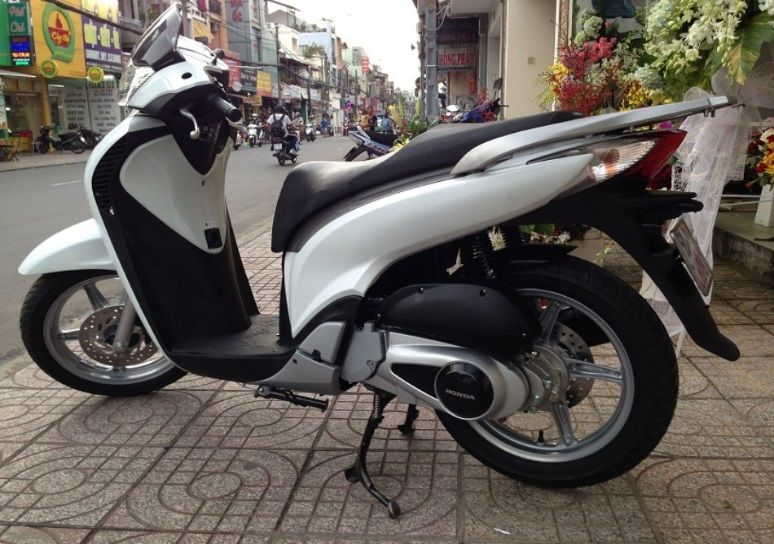

[🏠 Trang chủ](../../README.md) › [SH](../../dong-xe/sh.md) › **BO0323.1**

# BO0323.1 · SH125&150 2009 KTF Trắng NH35P

| | |
|---|---|
| **Mã bộ** | `BO0323.1` |
| **Tên bộ** | Bộ nhựa (Dàn áo) SH125&150 2009 KTF Trắng NH35P |
| **Đời xe** | SH 125&150  Năm 2009-2011 Màu Trắng- NH-35P |
| **Model** | Z1,Z3(125cc)Z2,Z4(150cc) |
| **Dòng xe** | SH |
| **Số chi tiết** | 30 |

**Bộ liên quan:** [BO0323](BO0323-sh125-150-2009-ktf-trang-nh35p.md)

## Chi tiết trong bộ

| STT | Mã chi tiết | Tên chi tiết | Dùng chung | Mã thay thế | Ghi chú |
|---:|---|---|:---:|---|---|
| 1 | [`53200KTGV00ZF`](../../tra-ma/5320.md#53200ktgv00zf) | Bộ ốp trái nắp tay lái\*NHB35P\* |  |  |  |
| 2 | [`53205KTF980ZA`](../../tra-ma/5320.md#53205ktf980za) | Nắp trước tay lái \*NH1\* | ✔ |  |  |
| 3 | [`53207KTF980ZA`](../../tra-ma/5320.md#53207ktf980za) | Tấm cài bên phải nắp trước tay | ✔ |  |  |
| 4 | [`53208KTF890ZP`](../../tra-ma/5320.md#53208ktf890zp) | ốp phải nắp tay lái \*NHB35P\* |  |  |  |
| 5 | [`53211KTGV00`](../../tra-ma/5321.md#53211ktgv00) | Bộ nắp sau tay lái | ✔ |  |  |
| 6 | [`53217KTF980ZA`](../../tra-ma/5321.md#53217ktf980za) | Tấm cài bên trái nắp trước tay | ✔ |  |  |
| 8 | [`61110KTGV00ZF`](../../tra-ma/611.md#61110ktgv00zf) | Bộ chắn bùn trước\*NHB35P\* |  |  |  |
| 9 | [`64300KTF980ZM`](../../tra-ma/6430.md#64300ktf980zm) | Bộ mặt nạ trước \*NHB35P\* |  |  |  |
| 10 | [`64302KTF980ZP`](../../tra-ma/6430.md#64302ktf980zp) | ốp yếm trước \*NHB35P\* |  |  |  |
| 11 | [`64305KTF980`](../../tra-ma/6430.md#64305ktf980) | Nẹp tấm thông gió trước | ✔ |  |  |
| 12 | [`64306KTF980ZA`](../../tra-ma/6430.md#64306ktf980za) | Tấm thông gió trước \*NH1\* | ✔ |  |  |
| 13 | [`64310KTF980ZA`](../../tra-ma/6431.md#64310ktf980za) | Sàn xe \*NH1\* | ✔ |  |  |
| 14 | [`64311KTF980ZA`](../../tra-ma/6431.md#64311ktf980za) | Nắp ốp đầu động cơ \*NH1\* | ✔ |  |  |
| 15 | [`64313KTF980ZA`](../../tra-ma/6431.md#64313ktf980za) | Tấm bảo vệ cổ láI \*NH1\* | ✔ |  |  |
| 16 | [`64316KPR900`](../../tra-ma/6431.md#64316kpr900) | Cao su giảm chấn bình ắc quy | ✔ |  |  |
| 17 | [`64321KTF980ZA`](../../tra-ma/6432.md#64321ktf980za) | ốp sàn bên phải \*NHA60MR\* | ✔ |  |  |
| 18 | [`64322KTF980ZA`](../../tra-ma/6432.md#64322ktf980za) | ốp sàn bên trái \*NHA60MR\* | ✔ |  |  |
| 19 | [`64331KTF980ZA`](../../tra-ma/6433.md#64331ktf980za) | Tấm ốp sàn dưới \*NH1\* | ✔ |  |  |
| 20 | [`67200KTGV00`](../../tra-ma/672.md#67200ktgv00) | Kính chắn nắp trước tay lái | ✔ |  |  |
| 21 | [`80100KTGV00`](../../tra-ma/8010.md#80100ktgv00) | Chắn bùn sau | ✔ |  |  |
| 22 | [`80105KPR900ZA`](../../tra-ma/8010.md#80105kpr900za) | Chắn bùn phụ sau \*NH1\* | ✔ |  |  |
| 23 | [`80106KTF980`](../../tra-ma/8010.md#80106ktf980) | Chắn bùn sau bên trong | ✔ |  |  |
| 24 | [`81131KTF980ZA`](../../tra-ma/8113.md#81131ktf980za) | Tấm ốp yếm trước bên trong \*NH | ✔ |  |  |
| 25 | [`81151KTF980ZP`](../../tra-ma/8115.md#81151ktf980zp) | Nắp hộp đồ trước \*NHB35P\* |  |  |  |
| 26 | [`81161KTF980ZP`](../../tra-ma/8116.md#81161ktf980zp) | Nắp phải ốp yếm trước bên tron |  |  |  |
| 27 | [`81162KTF980ZP`](../../tra-ma/8116.md#81162ktf980zp) | Nắp trái ốp yếm trước bên tron |  |  |  |
| 29 | [`83450KTGV00ZA`](../../tra-ma/834.md#83450ktgv00za) | Bộ trang trí ốp sườn phải \*NHB |  |  |  |
| 31 | [`83460KTGV00ZA`](../../tra-ma/834.md#83460ktgv00za) | Bộ trang trí ốp sườn trái \*NHB |  |  |  |
| 32 | [`83550KTGV00ZF`](../../tra-ma/8355.md#83550ktgv00zf) | Bộ ốp sườn phải \*NHB35P\* |  |  |  |
| 33 | [`83650KTGV00ZF`](../../tra-ma/8365.md#83650ktgv00zf) | Bộ ốp sườn trái \*NHB35P\* |  |  |  |

Cập nhật 11/11/2026
