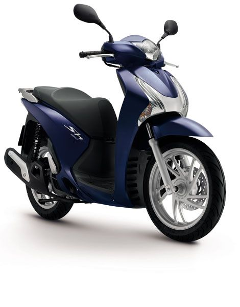

[🏠 Trang chủ](../../README.md) › [SH](../../dong-xe/sh.md) › **BO0332**

# BO0332 · SH125 2013 K01 Xanh PB 390

| | |
|---|---|
| **Mã bộ** | `BO0332` |
| **Tên bộ** | Bộ nhựa (Dàn áo) SH125 2013 K01 Xanh PB 390 |
| **Đời xe** | SH 125&150  Năm 2013 Màu Xanh - PB 390 |
| **Model** | Z7(125cc)Z8(150cc) |
| **Dòng xe** | SH |
| **Số chi tiết** | 30 |

**Bộ liên quan:** [BO0332.1](BO0332.1-sh150-2013-k01-xanh-pb-390.md)

## Chi tiết trong bộ

| STT | Mã chi tiết | Tên chi tiết | Dùng chung | Mã thay thế | Ghi chú |
|---:|---|---|:---:|---|---|
| 1 | [`17575K01900ZA`](../../tra-ma/175.md#17575k01900za) | Ốp đuôi sau \*NH-1\* | ✔ |  |  |
| 2 | [`53150K01600ZA`](../../tra-ma/531.md#53150k01600za) | Bộ nắp trước tay lái\*PB390\* |  |  |  |
| 3 | [`53206K01900ZA`](../../tra-ma/5320.md#53206k01900za) | Nắp sau tay lái \*NH-1\* | ✔ |  |  |
| 4 | [`53210K01600ZA`](../../tra-ma/5321.md#53210k01600za) | Bộ trang trí ốp tay lái\*PB390\* |  |  |  |
| 5 | [`61200K01600ZA`](../../tra-ma/612.md#61200k01600za) | Bộ chắn bùn trước\*PB390\* |  |  |  |
| 6 | [`64301K01900`](../../tra-ma/6430.md#64301k01900) | Trang trí ốp dưới | ✔ |  |  |
| 7 | [`64302K01900ZP`](../../tra-ma/6430.md#64302k01900zp) | Nắp trên ốp trước phải\*PB390M\* |  |  |  |
| 8 | [`64303K01900ZP`](../../tra-ma/6430.md#64303k01900zp) | Nắp trên ốp trước trái\*PB390M\* |  |  |  |
| 9 | [`64304K01900ZA`](../../tra-ma/6430.md#64304k01900za) | Ốp dưới trước \*NH-1\* | ✔ |  |  |
| 10 | [`64305K01900ZA`](../../tra-ma/6430.md#64305k01900za) | Bộ ốp sàn \*NH-1\* | ✔ |  |  |
| 11 | [`64312K01900ZA`](../../tra-ma/6431.md#64312k01900za) | Ốp trung tâm \*NH-1\* | ✔ |  |  |
| 12 | [`64314K01900ZA`](../../tra-ma/6431.md#64314k01900za) | Nắp ốp đầu động cơ \*NH-1\* | ✔ |  |  |
| 13 | [`64320K01600ZA`](../../tra-ma/6432.md#64320k01600za) | Bộ trang trí ốp trước\*PB390\* |  |  |  |
| 14 | [`64321K01900ZP`](../../tra-ma/6432.md#64321k01900zp) | Ốp sàn phải\*PB390M\* |  |  |  |
| 15 | [`64322K01900ZP`](../../tra-ma/6432.md#64322k01900zp) | Ốp sàn trái\*PB390M\* |  |  |  |
| 16 | [`64331K01900`](../../tra-ma/6433.md#64331k01900) | Ốp dưới | ✔ |  |  |
| 17 | [`80100K01900ZA`](../../tra-ma/8010.md#80100k01900za) | Chắn bùn sau A \*NH-1\* | ✔ |  |  |
| 18 | [`80101K01900`](../../tra-ma/8010.md#80101k01900) | Chắn bùn sau B | ✔ | [`80101K01610`](../../tra-ma/8010.md#80101k01610) |  |
| 19 | [`80102K01900`](../../tra-ma/8010.md#80102k01900) | Chắn bùn sau C | ✔ | [`80102K01D10`](../../tra-ma/8010.md#80102k01d10) |  |
| 20 | [`80106K01900`](../../tra-ma/8010.md#80106k01900) | Bộ chắn bùn C sau trước | ✔ |  |  |
| 21 | [`80150K01900ZA`](../../tra-ma/8015.md#80150k01900za) | Bộ nắp đậy bóng đèn \*NH-1\* | ✔ |  |  |
| 22 | [`81131K01900ZA`](../../tra-ma/8113.md#81131k01900za) | Tấm ốp bên trong \*NH-1\* | ✔ |  |  |
| 23 | [`81133K01900ZA`](../../tra-ma/8113.md#81133k01900za) | Nắp hộc đồ trước \*NH-1\* | ✔ |  |  |
| 24 | [`81134K01900ZP`](../../tra-ma/8113.md#81134k01900zp) | Tấm bảo vệ cổ lái\*PB390M\* |  |  |  |
| 25 | [`83200K01600ZA`](../../tra-ma/832.md#83200k01600za) | Bộ ốp sườn phải\*PB390\* |  |  |  |
| 26 | [`83300K01600ZA`](../../tra-ma/833.md#83300k01600za) | Bộ ốp sườn trái\*PB390\* |  |  |  |
| 27 | [`83400K01600ZA`](../../tra-ma/834.md#83400k01600za) | Bộ ốp sườn trước trái\*PB390\* |  |  |  |
| 28 | [`83410K01900ZA`](../../tra-ma/834.md#83410k01900za) | Nắp ốp để chân sau phải \*NH-1\* | ✔ |  |  |
| 29 | [`83420K01900ZA`](../../tra-ma/834.md#83420k01900za) | Nắp ốp để chân sau trái \*NH-1\* | ✔ |  |  |
| 30 | [`83450K01900ZN`](../../tra-ma/834.md#83450k01900zn) | Ốp sườn trước phải\*PB390M\* |  |  |  |

Cập nhật 11/11/2026
