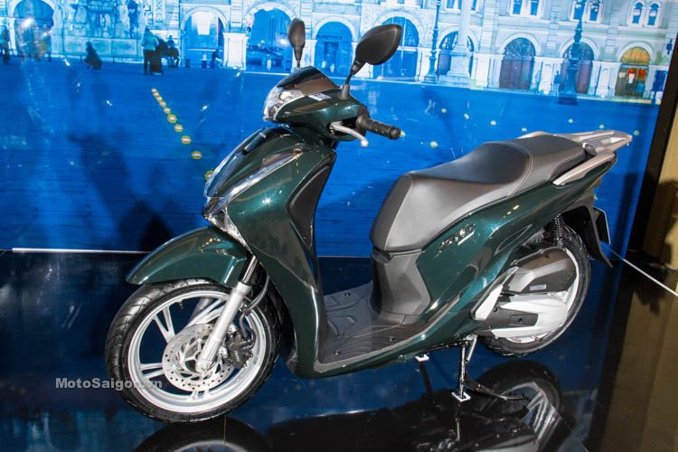

[🏠 Trang chủ](../../README.md) › [SH](../../dong-xe/sh.md) › **BO0343**

# BO0343 · SH125 2016 K77 Xanh Lục G209 phanh CBS (Khác dè)

| | |
|---|---|
| **Mã bộ** | `BO0343` |
| **Tên bộ** | Bộ nhựa (Dàn áo) SH125 2016 K77 Xanh Lục G209 phanh CBS (Khác dè) |
| **Đời xe** | SH 125&150  Năm 2016 Màu Xanh Lục - G-209 |
| **Model** | Z11(125cc)Z12(150cc) |
| **Dòng xe** | SH |
| **Số chi tiết** | 34 |

**Bộ liên quan:** [BO0343.1](BO0343.1-sh150-2016-k77-xanh-luc-g209-phanh-abs-khac-de.md)

## Chi tiết trong bộ

| STT | Mã chi tiết | Tên chi tiết | Dùng chung | Mã thay thế | Ghi chú |
|---:|---|---|:---:|---|---|
| 1 | [`53150K77V00ZF`](../../tra-ma/531.md#53150k77v00zf) | Bộ nắp trước tay lái \*G209P\* |  |  |  |
| 2 | [`53160K77V00ZA`](../../tra-ma/531.md#53160k77v00za) | Bộ ốp sau tay lái \*NH1\* | ✔ |  |  |
| 3 | [`53208K77V00ZF`](../../tra-ma/5320.md#53208k77v00zf) | Trang trí ốp tay lái \*G209P\* |  |  |  |
| 4 | [`53209K77V00ZA`](../../tra-ma/5320.md#53209k77v00za) | Nắp ốp đồng hồ \*NH1\* | ✔ |  |  |
| 5 | [`53211K77V00ZA`](../../tra-ma/5321.md#53211k77v00za) | Chụp nắp tay lái trước phải \*NH1\* | ✔ |  |  |
| 6 | [`53212K77V00ZA`](../../tra-ma/5321.md#53212k77v00za) | Chụp nắp tay lái trước trái \*NH1\* | ✔ |  |  |
| 7 | [`61200K77V00ZC`](../../tra-ma/612.md#61200k77v00zc) | Bộ chắn bùn trước \*G209\* |  | [`61200K77V10ZC`](../../tra-ma/612.md#61200k77v10zc) |  |
| 8 | [`64300K77V00ZF`](../../tra-ma/6430.md#64300k77v00zf) | Trang trí ốp trước \*G209P\* |  |  |  |
| 9 | [`64301K77V00`](../../tra-ma/6430.md#64301k77v00) | Trang trí ốp dưới | ✔ |  |  |
| 10 | [`64302K77V00ZF`](../../tra-ma/6430.md#64302k77v00zf) | Nắp trên ốp trước phải \*G209P\* |  |  |  |
| 11 | [`64303K77V00ZF`](../../tra-ma/6430.md#64303k77v00zf) | Nắp trên ốp trước trái \*G209P\* |  |  |  |
| 12 | [`64304K77V00ZA`](../../tra-ma/6430.md#64304k77v00za) | Ốp dưới trước \*NH1\* | ✔ |  |  |
| 13 | [`64306K77V00ZA`](../../tra-ma/6430.md#64306k77v00za) | Bộ ốp trang trí mặt trước \*TYPE1\* | ✔ |  |  |
| 14 | [`64311K77V00ZA`](../../tra-ma/6431.md#64311k77v00za) | Tấm bắt sàn \*NH1\* | ✔ |  |  |
| 15 | [`64312K77V00ZA`](../../tra-ma/6431.md#64312k77v00za) | Ốp trung tâm \*NH1\* | ✔ |  |  |
| 16 | [`64314K77V00ZA`](../../tra-ma/6431.md#64314k77v00za) | Nắp ốp đầu động cơ \*NH1\* | ✔ |  |  |
| 17 | [`64315K77V00ZA`](../../tra-ma/6431.md#64315k77v00za) | Nắp hộp chứa dung dịch làm mát \*NH1\* | ✔ |  |  |
| 18 | [`64317K77V00ZA`](../../tra-ma/6431.md#64317k77v00za) | Nắp dưới bình ắc quy \*NH1\* | ✔ |  |  |
| 19 | [`64321K77V00ZF`](../../tra-ma/6432.md#64321k77v00zf) | Ốp sàn phải \*G209P\* |  |  |  |
| 20 | [`64322K77V00ZA`](../../tra-ma/6432.md#64322k77v00za) | Ốp sàn trái \*G209P\* |  |  |  |
| 21 | [`64331K77V00`](../../tra-ma/6433.md#64331k77v00) | Ốp dưới | ✔ |  |  |
| 22 | [`80101K77V00`](../../tra-ma/8010.md#80101k77v00) | Chắn bùn sau B | ✔ |  |  |
| 23 | [`80102K01D10`](../../tra-ma/8010.md#80102k01d10) | Chắn bùn sau C | ✔ |  |  |
| 24 | [`80105K77V00ZA`](../../tra-ma/8010.md#80105k77v00za) | Nắp đèn soi biển số \*NH1\* | ✔ |  |  |
| 25 | [`80106K77V10`](../../tra-ma/8010.md#80106k77v10) | Nắp trên động cơ | ✔ |  |  |
| 26 | [`80150K77V00ZA`](../../tra-ma/8015.md#80150k77v00za) | Chắn bùn sau \*TYPE1\* | ✔ |  |  |
| 27 | [`81131K77V00ZA`](../../tra-ma/8113.md#81131k77v00za) | Ốp trên bên trong \*NH1\* | ✔ |  |  |
| 28 | [`81133K77V00ZA`](../../tra-ma/8113.md#81133k77v00za) | Nắp hộc đồ trước \*NH1\* | ✔ |  |  |
| 29 | [`81134K77V00ZF`](../../tra-ma/8113.md#81134k77v00zf) | Tấm bảo vệ cổ lái \*G209P\* |  |  |  |
| 30 | [`81137K77V00ZA`](../../tra-ma/8113.md#81137k77v00za) | Nắp hộc đồ trước \*NH1\* | ✔ |  |  |
| 31 | [`83200K77V00ZC`](../../tra-ma/832.md#83200k77v00zc) | Bộ ốp sườn phải \*G209\* |  |  |  |
| 32 | [`83300K77V00ZC`](../../tra-ma/833.md#83300k77v00zc) | Bộ ốp sườn trái \*G209\* |  |  |  |
| 33 | [`83410K77V00ZA`](../../tra-ma/834.md#83410k77v00za) | Nắp ốp để chân sau phải \*NH1\* | ✔ |  |  |
| 34 | [`83420K77V00ZA`](../../tra-ma/834.md#83420k77v00za) | Nắp ốp để chân sau trái \*NH1\* | ✔ |  |  |

Cập nhật 11/11/2026
