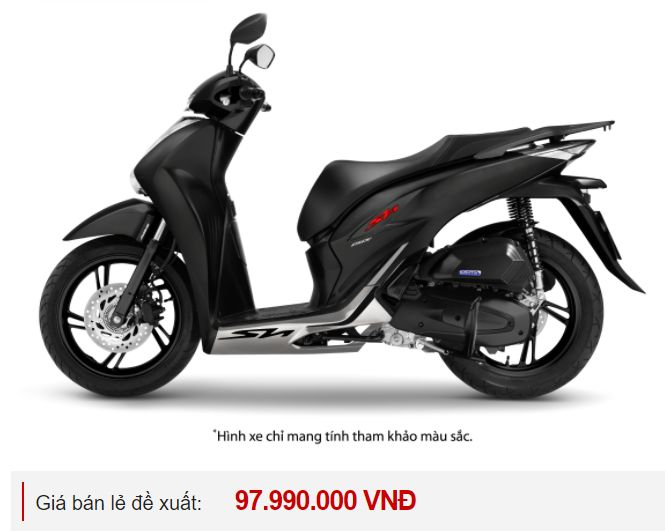

[🏠 Trang chủ](../../README.md) › [SH](../../dong-xe/sh.md) › **BO0755**

# BO0755 · SH 150cc 2021 K0R (Đặc Biệt ABS) Màu Đen Bạc \*NHA76\*

| | |
|---|---|
| **Mã bộ** | `BO0755` |
| **Tên bộ** | Bộ nhựa (Dàn áo) SH 150cc 2021 K0R (Đặc Biệt ABS) Màu Đen Bạc \*NHA76\* |
| **Đời xe** | SH 150cc 2021 (Đặc Biệt ABS) Màu Đen Bạc |
| **Dòng xe** | SH |
| **Số chi tiết** | 36 |

## Chi tiết trong bộ

| STT | Mã chi tiết | Tên chi tiết | Dùng chung | Mã thay thế | Ghi chú |
|---:|---|---|:---:|---|---|
| 1 | [`64310K0SV50ZA`](../../tra-ma/6431.md#64310k0sv50za) | Bộ ốp mặt nạ trước \*TYPE2\* | ✔ |  |  |
| 2 | [`83600K0SV50ZA`](../../tra-ma/8360.md#83600k0sv50za) | Bộ ốp sườn trái \*TYPE2\* |  | [`50616K0RV00`](../../tra-ma/506.md#50616k0rv00) |  |
| 3 | [`64330K0SV50ZA`](../../tra-ma/6433.md#64330k0sv50za) | Bộ ốp sàn trái \*TYPE2\* |  | [`53203K0RV00`](../../tra-ma/5320.md#53203k0rv00) |  |
| 4 | [`53210K0SV50ZA`](../../tra-ma/5321.md#53210k0sv50za) | Bộ nắp ốp đồng hồ \*TYPE2\* |  | [`53207K0RV00`](../../tra-ma/5320.md#53207k0rv00) |  |
| 5 | [`83500K0SV50ZA`](../../tra-ma/8350.md#83500k0sv50za) | Bộ ốp sườn phải \*TYPE2\* |  | [`64301K0RV00`](../../tra-ma/6430.md#64301k0rv00) |  |
| 6 | [`64320K0SV50ZA`](../../tra-ma/6432.md#64320k0sv50za) | Bộ ốp sàn phải \*TYPE2\* |  | [`64304K0RV00`](../../tra-ma/6430.md#64304k0rv00) |  |
| 7 | [`53160K0RV00ZA`](../../tra-ma/531.md#53160k0rv00za) | Bộ ốp tay lái \*NH1\* |  | [`64307K0RV00`](../../tra-ma/6430.md#64307k0rv00) |  |
| 8 | [`64312K0RV00ZA`](../../tra-ma/6431.md#64312k0rv00za) | Ốp nhựa trung tâm \*NH1\* \*NH1\* |  | [`64331K0RV00`](../../tra-ma/6433.md#64331k0rv00) |  |
| 9 | [`53205K0RV00ZF`](../../tra-ma/5320.md#53205k0rv00zf) | Nắp trước tay lái \*NHA76M\* |  | [`80102K0RV00`](../../tra-ma/8010.md#80102k0rv00) |  |
| 10 | [`81131K0RV00ZA`](../../tra-ma/8113.md#81131k0rv00za) | Ốp trên bên trong \*NH1\* |  | [`80108K0RV00`](../../tra-ma/8010.md#80108k0rv00) |  |
| 11 | [`81134K0RV00ZF`](../../tra-ma/8113.md#81134k0rv00zf) | Ốp trong phía trên \*NHA76M\* |  | [`81132KTF670`](../../tra-ma/8113.md#81132ktf670) |  |
| 12 | [`64303K0RV00ZF`](../../tra-ma/6430.md#64303k0rv00zf) | Nắp ốp trước trái \*NHA76M\* |  | [`83520K0RV00`](../../tra-ma/8352.md#83520k0rv00) |  |
| 13 | [`83420K0RV00ZA`](../../tra-ma/834.md#83420k0rv00za) | Nắp ốp để chân sau phải \*NH1\* |  |  |  |
| 14 | [`83440K01900ZA`](../../tra-ma/834.md#83440k01900za) | Ốp cần để chân sau trái \*NH-1\* |  |  |  |
| 15 | [`64302K0RV00ZF`](../../tra-ma/6430.md#64302k0rv00zf) | Nắp ốp trước phải \*NHA76M\* |  |  |  |
| 16 | [`83410K0RV00ZA`](../../tra-ma/834.md#83410k0rv00za) | Nắp ốp để chân sau phải \*NH1\* |  |  |  |
| 17 | [`83430K01900ZA`](../../tra-ma/834.md#83430k01900za) | Ốp cần để chân sau phải \*NH-1\* |  |  |  |
| 18 | [`83530K0RV00ZK`](../../tra-ma/8353.md#83530k0rv00zk) | Ốp trung tâm sau \*NH1\* |  |  |  |
| 19 | [`80100K0SV50ZA`](../../tra-ma/8010.md#80100k0sv50za) | Bộ chắn bùn sau A \*NH1\* |  |  |  |
| 20 | [`61200K0RV30ZA`](../../tra-ma/612.md#61200k0rv30za) | Bộ chắn bùn trước \*TYPE3\* |  |  |  |
| 21 | [`64305K0SV50ZA`](../../tra-ma/6430.md#64305k0sv50za) | Bộ ốp ống yếm trái \*NH1\* |  |  |  |
| 22 | [`53208K0RV00ZF`](../../tra-ma/5320.md#53208k0rv00zf) | Trang trí nắp tay lái \*NHA76M\* |  |  |  |
| 23 | [`80160K0RV00ZA`](../../tra-ma/8016.md#80160k0rv00za) | Nắp ốp bình xăng \*NH1\* |  |  |  |
| 24 | [`64350K0RV00ZF`](../../tra-ma/6435.md#64350k0rv00zf) | Nắp khóa khẩn cấp  \*NHA76M\* |  |  |  |
| 25 | [`50616K0RV00`](../../tra-ma/506.md#50616k0rv00) | Tấm chắn bơm xăng |  |  |  |
| 26 | [`53203K0RV00`](../../tra-ma/5320.md#53203k0rv00) | Nắp trên tay lái phải |  |  |  |
| 27 | [`53207K0RV00`](../../tra-ma/5320.md#53207k0rv00) | Trang trí nắp tay lái |  |  |  |
| 28 | [`64301K0RV00`](../../tra-ma/6430.md#64301k0rv00) | Ốp trang trí dưới phía trước |  |  |  |
| 29 | [`64304K0RV00`](../../tra-ma/6430.md#64304k0rv00) | Ốp dưới trước |  |  |  |
| 30 | [`64307K0RV00`](../../tra-ma/6430.md#64307k0rv00) | Nắp trang trí phía trước |  |  |  |
| 31 | [`64331K0RV00`](../../tra-ma/6433.md#64331k0rv00) | Ốp dưới |  |  |  |
| 32 | [`80102K0RV00`](../../tra-ma/8010.md#80102k0rv00) | Giá đỡ chắn bùn sau A |  |  |  |
| 33 | [`80108K0RV00`](../../tra-ma/8010.md#80108k0rv00) | Tấm nối chắn bùn |  |  |  |
| 34 | [`81132KTF670`](../../tra-ma/8113.md#81132ktf670) | Móc treo đồ |  |  |  |
| 35 | [`83520K0RV00`](../../tra-ma/8352.md#83520k0rv00) | Trang trí đuôi đèn sau |  |  |  |
| 36 | [`64311K0RV00ZA`](../../tra-ma/6431.md#64311k0rv00za) | Ốp sàn để chân \*NH1\* |  |  |  |

## Mã thiếu bổ sung

_Không tính sẵn trong bộ, thêm khi khách cần._

| Mã | Tên |
|---|---|
| [`50616K0RV00`](../../tra-ma/506.md#50616k0rv00) |  |
| [`53203K0RV00`](../../tra-ma/5320.md#53203k0rv00) |  |
| [`53207K0RV00`](../../tra-ma/5320.md#53207k0rv00) |  |
| [`64301K0RV00`](../../tra-ma/6430.md#64301k0rv00) |  |
| [`64304K0RV00`](../../tra-ma/6430.md#64304k0rv00) |  |
| [`64307K0RV00`](../../tra-ma/6430.md#64307k0rv00) |  |
| [`64331K0RV00`](../../tra-ma/6433.md#64331k0rv00) |  |
| [`80102K0RV00`](../../tra-ma/8010.md#80102k0rv00) |  |
| [`80108K0RV00`](../../tra-ma/8010.md#80108k0rv00) |  |
| [`81132KTF670`](../../tra-ma/8113.md#81132ktf670) |  |
| [`83520K0RV00`](../../tra-ma/8352.md#83520k0rv00) |  |

Cập nhật 11/11/2026
