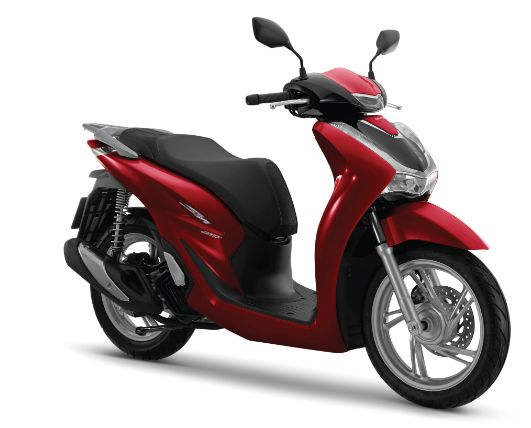

[🏠 Trang chủ](../../README.md) › [SH](../../dong-xe/sh.md) › **BO0905**

# BO0905 · SH160i 2024 K0R màuđỏ đen, phiên bản cao cấp

| | |
|---|---|
| **Mã bộ** | `BO0905` |
| **Tên bộ** | Bộ nhựa (Dàn áo) SH160i 2024 K0R màuđỏ đen, phiên bản cao cấp |
| **Đời xe** | SH160i 2024 màuđỏ đen, phiên bản cao cấp |
| **Dòng xe** | SH |
| **Số chi tiết** | 36 |

## Chi tiết trong bộ

| STT | Mã chi tiết | Tên chi tiết | Dùng chung | Mã thay thế | Ghi chú |
|---:|---|---|:---:|---|---|
| 1 | [`53160K0RV00ZA`](../../tra-ma/531.md#53160k0rv00za) | Bộ ốp tay lái \*NH1\* |  |  |  |
| 2 | [`64312K0RV00ZA`](../../tra-ma/6431.md#64312k0rv00za) | Ốp nhựa trung tâm \*NH1\* \*NH1\* |  |  |  |
| 3 | [`53205K0RV00ZE`](../../tra-ma/5320.md#53205k0rv00ze) | Nắp trước tay lái \*NHB25M\* |  |  |  |
| 4 | [`64300K0RV00ZE`](../../tra-ma/6430.md#64300k0rv00ze) | Bộ mặt nạ trước \*NHB25M\* |  |  |  |
| 5 | [`81131K0RV00ZA`](../../tra-ma/8113.md#81131k0rv00za) | Ốp trên bên trong \*NH1\* |  |  |  |
| 6 | [`81134K0RV40ZD`](../../tra-ma/8113.md#81134k0rv40zd) | Ốp trên bên trong \*NHB25M\* |  |  |  |
| 7 | [`83420K0RV00ZA`](../../tra-ma/834.md#83420k0rv00za) | Nắp ốp để chân sau trái \*NH1\* |  |  |  |
| 8 | [`80105K0RV00ZA`](../../tra-ma/8010.md#80105k0rv00za) | Cao su đệm \*NH1\* |  |  |  |
| 9 | [`83410K0RV00ZA`](../../tra-ma/834.md#83410k0rv00za) | Nắp ốp để chân sau phải \*NH1\* |  |  |  |
| 10 | [`80100K0RV00ZA`](../../tra-ma/8010.md#80100k0rv00za) | Bộ chắn bùn sau \*NH1\* |  |  |  |
| 11 | [`53208K0RV00ZE`](../../tra-ma/5320.md#53208k0rv00ze) | Trang trí ốp tay lái \*NHB25M\* |  |  |  |
| 12 | [`80160K0RV00ZA`](../../tra-ma/8016.md#80160k0rv00za) | Nắp ốp bình xăng \*NH1\* |  |  |  |
| 13 | [`64311K0RV00ZA`](../../tra-ma/6431.md#64311k0rv00za) | Ốp sàn để chân \*NH1\* |  |  |  |
| 14 | [`83600K0SVB0ZC`](../../tra-ma/8360.md#83600k0svb0zc) | Bộ ốp sườn trái \*R368C\* |  |  |  |
| 15 | [`83500K0SVB0ZC`](../../tra-ma/8350.md#83500k0svb0zc) | Bộ ốp sườn phải \*R368C\* |  |  |  |
| 16 | [`64322K0RV00ZA`](../../tra-ma/6432.md#64322k0rv00za) | Bộ ốp sàn trái \*R368C\* |  |  |  |
| 17 | [`64303K0RV00ZA`](../../tra-ma/6430.md#64303k0rv00za) | Ốp cạnh trước bên trái \*R368C\* |  |  |  |
| 18 | [`53204K0RV00ZB`](../../tra-ma/5320.md#53204k0rv00zb) | Nắp ốp đồng hồ \*R368C\* |  |  |  |
| 19 | [`64321K0RV00ZA`](../../tra-ma/6432.md#64321k0rv00za) | Bộ ốp sàn phải \*R368C\* |  |  |  |
| 20 | [`64302K0RV00ZA`](../../tra-ma/6430.md#64302k0rv00za) | Ốp cạnh trước bên phải \*R368C\* |  |  |  |
| 21 | [`83530K0RV00ZA`](../../tra-ma/8353.md#83530k0rv00za) | Ốp đuôi sau trên \*R368C\* |  |  |  |
| 22 | [`61200K0RV10ZD`](../../tra-ma/612.md#61200k0rv10zd) | Bộ chắn bùn trước \*R368\* |  |  |  |
| 23 | [`64305K0SV80ZB`](../../tra-ma/6430.md#64305k0sv80zb) | Bộ ốp ống yếm trái \*R368C\* |  |  |  |
| 24 | [`64350K0RV00ZA`](../../tra-ma/6435.md#64350k0rv00za) | Nắp khóa khẩn cấp \*R368C\* |  |  |  |
| 25 | [`50616K0RV00`](../../tra-ma/506.md#50616k0rv00) | Tấm chắn bơm xăng |  |  |  |
| 26 | [`53203K0RV00`](../../tra-ma/5320.md#53203k0rv00) | Nắp trên tay lái phải |  |  |  |
| 27 | [`53207K0RV00`](../../tra-ma/5320.md#53207k0rv00) | Trang trí nắp tay lái |  |  |  |
| 28 | [`64301K0RV00`](../../tra-ma/6430.md#64301k0rv00) | Ốp trang trí dưới phía trước |  |  |  |
| 29 | [`64304K0RV00`](../../tra-ma/6430.md#64304k0rv00) | Ốp dưới trước |  |  |  |
| 30 | [`64307K0RV00`](../../tra-ma/6430.md#64307k0rv00) | Nắp trang trí phía trước |  |  |  |
| 31 | [`64331K0RV00`](../../tra-ma/6433.md#64331k0rv00) | Ốp dưới |  |  |  |
| 32 | [`64355K0RV00`](../../tra-ma/6435.md#64355k0rv00) | Giá bắt công tắc |  |  |  |
| 33 | [`80102K0RV00`](../../tra-ma/8010.md#80102k0rv00) | Giá đỡ chắn bùn sau A |  |  |  |
| 34 | [`80108K0RV00`](../../tra-ma/8010.md#80108k0rv00) | Tấm nối chắn bùn |  |  |  |
| 35 | [`81320K0RV00`](../../tra-ma/813.md#81320k0rv00) | 81320K0RV00 Hộp bình điện SH 2020 |  |  |  |
| 36 | [`83520K0RV00`](../../tra-ma/8352.md#83520k0rv00) | Trang trí đuôi đèn sau |  |  |  |

Cập nhật 11/11/2026
