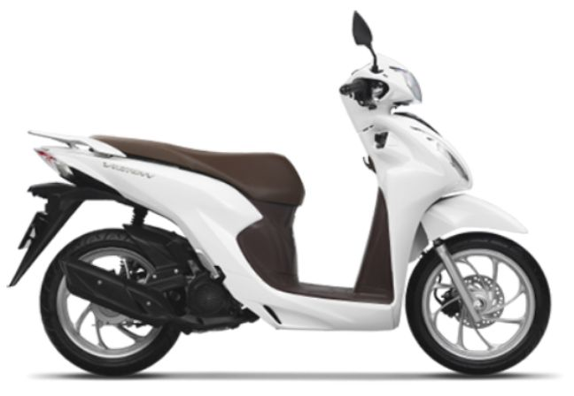

[🏠 Trang chủ](../../README.md) › [Vision](../../dong-xe/vision.md) › **BO0716**

# BO0716 · Vision 2021 K2C Màu Trắng nâu đen bản Smartkey NHB35P

| | |
|---|---|
| **Mã bộ** | `BO0716` |
| **Tên bộ** | Bộ nhựa (Dàn áo) Vision 2021 K2C Màu Trắng nâu đen bản Smartkey NHB35P |
| **Đời xe** | Vision 2021 phiên bản Cao Cấp -  NHB35P - Trắng Nâu Đen |
| **Model** | B9 |
| **Dòng xe** | Vision |
| **Số chi tiết** | 29 |

## Chi tiết trong bộ

| STT | Mã chi tiết | Tên chi tiết | Dùng chung | Mã thay thế | Ghi chú |
|---:|---|---|:---:|---|---|
| 1 | [`64305K2CV00ZA`](../../tra-ma/6430.md#64305k2cv00za) | Bộ ốp mặt nạ trước \*NH1\* | ✔ |  |  |
| 2 | [`83605K2CV00ZB`](../../tra-ma/8360.md#83605k2cv00zb) | Bộ ốp sườn trái \*TYPE5\* \*NHB35\* |  | [`64308K2CV00`](../../tra-ma/6430.md#64308k2cv00) |  |
| 3 | [`80125K2CV00ZA`](../../tra-ma/8012.md#80125k2cv00za) | Bộ nắp đèn soi biển số \*NH1\* | ✔ | [`50611K2CV00`](../../tra-ma/506.md#50611k2cv00) |  |
| 4 | [`83505K2CV00ZB`](../../tra-ma/8350.md#83505k2cv00zb) | Bộ ốp sườn phải \*TYPE5\* \*NHB35\* |  | [`80130K2CV00`](../../tra-ma/8013.md#80130k2cv00) |  |
| 5 | [`53210K2CV00ZD`](../../tra-ma/5321.md#53210k2cv00zd) | Bộ nắp sau tay lái \*NHB35P\* |  |  |  |
| 6 | [`80151K2CV00ZA`](../../tra-ma/8015.md#80151k2cv00za) | Ốp trung tâm \*YR286R\* | ✔ |  |  |
| 7 | [`64302K2CV00ZD`](../../tra-ma/6430.md#64302k2cv00zd) | Ốp trên \*NHB35P\* |  |  |  |
| 8 | [`53205K2CV00ZD`](../../tra-ma/5320.md#53205k2cv00zd) | Nắp trước tay lái \*NHB35P\* |  |  |  |
| 9 | [`81141K2CV00ZA`](../../tra-ma/8114.md#81141k2cv00za) | Ốp trên bên trong \*YR286R\* | ✔ |  |  |
| 10 | [`81131K2CV00ZB`](../../tra-ma/8113.md#81131k2cv00zb) | Ốp trong phía trên \*NHB35P\* |  |  |  |
| 11 | [`83620K2CV00ZD`](../../tra-ma/8362.md#83620k2cv00zd) | Ốp sàn trái \*NHB35P\* |  |  |  |
| 12 | [`64401K2CV00ZD`](../../tra-ma/6440.md#64401k2cv00zd) | Ốp trước bên trái \*NHB35P\* |  |  |  |
| 13 | [`83520K2CV00ZD`](../../tra-ma/8352.md#83520k2cv00zd) | Ốp sàn phải \*NHB35P\* |  |  |  |
| 14 | [`64301K2CV00ZD`](../../tra-ma/6430.md#64301k2cv00zd) | Ốp trước bên phải \*NHB35P\* |  |  |  |
| 15 | [`83700K2CV00ZD`](../../tra-ma/837.md#83700k2cv00zd) | Ốp giữa đuôi sau \*NHB35P\* |  |  |  |
| 16 | [`83751K2CV00ZA`](../../tra-ma/837.md#83751k2cv00za) | Ốp dưới  đuôi sau\*NH1\* | ✔ |  |  |
| 17 | [`61110K2CV00ZD`](../../tra-ma/611.md#61110k2cv00zd) | Bộ chắn bùn trước \*NHB35P\* |  |  |  |
| 18 | [`80110K2CV00ZA`](../../tra-ma/8011.md#80110k2cv00za) | Chắn bùn sau \*NH1\* | ✔ |  |  |
| 19 | [`64310K2CV00ZA`](../../tra-ma/6431.md#64310k2cv00za) | Sàn để chân \*YR286R\* | ✔ |  |  |
| 20 | [`81133K2CV00ZD`](../../tra-ma/8113.md#81133k2cv00zd) | Nắp hộc để đồ |  |  |  |
| 21 | [`50611K2CV00`](../../tra-ma/506.md#50611k2cv00) | Ốp nhựa dưới gầm |  |  |  |
| 22 | [`64308K2CV00`](../../tra-ma/6430.md#64308k2cv00) | Ốp trước phía dưới |  |  |  |
| 23 | [`64460K2CV00ZB`](../../tra-ma/6446.md#64460k2cv00zb) | Nắp ắc quy \*NH1\* |  |  |  |
| 24 | [`80130K2CV00`](../../tra-ma/8013.md#80130k2cv00) | Chắn bùn sau bên trong |  |  |  |
| 25 | [`81132GAH000ZW`](../../tra-ma/8113.md#81132gah000zw) | Móc treo hàng \*NH1\* |  |  |  |
| 26 | [`81134K2CV00`](../../tra-ma/8113.md#81134k2cv00) | Bản lề nắp hộc đồ |  |  |  |
| 27 | [`81136K2CV00`](../../tra-ma/8113.md#81136k2cv00) | Chốt cài móc hộp chứa đồ |  |  |  |
| 28 | [`17575K2CV00`](../../tra-ma/175.md#17575k2cv00) | Nắp bảo vệ bình xăng Vision 2021, |  |  |  |
| 29 | [`81145K2CV00ZE`](../../tra-ma/8114.md#81145k2cv00ze) | Cần mở nắp hộc để đồ khẩn cấp |  |  |  |

## Mã thiếu bổ sung

_Không tính sẵn trong bộ, thêm khi khách cần._

| Mã | Tên |
|---|---|
| [`50611K2CV00`](../../tra-ma/506.md#50611k2cv00) | Ốp nhựa dưới gầm |
| [`64308K2CV00`](../../tra-ma/6430.md#64308k2cv00) | Ốp trước phía dưới |
| [`64460K2CV00ZB`](../../tra-ma/6446.md#64460k2cv00zb) | Nắp ắc quy \*NH1\* |
| [`80130K2CV00`](../../tra-ma/8013.md#80130k2cv00) | Chắn bùn sau bên trong |
| [`81132GAH000ZW`](../../tra-ma/8113.md#81132gah000zw) | Móc treo hàng \*NH1\* |
| [`81134K2CV00`](../../tra-ma/8113.md#81134k2cv00) | Bản lề nắp hộc đồ |
| [`81136K2CV00`](../../tra-ma/8113.md#81136k2cv00) | Chốt cài móc hộp chứa đồ |

Cập nhật 11/11/2026
