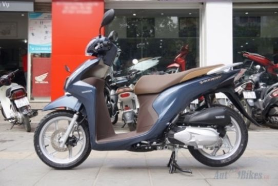

[🏠 Trang chủ](../../README.md) › [Vision](../../dong-xe/vision.md) › **BO0762**

# BO0762 · Vision 2019 màu Xanh tím \*NHA420M\* K44R, bản cao cấp

| | |
|---|---|
| **Mã bộ** | `BO0762` |
| **Tên bộ** | Bộ nhựa (Dàn áo) Vision 2019 màu Xanh tím \*NHA420M\* K44R, bản cao cấp |
| **Đời xe** | Vision phiên bản Cao Cấp 2019 - K44R - PB420M - Xanh Tím |
| **Dòng xe** | Vision |
| **Số chi tiết** | 22 |

## Chi tiết trong bộ

| STT | Mã chi tiết | Tên chi tiết | Dùng chung | Mã thay thế | Ghi chú |
|---:|---|---|:---:|---|---|
| 1 | [`64300K44VE0ZD`](../../tra-ma/6430.md#64300k44ve0zd) | Bộ ốp mặt nạ trước \*PB420\* |  |  |  |
| 2 | [`17575K44V00`](../../tra-ma/175.md#17575k44v00) | Nắp bảo vệ bình xăng NH1 Vision mới, màu nhựa đen. |  |  |  |
| 3 | [`53210K44V20ZR`](../../tra-ma/5321.md#53210k44v20zr) | Bộ nắp sau tay lái \*PB420M\* |  |  |  |
| 4 | [`83605K44VE0ZB`](../../tra-ma/8360.md#83605k44ve0zb) | Ốp sườn trái \*PB420\* |  |  |  |
| 5 | [`64450K44VE0ZB`](../../tra-ma/6445.md#64450k44ve0zb) | Bộ ốp sườn trước trái \*PB420\* |  |  |  |
| 6 | [`83505K44VE0ZB`](../../tra-ma/8350.md#83505k44ve0zb) | ốp sườn phải \*PB420\* |  |  |  |
| 7 | [`64350K44VE0ZB`](../../tra-ma/6435.md#64350k44ve0zb) | Bộ ốp trước phải \*PB420\* |  |  |  |
| 8 | [`80151K44V00ZA`](../../tra-ma/8015.md#80151k44v00za) | ốp nhựa trung tâm \*YR286R\* |  |  |  |
| 9 | [`64308K44V00ZA`](../../tra-ma/6430.md#64308k44v00za) | Bộ mặt nạ trước \*NH-1\* |  |  |  |
| 10 | [`53205K44V00ZR`](../../tra-ma/5320.md#53205k44v00zr) | Nắp trước tay lái \*PB420M\* |  |  |  |
| 11 | [`81141K44V00ZA`](../../tra-ma/8114.md#81141k44v00za) | Bộ ốp sườn trước trái \*YR286R\* |  |  |  |
| 12 | [`81131K44V90ZE`](../../tra-ma/8113.md#81131k44v90ze) | Ốp trên bên trong \*NHA40M\* |  |  |  |
| 13 | [`83620K44V00ZX`](../../tra-ma/8362.md#83620k44v00zx) | Bộ ốp sàn trái \*PB420M\* |  |  |  |
| 14 | [`80131K44V00ZA`](../../tra-ma/8013.md#80131k44v00za) | Nắp ốp xi nhan sau trái \*NH1\* |  |  |  |
| 15 | [`83520K44V00ZX`](../../tra-ma/8352.md#83520k44v00zx) | Bộ ốp sàn phải \*PB420M\* |  |  |  |
| 16 | [`80121K44V00ZA`](../../tra-ma/8012.md#80121k44v00za) | Nắp ốp xi nhan sau phải \*NH1\* |  |  |  |
| 17 | [`83700K44V00ZX`](../../tra-ma/837.md#83700k44v00zx) | Bộ ốp trung tâm sau \*PB420M\* |  |  |  |
| 18 | [`83751K44V00ZA`](../../tra-ma/837.md#83751k44v00za) | Bộ ốp dưới sau \*NH1\* |  |  |  |
| 19 | [`50611K44V00ZA`](../../tra-ma/506.md#50611k44v00za) | ốp nhựa dưới gầm \*NH-1\* |  |  |  |
| 20 | [`61110K44V00ZQ`](../../tra-ma/611.md#61110k44v00zq) | Bộ chắn bùn trước \*PB420M\* |  |  |  |
| 21 | [`80100K44V00ZA`](../../tra-ma/8010.md#80100k44v00za) | Chắn bùn sau |  |  |  |
| 22 | [`64310K44V00ZA`](../../tra-ma/6431.md#64310k44v00za) | Bộ ốp dưới \*YR286R\* |  |  |  |

Cập nhật 11/11/2026
