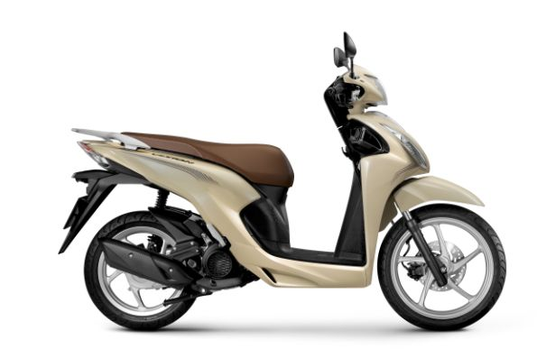

[🏠 Trang chủ](../../README.md) › [Vision](../../dong-xe/vision.md) › **BO0907**

# BO0907 · Vision 2024 K2C màu vàng đen bạc - Y229, phiên bản Cổ điển

| | |
|---|---|
| **Mã bộ** | `BO0907` |
| **Tên bộ** | Bộ nhựa (Dàn áo) Vision 2024 K2C màu vàng đen bạc - Y229, phiên bản Cổ điển |
| **Đời xe** | Vision 2024 màu vàng đen bạc - Y229, phiên bản Cổ điển |
| **Dòng xe** | Vision |
| **Số chi tiết** | 29 |

## Chi tiết trong bộ

| STT | Mã chi tiết | Tên chi tiết | Dùng chung | Mã thay thế | Ghi chú |
|---:|---|---|:---:|---|---|
| 1 | [`64305K2CVS0ZA`](../../tra-ma/6430.md#64305k2cvs0za) | Bộ ốp mặt nạ trước \*NH411M\* |  |  |  |
| 2 | [`80125K2CV00ZA`](../../tra-ma/8012.md#80125k2cv00za) | Bộ nắp đèn soi biển số \*NH1\* |  |  |  |
| 3 | [`53210K2CVF0ZJ`](../../tra-ma/5321.md#53210k2cvf0zj) | Bộ nắp sau tay lái \*NH1\* |  |  |  |
| 4 | [`80151K2CV00ZB`](../../tra-ma/8015.md#80151k2cv00zb) | Ốp trung tâm \*NH1\* |  |  |  |
| 5 | [`81141K2CV00ZB`](../../tra-ma/8114.md#81141k2cv00zb) | Ốp trên bên trong \*NH1\* |  |  |  |
| 6 | [`81131K2CV00ZQ`](../../tra-ma/8113.md#81131k2cv00zq) | Ốp trong dưới\*NH1\* |  |  |  |
| 7 | [`83751K2CV00ZA`](../../tra-ma/837.md#83751k2cv00za) | Ốp dưới đuôi sau\*NH1\* |  |  |  |
| 8 | [`80110K2CV00ZA`](../../tra-ma/8011.md#80110k2cv00za) | Chắn bùn sau \*NH1\* |  |  |  |
| 9 | [`81133K2CV00ZQ`](../../tra-ma/8113.md#81133k2cv00zq) | Nắp hộp đồ trước \*NH1\* |  |  |  |
| 10 | [`81145K2CV00ZQ`](../../tra-ma/8114.md#81145k2cv00zq) | Nắp khẩn cấp \*NH1\* |  |  |  |
| 11 | [`64310K2CV00ZB`](../../tra-ma/6431.md#64310k2cv00zb) | Sàn để chân \*NH1\* |  |  |  |
| 12 | [`64308K2CV00`](../../tra-ma/6430.md#64308k2cv00) | Ốp trước phía dưới |  |  |  |
| 13 | [`50611K2CV00`](../../tra-ma/506.md#50611k2cv00) | Ốp nhựa dưới gầm |  |  |  |
| 14 | [`80130K2CV00`](../../tra-ma/8013.md#80130k2cv00) | Chắn bùn sau bên trong |  |  |  |
| 15 | [`83605K2CVS0ZB`](../../tra-ma/8360.md#83605k2cvs0zb) | Bộ ốp sườn trái \*Y229P\* |  |  |  |
| 16 | [`64400K2CVS0ZB`](../../tra-ma/6440.md#64400k2cvs0zb) | Bộ ốp sườn trước trái \*Y229P\* |  |  |  |
| 17 | [`83505K2CVS0ZB`](../../tra-ma/8350.md#83505k2cvs0zb) | Bộ ốp sườn phải \*Y229P\* |  |  |  |
| 18 | [`64300K2CVS0ZB`](../../tra-ma/6430.md#64300k2cvs0zb) | Bộ ốp sườn trước phải \*Y229P\* |  |  |  |
| 19 | [`64302K2CV00ZS`](../../tra-ma/6430.md#64302k2cv00zs) | Ốp trên \*Y229P\* |  |  |  |
| 20 | [`53205K2CV90ZK`](../../tra-ma/5320.md#53205k2cv90zk) | Nắp trước tay lái \*Y229P\* |  |  |  |
| 21 | [`83620K2CV00ZR`](../../tra-ma/8362.md#83620k2cv00zr) | Ốp sàn bên trái\*Y229P\* |  |  |  |
| 22 | [`83520K2CV00ZR`](../../tra-ma/8352.md#83520k2cv00zr) | Ốp sàn bên phải \*Y229P\* |  |  |  |
| 23 | [`83700K2CV00ZR`](../../tra-ma/837.md#83700k2cv00zr) | Ốp giữa đuôi sau \*Y229P\* |  |  |  |
| 24 | [`64460K2CV00ZA`](../../tra-ma/6446.md#64460k2cv00za) | 64460-K2C-V00ZA Nắp ắc quy \*YR286R\* Vision 2021, màu nâu. |  |  |  |
| 25 | [`17575K2CV00`](../../tra-ma/175.md#17575k2cv00) |  |  |  |  |
| 26 | [`81132GAH000ZW`](../../tra-ma/8113.md#81132gah000zw) | Móc treo hàng \*NH1\* |  |  |  |
| 27 | [`81134K2CV00`](../../tra-ma/8113.md#81134k2cv00) |  |  |  |  |
| 28 | [`81136K2CV00`](../../tra-ma/8113.md#81136k2cv00) | Chốt cài móc hộp chứa đồ |  |  |  |
| 29 | [`61100K2CV30ZJ`](../../tra-ma/611.md#61100k2cv30zj) | Chắn bùn trước \*Y229P\* |  |  |  |

Cập nhật 11/11/2026
